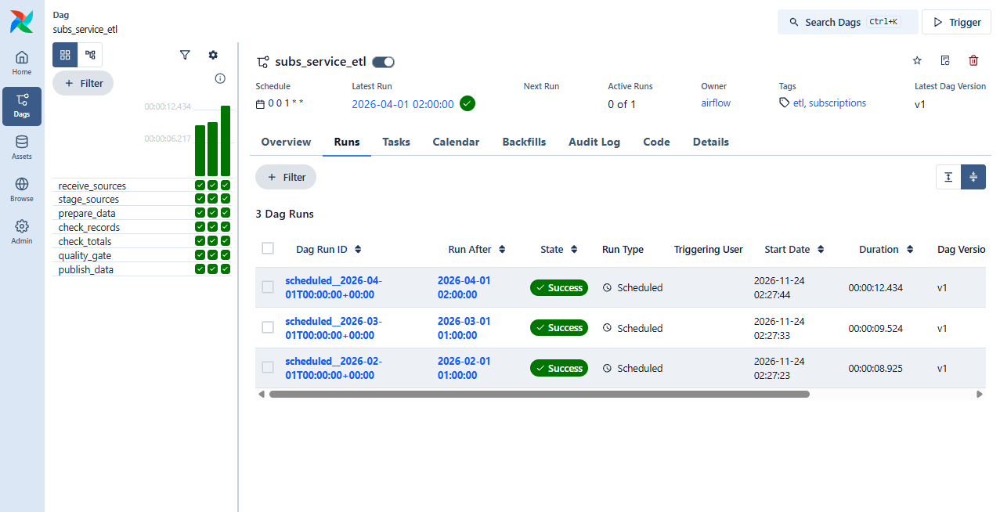
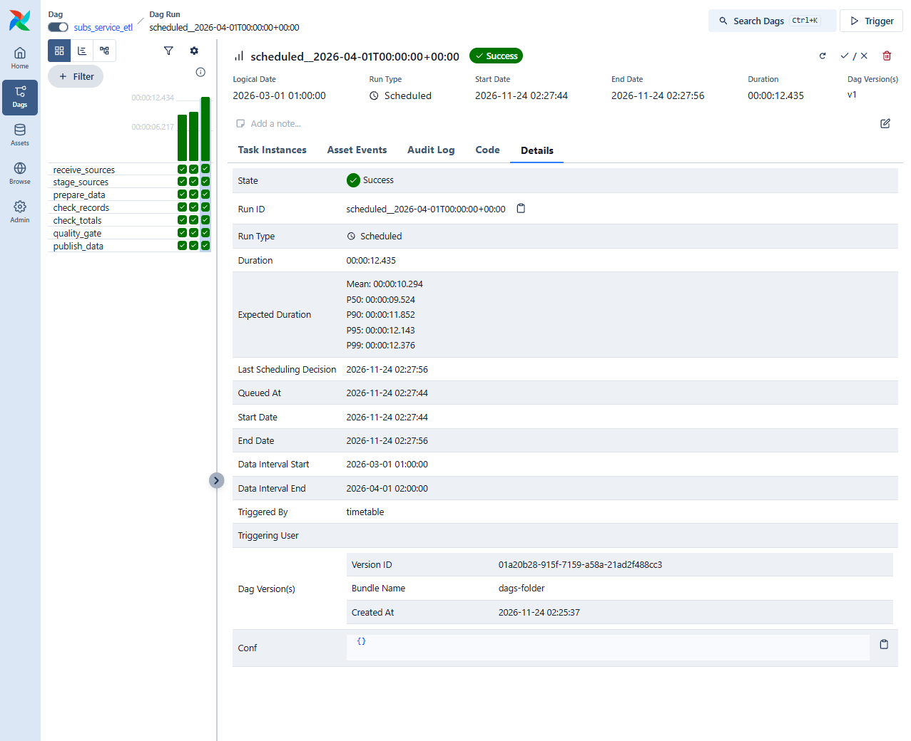
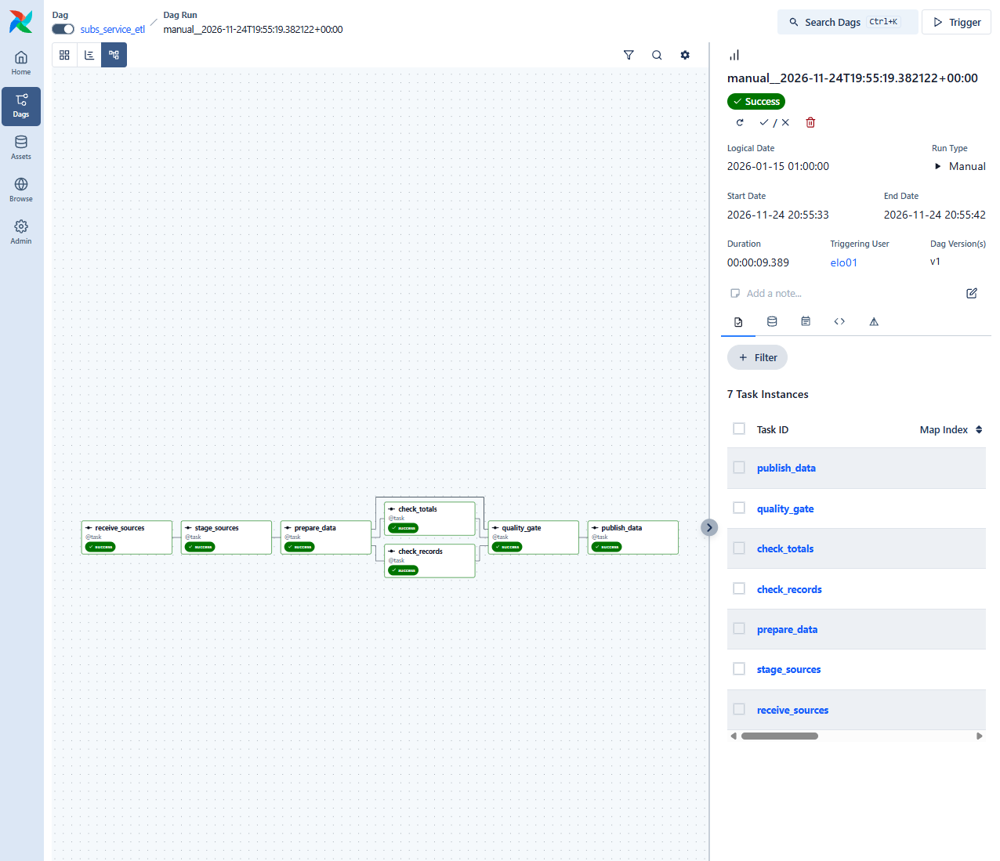
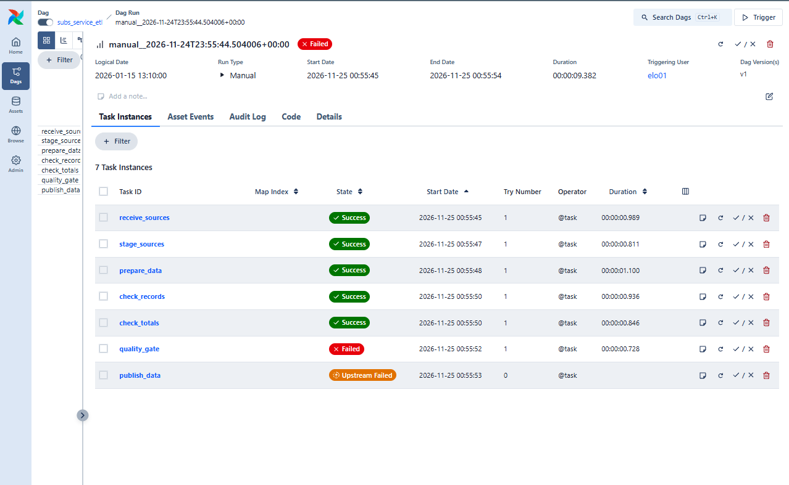
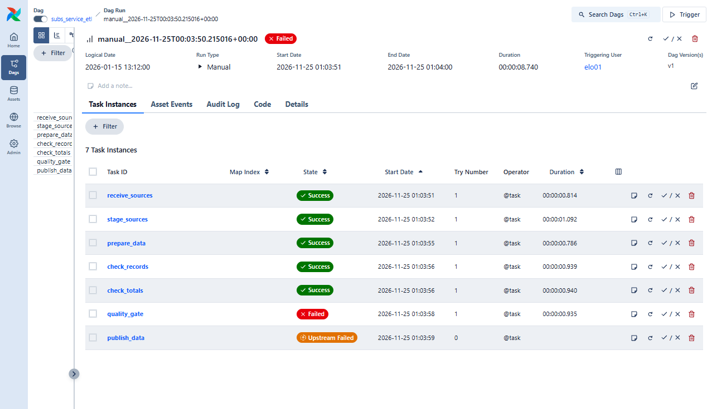

# Проект Подписочный сервис
Сервис продает подписки по тарифам с разной стоимостью и валютой. Необходимо объединить историю подписок, тарифов, начислений, платежей и возвратов, чтобы получать состояние подписок и расчетов на выбранную дату. Две ежедневные витрины позволяют определить число активных подписок и распределение по тарифам, выделить полностью, частично и неоплаченные счета, рассчитать остаток задолженности и просрочку. История тарифов и пересчет прошлых снимков позволяют учитывать запоздавшие события и исправления без искажения исторической аналитики. Исходные данные синтетические; обработка не выполняет реальных финансовых операций.

## 1. Рабочее окружение и репозиторий
### Технологический стек
Проект реализуется на Python и PostgreSQL с использованием Git/GitHub. Для получения данных из HTTP API используется библиотека requests, для работы с PostgreSQL - psycopg. Оркестрация ETL-процесса реализована с помощью Apache Airflow.

Исходные данные и код источника находятся в каталоге `subscription_source/`. Договор источников, описание API и контрольные случаи приведены в `subscription_source/source_readme.md`. При необходимости синтетические поставки можно воспроизвести из корня проекта командой `python subscription_source/generate.py`: генератор записывает файлы в `subscription_source/data/`. Генерировать данные заново во время обработки поставки не следует.

Используемые версии инструментов: 
* Python в Windows (subs_service/.venv) - 3.13.15
* Python в WSL (~/airflow-course/.venv) - 3.14.4
* Apache Airflow - 3.3.2
* Apache Airflow PostgreSQL provider - 7.0.2.
* PostgreSQL 18.6 on x86_64-windows, compiled by msvc-19.44.35228, 64-bit

### Организация репозитория
- `py/` - Python-модули получения, проверки и загрузки данных.
- `sql/` - SQL-скрипты создания объектов PostgreSQL, преобразований и проверок.
- `dag/` - DAG Apache Airflow.
- `subscription_source/` - синтетические исходные данные, генератор и локальный HTTP API.
- `requirements.txt` - зависимости Python с зафиксированными версиями.
- `requirements-airflow.txt` - зафиксированные зависимости отдельного окружения Airflow в WSL (создается командой pip freeze из этого окружения).
- `.env.example` - шаблон переменных окружения без секретов.
- `README.md` - документация проекта и результаты проверок.

Разработка ведется в отдельных Git-ветках. Изменения фиксируются коммитами.

### Настройка Python
Для локальной разработки используется виртуальное окружение `.venv`.

Создание и активация в Windows PowerShell:
```bash
py -3.13 -m venv .venv
.\.venv\Scripts\Activate.ps1
python -m pip install -r requirements.txt
```
Зависимости фиксируются в `requirements.txt`. Само виртуальное окружение не включается в репозиторий.

### Настройки и безопасность
Параметры подключения к PostgreSQL и адрес источника задаются через переменные окружения.

Для локальной разработки используется файл `.env`, который создается на основе `.env.example`.

Пароли и другие секреты не хранятся в исходном коде, не включаются в Git и не выводятся в журналы выполнения.

### Среды выполнения
**Разработка (development).** Локальный запуск Python-скриптов, PostgreSQL и HTTP API. Используется база данных `subs_service`. Допускается отладка и повторное выполнение отдельных этапов загрузки.

**Тестирование (testing).** Отдельная тестовая база/схема PostgreSQL. Используются заранее подготовленные поставки `01_full`, `02_delta`, `03_delta`, `05_empty_delta` и независимые контрольные случаи `test_*`. Проверки не должны изменять результаты основной загрузки.

**Рабочий запуск (production-like).** В рамках проекта имитируется регулярная эксплуатация ETL-процесса через Apache Airflow. Подключения и параметры выполнения передаются через конфигурацию среды и Airflow Connections. Публикация данных должна выполняться только после обязательных проверок качества.

## Модель данных
### Схемы

| Схема | Назначение|
|---|---|
| etl | Техническая схема для логирования работы загрузчика |
| stg | Стейджинг - исходные данные источников |
| core | Слой промежуточных данных |
| mart | Слой витрин |

### Создание базы и схем
Для локальной разработки создается база `subs_service` в PostgreSQL; для независимых испытаний - отдельная база `subs_reference`. 
Скрипты выполняются в следующем порядке:
1. sql/01_schemas.sql - схемы
2. sql/02_staging.sql - исходные записи
3. sql/03_core_dimensions.sql - измерения и заполнение календаря
4. sql/04_core_facts.sql - факты
5. sql/05_marts.sql - витрины
6. sql/07_etl.sql - служебные таблицы

`sql/06_checks.sql` содержит контрольные SELECT-запросы и выполняется после загрузки для сверки результата, это не скрипт создания модели.

В `.env` указывается имя созданной базы и параметры пользователя. В Airflow аналогичные параметры задаются через Connection.

### Объекты модели

Типы столбцов и ограничения приведены в DDL 02_staging.sql–`05_marts.sql` и 07_etl.sql. Денежные поля - numeric, временные метки источника - timestamptz, ключи измерений и фактов - целочисленные суррогатные ключи, календарный ключ - integer в формате YYYYMMDD. Связи строятся по FK; для SCD Type 2 факты ссылаются на историческую версию тарифа.

|Схема|Наименование объекта|Описание таблицы|Тип объекта|Детализация<br>(1 строка =)|Ключ|FK|Зависимости|
|-----|--------------------|----------------|-----------|-----------|--|--|-----------|
|stg|`source_records`			|Исходные записи всех шести источников   |staging	|одна полученная запись конкретного источника в конкретном запуске	|`stg_id` <br>UNIQUE(`load_id`, `source_type`, `record_number`)		|-														|-|
|core|`dim_customer`			|Клиенты                     |измерение	|один клиент с актуальными атрибутами								|`customer_sk` <br>UNIQUE(`customer_id`)						|-														|`source_records`|
|core|`dim_subscription`		|Устойчивые идентификаторы подписок      |измерение	|одна подписка независимо от числа изменений состояния				|`subscription_sk` <br>UNIQUE(`subscription_id`)				|dim_customer.`customer_sk`								|`source_records`|
|core|`dim_plan`				|Исторические версии тарифов |измерение	|одна историческая версия тарифа с определенным периодом действия	|`plan_sk` <br>UNIQUE(`catalog_event_id`)						|-														|`source_records`|
|core|`dim_date`				|Календарное измерение                   |измерение	|один календарный день UTC											|`date_key`													|-														|`source_records`|
|core|`fact_subscription_event`|События изменения подписок             |факт (транзакционный)	|одно событие `event_id` в его последней принятой версии				|`event_sk` <br>UNIQUE(`event_id`)								|dim_subscription.`subscription_sk`<br>dim_date.`date_key`	|*зависимости*|
|core|`fact_invoice`			|Выставленные счета                      |факт (транзакционный)	|один выставленный счет												|`invoice_sk`	<br>UNIQUE(`invoice_id`)							|dim_subscription.`subscription_sk`<br>dim_plan.`plan_sk`<br>dim_date.`date_key`|*зависимости*|
|core|`fact_payment`			|Попытки оплаты счетов                   |факт (транзакционный)	|одна попытка платежа `payment_id`, включая неуспешные				|`payment_sk`	<br>UNIQUE(`payment_id`)							|fact_invoice.`invoice_sk`<br>dim_date.`date_key`			|*зависимости*|
|core|`fact_refund`			|Возвраты платежей                       |факт (транзакционный)	|один возврат `refund_id`												|`refund_sk` <br>UNIQUE(`refund_id`)							|fact_payment.`payment_sk`<br>dim_date.`date_key`			|*зависимости*|
|mart|`subscription_daily`	|Ежедневные состояния подписок           |витрина (периодический снимок)|состояние одной подписки на конец одного календарного дня UTC		|`date_key`<br>`subscription_sk`	|dim_date.`date_key`<br>dim_subscription.`subscription_sk`<br>dim_customer.`customer_sk`<br>dim_plan.`plan_sk`|*зависимости*|
|mart|`invoice_daily`			|Ежедневные расчеты и задолженность      |витрина (периодический снимок)|состояние расчетов по одному счету на конец одного дня UTC			|`date_key`<br>`invoice_sk`										|dim_date.`date_key`<br>fact_invoice.`invoice_sk`			|*зависимости*|


### Служебные таблицы etl

| Таблица | Одна строка | Ключ и связь | Назначение |
|---|---|---|---|
| `load_runs` | Один запуск обработки поставки | `load_id` UUID, PK | `run_id`, `batch_id`, источник, манифест JSONB, период timestamptz, статус, счетчики и признак `staging_complete`. |
| `load_events` | Одно событие этапа и попытки | `event_id` bigint, PK; `load_id` FK | История этапов, статусы, счетчики JSONB и сообщение. |
| `rejections` | Одна отклоненная запись staging | `stg_id` bigint, PK/FK на `stg.source_records` | Массив причин `text[]`, время отклонения; исходные значения остаются в staging. |
| `pipeline_state` | Состояние одного ETL-процесса | `pipeline_name` text, PK; `last_load_id` FK | Watermark `last_success_until` timestamptz, последняя продвинувшая его загрузка и поставка. |
| `dq_results` | Результат одного правила в одной попытке задачи | `result_id` bigint, PK; `load_id` FK; UNIQUE (`load_id`, `task_id`, `attempt`, `rule_name`) | Период, правило, критичность, статус, ожидаемое и фактическое JSONB, причина и счетчики. |
| `publication_approvals` | Один актуальный допуск к публикации данной загрузки | `load_id` UUID, PK/FK | Идентификаторы обязательных DQ-результатов (`bigint[]`), номер попытки и время допуска. |

#### Версионность измерений
SCD1 - клиенты. В dim_customer одна строка соответствует одному клиенту. При поступлении новой версии источника измененые атрибуты segment и acquisition_channel обновляются без сохранения предыдущих значений в измерении - это позволяет хранить актуальные сведения о клиенте без дополнительной историзации, при этом предыдущие полученные значения остаются доступными в staging.

SCD2 - тарифы. В dim_plan изменение цены тарифа сохраняется как новая историческая версия с собственным plan_sk, период действия задается полями valid_from (включительно) и valid_to (исключительно), для последней версии valid_to = NULL. Для одного plan_id интервалы не должны пересекаться.

### Показатели и правила расчета
| Показатель | Правило расчета, условия включения |
|---|---|
| **Количество подписок на дату** | Количество различных `subscription_sk`, у которых есть хотя бы одно событие `effective_at` до начала следующих суток UTC. |
| **Активные подписки** | Количество строк `mart.subscription_daily` за выбранную дату с `state = 'active'` (`is_active = TRUE`). |
| **Активные подписки по тарифам** | Те же активные подписки, сгруппированные по действующей на конец дня версии `dim_plan` (`plan_id`, `tier`, `currency`). |
| **Начислено по счету** | `fact_invoice.amount` для счета с `issued_at` до начала следующих суток. На дату одна строка витрины - один счет; при агрегации в рамках одной даты сумма начислений складывается по таким счетам отдельно в каждой валюте. |
| **Зачтенные оплаты (`paid_amount`)** | Сумма `fact_payment.amount` по платежам **конкретного счета**, только `status = 'succeeded'` и `paid_at` до начала следующих суток. Неуспешные платежи не уменьшают долг. |
| **Возвраты (`refund_amount`)** | Сумма `fact_refund.amount` по успешным возвратам, связанным с успешными платежами данного счета, с `refunded_at` до начала следующих суток. Не увеличивает/не уменьшает первоначальную сумму счета. |
| **Чистая оплата (`net_paid_amount`)** | `paid_amount - refund_amount`. |
| **Сальдо (`balance_amount`)** | `invoice_amount - net_paid_amount`. Отрицательное значение означает переплату. |
| **Неоплаченный остаток (`outstanding_amount`)** | Большее из `balance_amount` и `0`. Не может быть отрицательным. |
| **Переплата (`overpayment_amount`)** | Большее из `-balance_amount` и `0`. Не может быть отрицательной. |
| **Статус оплаты (`payment_status`)** | `paid`, если `outstanding_amount = 0`; `partial`, если остаток > 0, но `net_paid_amount > 0`; иначе `unpaid`. Переплата тоже соответствует `paid`. |
| **Дни просрочки (`days_overdue`)** | Если `outstanding_amount > 0` и отчетная дата позже `due_date`, число календарных дней между отчетной датой и `due_date`; иначе `0`. |
| **Признак просрочки (`is_overdue`)** | `TRUE`, если `outstanding_amount > 0` и отчетная дата **позже** `due_date`, иначе `FALSE`. |
| **Сумма просроченной задолженности** | Сумма `outstanding_amount` только по строкам выбранной отчетной даты с `is_overdue = TRUE`, отдельно по валютам. |
| **Доля активных подписок** | Количество активных подписок на дату / общее количество подписок на эту дату. Числитель и знаменатель считаются и хранятся или доступны отдельно; при нулевом знаменателе значение доли - `NULL`, а не `0`. |

У финансовой витрины периодический характер: один и тот же счет появляется на разных датах с пересчитанными остатками. Нельзя суммировать ежедневную задолженность за разные даты: это суммирование разных снимков одного обязательства. Суммы по счетам допустимы в пределах одной даты и одной валюты. Для анализа изменения задолженности сравниваются два снимка, а не складываются.

### Отчетные даты, NULL, валюта и просрочка
**UTC**. Все временные метки источников интерпретируются с часовым поясом и записываются в `TIMESTAMPTZ`. Отчетные сутки соответствуют интервалу `[00:00:00 UTC текущей даты, 00:00:00 UTC следующей даты)`. Поля `*_date_key` должны соответствовать UTC-дате события. Поле `updated_at` обозначает регистрацию версии источником, а не дату финансового события, оно используется для full/delta-отбора, но не для определения даты оплаты, возврата или начисления.

**Отсутствующие значения (NULL)**. Необязательный `acquisition_channel` может быть `NULL` (в контрольном случае это предупреждение). `dim_plan.valid_to IS NULL` обозначает незакрытую версию; `subscription_ended_at IS NULL` - отсутствие известной окончательной отмены. Отсутствие платежей по существующему счету дает в расчетах paid_amount = 0, отсутствие возвратов - refund_amount = 0. Отсутствие обязательного исходного amount - ошибка данных, а не нулевая сумма.

**Валюты**. Все суммы хранятся и сверяются в исходной валюте (EUR или USD), без конвертации. Валюта платежа должна совпадать с валютой счета, валюта возврата - с валютой исходного платежа. Суммировать суммы в разных валютах без учета курса недопустимо.

**Просрочка**. `due_date` - последний день своевременной оплаты включительно, на саму дату `due_date` просрочки еще нет. Начиная со следующего календарного дня UTC непогашеная сумма становится просроченной. При полной оплате или переплате `days_overdue` = `0` и `is_overdue` = `FALSE`.

**Пересчет истории**. При исправлении суммы платежа или поступлении запоздавшего события используются фактические `paid_at`, `refunded_at`, `issued_at`, `effective_at` и актуально принятые версии данных. Затронутые исторические снимки пересчитываются. Отсутствие строки в дельте не означает удаление ранее полученной записи.


## Организация загрузки
Основной загрузчик реализован в py/load_subscriptions.py. Он получает данные из CSV, вложенного JSON и HTTP API, сохраняет исходные записи в PostgreSQL, проверяет качество данных и применяет изменения к аналитической модели.

Основные этапы:
1. Получение - чтение manifest.json, четырех CSV-файлов, subscriptions.json и платежей через API.
2. Staging - сохранение исходных записей в stg.source_records с привязкой к load_id.
3. Проверка и подготовка - проверка структуры, типов, обязательных полей, дат, сумм, ссылок и полноты поставки. Причины отклонения записываются в etl.rejections.
4. Core - применение новых и измененных записей по бизнес-ключам и версиям, формирование исторических версий тарифов SCD Type 2.
5. Витрины - пересчет ежедневных состояний подписок и задолженности.

Python отвечает за работу с файлами и API, первичное преобразование типов, журналирование и управление процессом. PostgreSQL выполняет соединения таблиц, обработку исторических версий и расчет аналитических показателей.

### Работа с HTTP API
Платежи получаются через локальный учебный HTTP API GET /payments.

Основные параметры:
|Параметр|Назначение|
|--------|----------|
|batch|Идентификатор поставки|
|page|Номер страницы начиная с 1|
|limit|Максимальное число записей на странице, от 1 до 50|
|fault, trial|Необязательные параметры тестирования ошибок|

Загрузчик обходит все страницы по ссылке next до получения null. Контролируются структура JSON, постоянство total и совпадение общего количества полученных платежей с ожидаемым.

Для HTTP-запросов используются connect_timeout=5 секунд и read_timeout=30 секунд. При временных сетевых ошибках и HTTP 429, 500, 502, 503, 504 выполняется не более трех попыток. Между попытками предусмотрены паузы с учетом заголовка Retry-After.

Ошибочные HTTP-ответы и некорректный JSON не считаются подтверждением отсутствия данных.

Учебный API не требует авторизации. Адрес задается переменной окружения PAYMENTS_API_URL.

### Проверка и преобразование данных
При чтении CSV и JSON проверяются структура и наличие обязательных элементов.

Для денежных сумм используется Decimal, для временных меток - datetime с приведением к UTC. Исходные значения сохраняются в staging в формате JSONB.

Результаты первичных проверок сопоставляются с контрольными показателями manifest.json: количеством записей по источникам и денежными суммами отдельно по EUR и USD.

Пустая delta допустима только после успешной full-загрузки, если complete=true, staging зафиксирован, контрольные количества равны нулю, контрольные суммы пусты и API корректно вернул total=0. Бизнес-записи не удаляются; витрины могут быть продлены на новые отчетные даты, watermark продвигается только после успешной публикации. Пустая первоначальная full-поставка недопустима: без исходной истории невозможно сформировать требуемые витрины. complete=false блокирует публикацию.

Если CSV, вложенный JSON или страница API не разбирается, диагностическое содержимое сохраняется в stg.source_records.raw_text, а причина - в etl.rejections. Для неразбираемого манифеста сохраняются путь к исходной поставке и причина в etl.load_runs; сам файл остается доступен на диске. Для страницы API фиксируется page_number. Полнота staging не подтверждается, публикация не начинается. После исправления структурной ошибки создается новый запуск с новым load_id, чтобы сохранить исходное отклонение и не смешивать его с корректными записями. Временные сетевые ошибки и HTTP-ошибки обрабатываются отдельно ограниченными повторами.

### Full load и delta load
Режим определяется полем mode в manifest.json.

Full load используется для формирования первоначального состояния. Delta load содержит новые записи и измененные версии существующих объектов.

Признак изменения - version внутри устойчивого бизнес-ключа. Для отбора поставок используется updated_at.

При обработке версий:
- новая запись добавляется;
- более новая версия обновляет существующую;
- старая версия пропускается;
- повтор одинаковой версии с одинаковыми бизнес-полями пропускается;
- одинаковая версия с противоречивыми бизнес-полями вызывает ошибку.

Отсутствие записи в дельте не считается удалением. Отмена подписки представлена отдельным событием cancelled.

Изменения, зарегистрированные позже даты бизнес-события, применяются к соответствующему историческому периоду. Затронутые ежедневные снимки пересчитываются.

### Watermark и границы периодов
`etl.pipeline_state.last_success_until` - исключительная верхняя граница последней успешно опубликованной поставки по `updated_at`, а не максимальная дата бизнес-события и не время выполнения загрузчика. Для full нижняя граница `from_inclusive=null`, для delta используется полуоткрытый интервал `[from_inclusive, until_exclusive)`. Все временные метки приводятся к UTC.

Delta допускается после успешной full. Если нижняя граница delta больше watermark, загрузка блокируется из-за разрыва периодов. Если нижняя граница равна watermark или меньше него, поставка допускается: перекрытие безопасно благодаря устойчивым ключам и правилам версий. Повтор старой поставки не уменьшает watermark. Новая граница равна максимуму прежней границы и `until_exclusive`; она фиксируется атомарно с `core` и `mart`. При ошибке прежние данные и watermark сохраняются.

Запоздавшие изменения отбираются по `updated_at`, а их бизнес-даты определяют историческое состояние подписки/счета. Для небольшого учебного объема пересчитывается история ежедневных снимков до максимальной ранее опубликованной или новой отчетной границы. Повтор `01_full` допустим без сброса данных при уже достигнутой границе; `04_full_reference` загружается в отдельную чистую базу для сверки.

### Ограничения источника
API не предоставляет самостоятельного фильтра по updated_at. Вместо этого каждая неизменяемая поставка выбирается по batch, а ее временные границы определяются манифестом.

Полнота получения данных подтверждается сочетанием manifest.complete, контрольных количеств и сумм, а для API - также total и завершением пагинации.

### Логирование и транзакции

Каждый запуск получает load_id. Сведения о загрузке сохраняются в etl.load_runs, события обработки - в etl.load_events, исходные записи - в stg.source_records.

Staging фиксируется отдельной транзакцией. Изменения core и пересчет обеих витрин выполняются в одной транзакции PostgreSQL. При ошибке публикации изменения core и mart откатываются.

Логи записываются в logs/load.log и выводятся в консоль. Пароли и токены в журналы не записываются.

### Локальный запуск

Сначала запускается учебный сервер:

```powershell
python .\subscription_source\api.py
```

В отдельном терминале выполняется загрузчик:

```powershell
python .\py\load_subscriptions.py --batch 01_full --limit 5
```

После полной загрузки последовательно обрабатываются 02_delta и 03_delta.

Для проверки полной и инкрементальной загрузки одного состояния 04_full_reference обрабатывается в изолированной базе данных.

Контрольные поставки test_* являются независимыми сценариями и не обрабатываются как одна последовательность.

### Восстановление после сбоя

Сначала устранить причину ошибки, найти `load_id` и признак `staging_complete` в `etl.load_runs`:

```sql
-- Q1. История и статус загрузок для диагностики и восстановления.
SELECT load_id, batch_id, status, staging_complete, last_error
FROM etl.load_runs ORDER BY started_at DESC;
```

Для возобновления CLI после временного сбоя или ошибки публикации:

```powershell
python .\py\load_subscriptions.py --resume-load "UUID_НЕУСПЕШНОЙ_ЗАГРУЗКИ"
```

При `staging_complete=true` повторно использовать зафиксированный staging и выполнить проверки и публикацию; при незавершенном staging после временной ошибки источник читается заново. Манифест не должен измениться. Уже опубликованный `load_id` не применяется повторно. Если сохранено структурное отклонение или нужно исправить исходную поставку после зафиксированного staging, использовать новый запуск `--batch`, не удаляя записи прошлого запуска. Для воспроизводимых тестов предусмотрены `--fail-after-staging` и `--fail-inside-publication`; при восстановлении эти флаги не передаются.

## AIRFLOW

Apache Airflow работает в Ubuntu (WSL) в `~/airflow-course/.venv`; Windows-окружение проекта не используется Airflow. Версии указаны в разделе технологического стека. Зависимости установленной среды сохраняются отдельно в `requirements-airflow.txt` (включая `apache-airflow`, `apache-airflow-providers-postgres`, `psycopg`, `requests`, `python-dotenv` и их зависимости). Для воспроизведения использовать тот же Python в WSL и установку из файла зафиксированных зависимостей в новом виртуальном окружении, а не смешивать Windows и Linux пакеты.

Запуск в WSL:
```bash
wsl -d Ubuntu
cd ~/airflow-course
source .venv/bin/activate
export PROJECT_DIR="/mnt/c/.../git/subs_service"
export AIRFLOW_HOME="$HOME/airflow-course/runtime"
export AIRFLOW__CORE__DAGS_FOLDER="$PROJECT_DIR/dag"
export PAYMENTS_API_URL="http://127.0.0.1:8765/payments"
airflow standalone
```

В другом терминале WSL запустить API из каталога источника (`PROJECT_DIR` задать повторно или подставить полный путь):

```bash
cd "$PROJECT_DIR/subscription_source"
python3 api.py
```

Проверка API:

```bash
curl "http://127.0.0.1:8765/payments?batch=01_full&limit=5"
```

### Подключение PostgreSQL

В интерфейсе Airflow открыть Admin -> Connections и создать подключение:

| Поле | Значение |
|---|---|
| Connection ID | `subs_postgres` |
| Connection Type | Postgres |
| Host | Адрес PostgreSQL, доступный из WSL (использовать проверенный адрес своей установки) |
| Port | `5432` или фактический порт |
| Database / Schema | `subs_service` для основной базы либо имя отдельной тестовой базы |
| Login | Пользователь PostgreSQL |
| Password | Пароль пользователя; вводится в интерфейсе, не в README или Git |

DAG получает параметры через `PostgresHook` и передает их `psycopg.connect()`. Если PostgreSQL запущен в Windows, доступность `127.0.0.1` из WSL зависит от сетевого режима; при необходимости использовать доступный адрес хоста Windows. Поле Database/Schema означает имя базы PostgreSQL, а не схему `core`. Для переключения учебных сред изменить подключение и не запускать конфликтующие процессы одновременно.

### Расписание и выбор поставки

DAG `subs_service_etl` использует `CronDataIntervalTimetable("0 0 1 * *", timezone="UTC")`, `start_date=2026-01-01 00:00 UTC`, `end_date=2026-03-01 00:00 UTC`, `catchup=True`, `max_active_runs=1`. Месячный запуск выполняется после окончания интервала; `end_date` ограничивает начало (logical date) последнего интервала. `catchup=True` позволяет планировщику создать пропущенные исторические месячные интервалы после включения DAG. В интерфейсе для проверки времени выбрать UTC.

| Интервал UTC | Плановая граница запуска UTC | Поставка |
|---|---|---|
| `[2026-01-01, 2026-02-01)` | 2026-02-01 00:00 | `01_full` (включает всю доступную предысторию) |
| `[2026-02-01, 2026-03-01)` | 2026-03-01 00:00 | `02_delta` |
| `[2026-03-01, 2026-04-01)` | 2026-04-01 00:00 | `03_delta` |

Фактическое время выполнения может быть позднее плановой границы. Автоматический запуск выбирает поставку по `data_interval_start` и `data_interval_end`; нижняя граница full является исключением. Для ручного запуска в интерфейсе DAG выбрать Trigger и передать JSON конфигурации:

```json
{"batch_id": "05_empty_delta"}
```

Либо из активированного WSL-окружения с теми же переменными:

```bash
airflow dags trigger subs_service_etl --conf '{"batch_id":"05_empty_delta"}'
```

Поставка `05_empty_delta` покрывает 1–2 апреля 2026 года и выполняется после трех основных поставок; ее период определяется манифестом, а не интервалом ручного запуска. Историческая обработка также выполняется ручным выбором `batch_id` с учетом watermark. `04_full_reference` и `test_*` предназначены для независимых тестов, а не для автоматического расписания.

### Задачи и ограничения выполнения

Последовательность: `receive_sources` -> `stage_sources` -> `prepare_data` -> параллельные `check_records` и `check_totals` -> `quality_gate` -> `publish_data`. В XCom передаются идентификатор загрузки, небольшие словари результатов и допуск; сами исходные данные остаются в PostgreSQL. Подключения к БД и чтение источников выполняются внутри задач.

| Задача | retries | execution_timeout |
|---|---:|---:|
| `receive_sources` | 2 | 5 минут |
| `stage_sources` | 2 | 10 минут |
| `prepare_data` | 0 | 10 минут |
| `check_records`, `check_totals`, `quality_gate` | 0 | 5 минут каждая |
| `publish_data` | 0 | 20 минут |

Для получения и staging `retry_delay` составляет 30 секунд. `max_active_runs=1` ограничивает параллельные запуски DAG; CLI не запускается одновременно с ним в той же базе.

### Повтор задач DAG

При временном сбое получения/staging срабатывают настроенные `retries`. Для ручного восстановления в интерфейсе открыть конкретный DAG Run и выполнить Clear сбойной задачи и необходимых downstream-задач. При уже зафиксированном staging он повторно используется. После сбоя внутри публикации очистить `quality_gate` и `publish_data` (или обе DQ-задачи и последующие задачи, если нужно пересоздать DQ). Один `publish_data` после статуса `failed` недостаточен: нужно заново получить допуск `checked`. Если повторяется только уже успешно опубликованная задача `publish_data`, она завершается успешно без изменений. При изменении версии правил DQ заново выполнить обе группы проверок и допуск. После структурно поврежденного ввода/исправления исходных файлов создать новый DAG Run, сохранив историю предыдущего.

## DQ
В `py/load_subscriptions.py` хранятся словари `ROW_SQL_RULES` и `TOTAL_SQL_RULES`, функции `check_quality()`, `quality_gate()`, `verify_publication_approval()` и `check_published_model()`. Отдельный `dq_rules.py` не используется.

**Порядок обработки:** получение/регистрация -> staging с COMMIT -> подготовка/фиксация отклонений -> две независимые группы DQ (`check_records`, `check_totals`) -> `quality_gate` -> единая транзакция обновления core, mart и watermark.

`validate_staging(..., strict=False)` для Airflow записывает отклонения в `etl.rejections`, но не прекращает выполнение: так обе DQ-задачи могут сохранить результаты даже для критически некачественной поставки. Публикация возможна только при подтверждении всех обязательных правил. Для повторной проверки перед публикацией используется строгий режим `validate_staging()`.

### Правила по записям (`check_records`)

| SQL-правило | Проверка | Критичность |
|---|---|---|
| `record_validation` | Отсутствие отклонений после проверок полей, типов, денег, дат и статусов | CRITICAL |
| `business_keys_unique` | Уникальные устойчивые ключи по каждому источнику, для событий - `event_id` внутри вложенных массивов | CRITICAL |
| `reference_integrity` | Связи подписок с клиентами, счетов с подписками, платежей со счетами, возвратов с платежами | CRITICAL |
| `event_plan_exists` | Назначенный событию `plan_id` имеется в каталоге core или поставки | CRITICAL |
| `source_version_conflict` | При равных бизнес-ключе и версии не изменены бизнес-поля | CRITICAL |
| `currency_links` | Валюты платежа и счета, возврата и платежа согласованы | CRITICAL |

Старые версии допустимы: `upsert_versioned()` их пропускает. Более новые версии применяются, одинаковые противоречивые блокируются. Историческая версия тарифа, интервалы SCD2 и итоговые финансовые связи дополнительно проверяются **внутри транзакции публикации** функцией `check_published_model()`; это защищает опубликованную модель от частичного обновления.

### Общие проверки (`check_totals`)

| SQL-правило | Проверка | Критичность |
|---|---|---|
| `manifest_complete` | `complete=true` | CRITICAL |
| `staging_complete` | Staging подтвержден в `etl.load_runs` (включая ноль строк) | CRITICAL |
| `manifest_counts` | Фактические количества каждого источника совпадают с manifest; `events` подсчитываются по вложенным элементам | CRITICAL |
| `manifest_amounts` | Суммы счетов и успешных платежей/возвратов совпадают с manifest отдельно по EUR и USD | CRITICAL |
| `period_coverage` | `updated_at` всех записей находится в границах `[from_inclusive, until_exclusive)` | CRITICAL |
| `empty_input_confirmed` | Пустой результат допустим только для delta при полном manifest с нулевыми количествами и пустыми суммами | CRITICAL |
| `delivery_timeliness` | Задержка относительно `until_exclusive` не более 24 часов; поздний исторический запуск дает WARN | WARNING |
| `missing_channel_share` | Доля клиентов с пустым каналом в объединенном состоянии клиентов не выше 5% | WARNING |

Для `missing_channel_share`: при доле 0 возвращается PASS; при доле выше 0, но не более 5% - WARN, публикация разрешена; выше 5% - FAIL, публикация блокируется. В `test_warning` пропущен канал одного клиента, поэтому на фоне 80 известных клиентов это примерно 1,25%.

Порог 5% выбран как учебный предел допустимого ухудшения аналитики по каналам привлечения: до 5% клиентов без канала можно анализировать в отдельной группе неизвестных значений, не теряя основные финансовые показатели; выше 5% разбивка по каналам становится недостаточно надежной, поэтому публикация блокируется. Это проектное правило, а не заявленный SLA источника.

Порог 24 часа выбран как учебное окно реакции на задержку обработки после окончания периода: один календарный день позволяет выявить значимое отставание от месячного расписания без блокировки корректных исторических данных. Правило сравнивает `etl.load_runs.started_at` с `period_to + 24 hours`, то есть измеряет задержку начала обработки, а не отдельно доказанное время поступления источника. Для исторических запусков ожидается WARN; предупреждение сохраняется, публикация при отсутствии критических нарушений разрешена.

### Хранение и решение о публикации

`check_quality(conn, load_id, group, attempt)` выполняет все запросы выбранной группы и сохраняет по одной строке на правило в `etl.dq_results`: ожидаемое/фактическое, статус, критичность, количество проверенных/ошибочных строк, `load_id`, период, попытку и объяснение. SQL-ошибка фиксируется статусом ERROR, а не считается успешной проверкой.

`quality_gate()` проверяет наличие **всех 14** правил, соответствие `load_id`, `run_id`, интервала, версии правил и попытки каждой задачи. Для CRITICAL требуется PASS; для WARNING допустимы PASS и WARN. FAIL, ERROR, NOT_EVALUATED, чужой/отсутствующий результат блокируют публикацию. Допуск фиксируется в `etl.publication_approvals`; при отказе загрузка получает статус `blocked`.

В `publish_data` допуск перечитывается и проверяется повторно непосредственно перед изменением бизнес-данных. Изменения core, пересчет mart и продвижение watermark выполняются в одной транзакции; дополнительные проверки исторических тарифов, связей и числа счетов в витрине выполняются **до COMMIT**. При исключении изменения откатываются.

### Финальные проверки внутри публикации

Дополнительно выполняются сверки числа обработанных записей (`inserted + updated + skipped`), исторических тарифов, финансовых связей, даты возврата относительно оплаты, суммарных успешных возвратов относительно исходного платежа, количества счетов на пересчитанных датах и финансовых сумм core -> mart на последнюю отчетную дату. Для сверки staging -> core после `apply_core()` читается сохраненная запись каждого денежного ключа текущей поставки. Если версия в core выше входящей, старая запись исключается из сверки. Остальные записи проверяются по версии, сумме и валюте относительно типизированного staging. Суммы сравниваются отдельно по источнику и валюте, включая все статусы для сверки фактов; контрольные суммы манифеста и витрины учитывают только успешные платежи и возвраты.

Выполненные финальные проверки сохраняются в `etl.dq_results` с `task_id=publish_data`, критичностью CRITICAL, номером попытки и ожидаемым/фактическим результатом. PASS сохраняется внутри успешной публикации. При нарушении или исключении сначала откатывается транзакция обновления core, mart и watermark, после чего накопленные результаты проверок сохраняются отдельной транзакцией. Эти результаты описывают проверявшееся состояние до COMMIT, а не состояние базы после rollback. Предварительный допуск по 14 правилам не изменяется; дополнительные правила обязательны внутри публикации.


## Приемочные испытания
### Обязательные сценарии приемки 

1. Полная загрузка корректного источника формирует обе витрины и ответы на бизнес-вопросы. 
2. Две последовательные порции изменений добавляют новые записи, обновляют существующие и применяют выбранное правило отмены или удаления. 
3. Повтор той же порции и всего процесса не меняет результат. Поступление старой версии не откатывает актуальное состояние. 
4. Запоздавшее изменение корректирует нужный исторический период; пересчет не портит соседние периоды. 
5. После полной и инкрементальной загрузки одного состояния источника совпадают ключи и значения бизнес-полей. Технические идентификаторы запусков могут различаться. 
6. Критическая ошибка данных блокирует публикацию и сохраняет предыдущий корректный результат. Допустимое предупреждение сохраняется и обрабатывается по заданному правилу. 
7. Подтвержденный пустой результат обрабатывается осознанно. Неполная выгрузка и неисправный ответ API не объявляются успешной пустой поставкой. 
8. Временная ошибка источника приводит к ограниченному повтору. После исчерпания попыток процесс завершается неуспешно. 
9. Сбой после фиксации staging не приводит к дубликатам при повторе. Сбой внутри публикации не оставляет частично обновленную витрину. 
10. Проверка другой загрузки или отсутствие обязательной проверки не дают разрешения на публикацию. 
11. Для SCD Type 2 проверены границы версий, отсутствие пересечений и нескольких текущих записей одного объекта. Факты связаны с нужными версиями. 
12. Проверены начало и конец периода, задержка запуска и заданный часовой пояс. В интерфейсе наблюдался хотя бы один запуск по расписанию; его интервал соответствует требованиям.

Последовательность проведения испытаний:
|Сценарий|Причины для такого порядка|
|--------|--------------------------------------|
|№12. Расписание|Проверили автоматическую работу Airflow до начала ручных испытаний|
|№1. Full load|Получили первоначальное состояние данных и основу для дальнейших сравнений|
|№2 и №4. Дельты и исторический пересчет|Одни и те же поставки содержат новые записи, изменения существующих записей и запоздавшие события, поэтому их обработка одновременно позволяет проверить оба сценария|
|№11. SCD Type 2|После дельт появились исторические версии тарифов и счета, относящиеся к разным версиям - на этом состоянии удобно проверять интервалы и связи фактов|
|№3. Идемпотентность|После формирования корректного состояния можно сохранить эталон и проверить, что повторные загрузки его не меняют|
|№5. Совпадение full и delta|После обработки трех основных поставок получили состояние, которое соответствует независимой поставке 04_full_reference|
|№7. Пустая дельта|Следующая поставка по хронологии источника, формирует исходное состояние для контрольных испытаний|
|№6, №7, №8, №3, №10. Негативные проверки|Сначала выполняли испытания, которые не должны изменять корректное бизнес-состояние, это позволило использовать один сохраненый эталон|
|№3. Старая версия|Тестили отдельно в subs_reference, поскольку успешная обработка поставки продвигает watermark|
|№9 и №6. Восстановление и предупреждение|Одна поставка test_warning позволяет проверить откат реальных изменений, повторное использование staging и успешную публикацию с предупреждением|

Проверочные sql-запросы, которые использовались в ходе ПСИ, приведены в следующих файлах (пронумеровала их в файлах для удобства поиска по файлам):

* `08_business_queries.sql`- ответы на бизнес-вопросы (B1–B9)
* `09_acceptance_test.sql` - проверки качества загрузки (Q1–Q46)
* `acceptance_snapshot.sql` - снапшоты для использованияв  дальнейших сверках

### Сценарий №12. Расписание, интервалы данных и часовой пояс
**Входные условия.** Перед испытанием схемы учебной базы PostgreSQL пересозданы, история предварительных экспериментальных запусков DAG удалена. Учебный API доступен. DAG активирован командой `airflow dags unpause subs_service_etl`.

**Ожидаемый результат.** Airflow самостоятельно создает три запуска по расписанию для обработки поставок `01_full`, `02_delta` и `03_delta`. Интервалы запусков соответствуют январю, февралю и марту 2026 года. Все поставки успешно публикуются. Проверка своевременности формирует допустимое предупреждение, поскольку исторические данные обрабатываются с задержкой более 24 часов.

<details>
<summary>Команды и фактические результаты SQL</summary>

> 

> 

```sql
-- Q2. Интервалы, задержка и статус регламентных запусков.
SELECT
    run_id,
    batch_id,
    period_from,
    period_to,
    started_at,
    started_at - period_to AS delay,
    status
FROM etl.load_runs
WHERE run_id LIKE 'scheduled__%'
ORDER BY period_to;
```

|run_id|batch_id|period_from|period_to|started_at|delay|status|
|------|--------|-----------|---------|----------|-----|------|
|scheduled__2026-02-01T00:00:00+00:00|01_full||2026-02-01 01:00:00.000 +0100|2026-11-24 02:27:25.205 +0100|296 days 01:27:25.20588|published|
|scheduled__2026-03-01T00:00:00+00:00|02_delta|2026-02-01 01:00:00.000 +0100|2026-03-01 01:00:00.000 +0100|2026-11-24 02:27:34.719 +0100|268 days 01:27:34.719846|published|
|scheduled__2026-04-01T00:00:00+00:00|03_delta|2026-03-01 01:00:00.000 +0100|2026-04-01 02:00:00.000 +0200|2026-11-24 02:27:44.991 +0100|237 days 01:27:44.991265|published|


```sql
-- Q3. Результаты DQ по своевременности поставок.
SELECT
    batch_id,
    rule_name,
    severity,
    status,
    expected,
    actual,
    reason
FROM etl.dq_results
WHERE rule_name = 'delivery_timeliness'
ORDER BY created_at;
```

|batch_id|rule_name|severity|status|expected|actual|reason|
|--------|---------|--------|------|--------|------|------|
|01_full|delivery_timeliness|WARNING|WARN|{"max_delay_hours": 24}|{"late": true, "period_to": "2026-02-01T00:00:00+00:00", "started_at": "2026-11-24T01:27:25.20588+00:00"}|Для исторических учебных запусков ожидается WARN, он не запрещает backfill|
|02_delta|delivery_timeliness|WARNING|WARN|{"max_delay_hours": 24}|{"late": true, "period_to": "2026-03-01T00:00:00+00:00", "started_at": "2026-11-24T01:27:34.719846+00:00"}|Для исторических учебных запусков ожидается WARN, он не запрещает backfill|
|03_delta|delivery_timeliness|WARNING|WARN|{"max_delay_hours": 24}|{"late": true, "period_to": "2026-04-01T00:00:00+00:00", "started_at": "2026-11-24T01:27:44.991265+00:00"}|Для исторических учебных запусков ожидается WARN, он не запрещает backfill|

Предупреждения ожидаемы, поскольку мы обрабатываем исторические периоды спустя более чем 24 часа после их окончания.

```sql 
-- Q4. Текущее состояние прогресса (watermark).
SELECT *
FROM etl.pipeline_state;
```
|pipeline_name|last_success_until|last_load_id|last_batch_id|updated_at|
|-------------|------------------|------------|-------------|----------|
|subs_service|2026-04-01 02:00:00.000 +0200|d31cb504-ee0f-411c-970a-25b4547442d5|03_delta|2026-11-24 02:27:56.229 +0100|

</details>

**Фактический результат:** Airflow самостоятельно сформировал три исторических запуска по месячному расписанию. Поставки `01_full`, `02_delta`, `03_delta` успешно обработаны и опубликованы. Верхние границы обработанных периодов соответствуют 01.02.2026, 01.03.2026 и 01.04.2026 00:00 UTC.

Поскольку историческая обработка выполнялась 24.11.2026, задержка каждого запуска превысила установленный порог 24 часа. Проверка `delivery_timeliness` сформировала WARN для всех трех поставок. Предупреждения не заблокировали публикацию.

Итоговый watermark - 01.04.2026 00:00 UTC. Отображение отдельных временных меток в SQL-клиенте со смещениями +0100 и +0200 связано с часовым поясом сессии и не означает изменения момента времени.

**Вывод:** расписание, обработка пропущенных исторических интервалов, выбор поставок и контроль задержки работают в соответствии с заданными настройками.

******
### Подготовка базы к ручным испытаниям
Пересоздали схемы:
```sql
drop schema if exists etl cascade;
drop schema if exists mart cascade;
drop schema if exists core cascade;
drop schema if exists stg cascade;
```

Выполнены скрипты:
- `sql/01_schemas.sql`
- `sql/02_staging.sql`
- `sql/03_core_dimensions.sql`
- `sql/04_core_facts.sql`
- `sql/05_marts.sql`
- `sql/07_etl.sql`

******
### Сценарий №1. Первоначальная полная загрузка
**Входные условия:** пустая учебная база PostgreSQL с созданной моделью и заполненным календарным измерением. Поставка `01_full`, ручной запуск DAG, размер страницы API - 5.

**Ожидаемый результат:** получение всех 79 платежей с 16 страниц API, публикация обеих витрин за январь 2026 года. В core ожидаются 80 клиентов, 80 подписок, 6 версий тарифов, 80 событий, 80 счетов, 79 платежей. В каждой витрине ожидается 2480 строк. Watermark - 01.02.2026 00:00 UTC.

<details>
<summary>Команды и фактические результаты SQL</summary>
```bash
airflow dags trigger \
  -l '2026-01-15T00:00:00+00:00' \
  -c '{"batch_id":"01_full"}' \
  subs_service_etl
```

> 

stage_sources:
```
[2026-11-24 20:55:36] INFO - event=api_read_complete batch=01_full pages=16 payments=79
```
```sql
-- Q5. Подробные сведения и счетчики выбранной загрузки.
select load_id, run_id, batch_id, status, staging_complete, manifest_complete,
       period_from, period_to, started_at, finished_at, last_error, counts
from etl.load_runs order by started_at desc limit 1;
```
|load_id|run_id|batch_id|status|staging_complete|manifest_complete|period_from|period_to|started_at|finished_at|last_error|counts|
|-------|------|--------|------|----------------|-----------------|-----------|---------|----------|-----------|----------|------|
|ac964462-c94d-49c7-a959-8129ff0dd5e3|manual__2026-11-24T19:55:19.382122+00:00|01_full|published|true|true||2026-02-01 01:00:00.000 +0100|2026-11-24 20:55:34.362 +0100|2026-11-24 20:55:42.187 +0100||{"core": {"plans": {"skipped": 0, "updated": 0, "inserted": 6}, "events": {"skipped": 0, "updated": 0, "inserted": 80}, "refunds": {"skipped": 0, "updated": 0, "inserted": 0}, "invoices": {"skipped": 0, "updated": 0, "inserted": 80}, "payments": {"skipped": 0, "updated": 0, "inserted": 79}, "customers": {"skipped": 0, "updated": 0, "inserted": 80}}, "mart": {"from": "2026-01-01", "to_exclusive": "2026-02-01", "invoice_daily": 2480, "subscription_daily": 2480}, "staging": {"plans": 6, "events": 80, "refunds": 0, "invoices": 80, "payments": 79, "customers": 80, "subscriptions": 80}}|

```sql
-- Q4. Текущее состояние прогресса (watermark).
select * from etl.pipeline_state;
```

|pipeline_name|last_success_until|last_load_id|last_batch_id|updated_at|
|-------------|------------------|------------|-------------|----------|
|subs_service|2026-02-01 01:00:00.000 +0100|ac964462-c94d-49c7-a959-8129ff0dd5e3|01_full|2026-11-24 20:55:42.186 +0100|

```sql
-- Q6. Количество бизнес-записей и снимков.
select 'customers' as dataset, count(*) from core.dim_customer
union all select 'subscriptions', count(*) from core.dim_subscription
union all select 'plans', count(*) from core.dim_plan
union all select 'events', count(*) from core.fact_subscription_event
union all select 'invoices', count(*) from core.fact_invoice
union all select 'payments', count(*) from core.fact_payment
union all select 'refunds', count(*) from core.fact_refund
union all select 'subscription_daily', count(*) from mart.subscription_daily
union all select 'invoice_daily', count(*) from mart.invoice_daily;
```

|dataset|count|
|-------|-----|
|customers|80|
|subscriptions|80|
|plans|6|
|events|80|
|invoices|80|
|payments|79|
|refunds|0|
|subscription_daily|2480|
|invoice_daily|2480|

```sql
-- Q7. Покрытие периода каждой витриной.
select 'subscription_daily' as dataset, min(date_key), max(date_key),
       count(distinct date_key) as days from mart.subscription_daily
union all
select 'invoice_daily', min(date_key), max(date_key), count(distinct date_key)
from mart.invoice_daily;
```

|dataset|min|max|days|
|-------|---|---|----|
|subscription_daily|20260101|20260131|31|
|invoice_daily|20260101|20260131|31|

```sql
-- Q8. Контроль финансовых сумм core (по валютам, без failed).
select 'invoices' as dataset, currency, count(*) as rows, sum(amount) as amount
from core.fact_invoice group by currency
union all
select 'payments_succeeded', currency, count(*), sum(amount)
from core.fact_payment where status = 'succeeded' group by currency
union all
select 'refunds_succeeded', currency, count(*), sum(amount)
from core.fact_refund where status = 'succeeded' group by currency
order by dataset, currency;
```

|dataset|currency|rows|amount|
|-------|--------|----|------|
|invoices|EUR|60|1920.00|
|invoices|USD|20|720.00|
|payments_succeeded|EUR|47|978.00|
|payments_succeeded|USD|16|354.00|

```sql
-- Q9. Последняя загрузка: число исходных записей (JSON subscriptions хранится группами)
select source_type, count(*) as staging_rows
from stg.source_records
where load_id = (select load_id from etl.load_runs order by started_at desc limit 1)
group by source_type order by source_type;
```

|source_type|staging_rows|
|-----------|------------|
|customers|80|
|invoices|80|
|payments|79|
|plans|6|
|subscriptions|80|

```sql
-- Q10. Содержательные события и результаты DQ последней загрузки
select task_id, attempt, rule_name, severity, status, expected, actual, reason
from etl.dq_results
where load_id = (select load_id from etl.load_runs order by started_at desc limit 1)
order by task_id, attempt, rule_name;
```

|task_id|attempt|rule_name|severity|status|expected|actual|reason|
|-------|-------|---------|--------|------|--------|------|------|
|check_records|1|business_keys_unique|CRITICAL|PASS|{"duplicate_records": 0}|{"duplicate_keys": 0, "duplicate_records": 0}|Бизнес-ключи не должны повторяться внутри одной поставки|
|check_records|1|currency_links|CRITICAL|PASS|{"currency_mismatches": 0}|{"currency_mismatches": 0}|Валюта платежа совпадает с валютой счета, возврата - с валютой платежа|
|check_records|1|event_plan_exists|CRITICAL|PASS|{"missing_plans": 0}|{"missing_plans": 0}|Версия тарифа по времени будет дополнительно проверена внутри транзакции публикации|
|check_records|1|record_validation|CRITICAL|PASS|{"rejected_rows": 0}|{"rejected_rows": 0}|Первичная проверка типов, полей, дат и допустимых значений Python|
|check_records|1|reference_integrity|CRITICAL|PASS|{"missing_links": 0}|{"missing_links": 0}|Связи подписка-клиент, счет-подписка, платеж-счет, возврат-платеж|
|check_records|1|source_version_conflict|CRITICAL|PASS|{"conflicts": 0}|{"conflicts": 0}|Одинаковый бизнес-ключ и source_version не могут иметь разные бизнес-поля|
|check_totals|1|delivery_timeliness|WARNING|WARN|{"max_delay_hours": 24}|{"late": true, "period_to": "2026-02-01T00:00:00+00:00", "started_at": "2026-11-24T19:55:34.36293+00:00"}|Для исторических учебных запусков ожидается WARN, он не запрещает backfill|
|check_totals|1|empty_input_confirmed|CRITICAL|PASS|{"empty_requires": "complete=true, staging=true, zero counts and zero sums"}|{"complete": true, "raw_rows": 325}|Пустая дельта не удаляет ранее загруженные бизнес-записи|
|check_totals|1|manifest_amounts|CRITICAL|PASS|{"refunds": {}, "invoices": {"EUR": "1920.00", "USD": "720.00"}, "payments": {"EUR": "978.00", "USD": "354.00"}}|{"refunds": {}, "invoices": {"EUR": "1920.00", "USD": "720.00"}, "payments": {"EUR": "978.00", "USD": "354.00"}}|Сверка исходных сумм успешных платежей/возвратов и всех счетов отдельно по валютам|
|check_totals|1|manifest_complete|CRITICAL|PASS|{"complete": true}|{"complete": true}|Полнота подтверждается manifest.complete, не максимальной датой событий|
|check_totals|1|manifest_counts|CRITICAL|PASS|{"plans": 6, "events": 80, "refunds": 0, "invoices": 80, "payments": 79, "customers": 80}|{"plans": 6, "events": 80, "refunds": 0, "invoices": 80, "payments": 79, "customers": 80}|counts.events считает элементы вложенных events[], а не объекты subscriptions|
|check_totals|1|missing_channel_share|WARNING|PASS|{"max_ratio": 0.05}|{"ratio": 0.0, "total": 80, "missing": 0}|Незначительное отсутствие необязательного канала - предупреждение, >5% блокирует|
|check_totals|1|period_coverage|CRITICAL|PASS|{"period_to": "2026-02-01T00:00:00+00:00", "period_from": null}|{"rows_outside_interval": 0}|Границы manifest по updated_at включительно/исключительно; UTC|
|check_totals|1|staging_complete|CRITICAL|PASS|{"staging_complete": true}|{"staged": 325, "staging_complete": true}|Успешный staging допускает ноль строк только при подтвержденном пустом batch|
|publish_data|1|calendar_coverage|CRITICAL|PASS|31|31|Календарь покрывает весь период пересчета|
|publish_data|1|core_amounts_invoices_EUR|CRITICAL|PASS|"1920.00"|"1920.00"|Сумма принятых записей staging и core в EUR|
|publish_data|1|core_amounts_invoices_USD|CRITICAL|PASS|"720.00"|"720.00"|Сумма принятых записей staging и core в USD|
|publish_data|1|core_amounts_payments_EUR|CRITICAL|PASS|"1314.00"|"1314.00"|Сумма принятых записей staging и core в EUR|
|publish_data|1|core_amounts_payments_USD|CRITICAL|PASS|"522.00"|"522.00"|Сумма принятых записей staging и core в USD|
|publish_data|1|core_amounts_refunds_EUR|CRITICAL|PASS|"0.00"|"0.00"|Сумма принятых записей staging и core в EUR|
|publish_data|1|core_amounts_refunds_USD|CRITICAL|PASS|"0.00"|"0.00"|Сумма принятых записей staging и core в USD|
|publish_data|1|core_count_customers|CRITICAL|PASS|80|80|Количество вставленных, обновленных и пропущенных записей|
|publish_data|1|core_count_events|CRITICAL|PASS|80|80|Количество вставленных, обновленных и пропущенных записей|
|publish_data|1|core_count_invoices|CRITICAL|PASS|80|80|Количество вставленных, обновленных и пропущенных записей|
|publish_data|1|core_count_payments|CRITICAL|PASS|79|79|Количество вставленных, обновленных и пропущенных записей|
|publish_data|1|core_count_plans|CRITICAL|PASS|6|6|Количество вставленных, обновленных и пропущенных записей|
|publish_data|1|core_count_refunds|CRITICAL|PASS|0|0|Количество вставленных, обновленных и пропущенных записей|
|publish_data|1|core_money_rows_invoices|CRITICAL|PASS|0|0|Версия, сумма и валюта каждой принятой записи совпадают|
|publish_data|1|core_money_rows_payments|CRITICAL|PASS|0|0|Версия, сумма и валюта каждой принятой записи совпадают|
|publish_data|1|core_money_rows_refunds|CRITICAL|PASS|0|0|Версия, сумма и валюта каждой принятой записи совпадают|
|publish_data|1|invoice_daily_amounts|CRITICAL|PASS|0|0|Суммы core и mart.invoice_daily совпадают по валютам на последнюю дату|
|publish_data|1|invoice_daily_count|CRITICAL|PASS|2480|2480|Количество снимков счетов|
|publish_data|1|invoice_historical_plan|CRITICAL|PASS|0|0|Счета связаны с правильной версией тарифа|
|publish_data|1|mart_period|CRITICAL|PASS|true|true|Начало пересчета должно быть раньше конца периода|
|publish_data|1|money_links|CRITICAL|PASS|0|0|Валюты совпадают, успешный возврат связан с успешным платежом|
|publish_data|1|nonempty_history|CRITICAL|PASS|true|true|Для построения витрин нужна история подписок или счетов|
|publish_data|1|plan_periods|CRITICAL|PASS|0|0|Границы исторических версий тарифов|
|publish_data|1|refund_amount|CRITICAL|PASS|0|0|Сумма успешных возвратов не превышает платеж|
|publish_data|1|refund_date|CRITICAL|PASS|0|0|Возврат не может быть раньше оплаты|
|publish_data|1|subscription_daily_count|CRITICAL|PASS|2480|2480|Витрина подписок содержит все ожидаемые снимки|

```sql
-- Q11. История событий этапов загрузки и попыток.
select stage, attempt, status, counters, message, created_at
from etl.load_events
where load_id = (select load_id from etl.load_runs order by started_at desc limit 1)
order by event_id;
```

|stage|attempt|status|counters|message|created_at|
|-----|-------|------|--------|-------|----------|
|receive|1|SUCCESS|{}||2026-11-24 20:55:34.380 +0100|
|stage|1|SUCCESS|{"plans": 6, "events": 80, "refunds": 0, "invoices": 80, "payments": 79, "customers": 80, "subscriptions": 80}||2026-11-24 20:55:36.476 +0100|
|prepare|1|SUCCESS|{"plans": 6, "events": 80, "refunds": 0, "invoices": 80, "payments": 79, "customers": 80, "rejected_rows": 0, "delivery_errors": 0}||2026-11-24 20:55:37.606 +0100|
|quality_gate|1|WARN|{"warnings": 1}||2026-11-24 20:55:40.091 +0100|
|publish|1|SUCCESS|{}||2026-11-24 20:55:42.188 +0100|

```sql
-- B1. Активные подписки по тарифам
select p.plan_id, p.tier, p.currency, count(*) as active_subscriptions
from mart.subscription_daily m
join core.dim_plan p on p.plan_sk = m.plan_sk
where m.date_key = 20260131 and m.is_active
group by p.plan_id, p.tier, p.currency
order by p.plan_id;
```

|plan_id|tier|currency|active_subscriptions|
|-------|----|--------|--------------------|
|basic_EUR|basic|EUR|20|
|basic_USD|basic|USD|6|
|plus_EUR|plus|EUR|20|
|plus_USD|plus|USD|7|
|team_EUR|team|EUR|20|
|team_USD|team|USD|7|

```sql
-- B2. Количество счетов по статусам, отдельно по валютам
select i.currency, m.payment_status, count(*) as invoices,
       sum(m.outstanding_amount) as outstanding
from mart.invoice_daily m
join core.fact_invoice i using (invoice_sk)
where m.date_key = 20260131
group by i.currency, m.payment_status
order by i.currency, m.payment_status;
```

|currency|payment_status|invoices|outstanding|
|--------|--------------|--------|-----------|
|EUR|paid|23|0.00|
|EUR|partial|13|222.00|
|EUR|unpaid|24|720.00|
|USD|paid|8|0.00|
|USD|partial|4|66.00|
|USD|unpaid|8|300.00|

```sql
-- B3. Начисления, зачтенные оплаты, возвраты и задолженность на дату
select i.currency, sum(m.invoice_amount) as invoiced,
       sum(m.paid_amount) as paid, sum(m.refund_amount) as refunded,
       sum(m.net_paid_amount) as net_paid,
       sum(m.outstanding_amount) as outstanding,
       sum(m.overpayment_amount) as overpayment
from mart.invoice_daily m
join core.fact_invoice i using (invoice_sk)
where m.date_key = 20260131
group by i.currency order by i.currency;
```

|currency|invoiced|paid|refunded|net_paid|outstanding|overpayment|
|--------|--------|----|--------|--------|-----------|-----------|
|EUR|1920.00|978.00|0.00|978.00|942.00|0.00|
|USD|720.00|354.00|0.00|354.00|366.00|0.00|

```sql
-- B4. Распределение непогашенного долга по срокам просрочки.
select i.currency,
       case when m.days_overdue = 0 then '0: не просрочен'
            when m.days_overdue <= 30 then '1: 1–30 дней'
            when m.days_overdue <= 60 then '2: 31–60 дней'
            else '3: более 60 дней' end as overdue_bucket,
       count(*) as invoices, sum(m.outstanding_amount) as outstanding
from mart.invoice_daily m
join core.fact_invoice i using (invoice_sk)
where m.date_key = 20260131 and m.outstanding_amount > 0
group by i.currency, overdue_bucket
order by i.currency, overdue_bucket;
```

|currency|overdue_bucket|invoices|outstanding|
|--------|--------------|--------|-----------|
|EUR|1: 1–30 дней|37|942.00|
|USD|1: 1–30 дней|12|366.00|

```sql
-- B5. Изменения тарифа и статуса конкретных подписок.
select m.date_key, s.subscription_id, p.plan_id, p.monthly_price, m.state
from mart.subscription_daily m
join core.dim_subscription s using (subscription_sk)
join core.dim_plan p using (plan_sk)
where s.subscription_id in ('S0006', 'S0010', 'S0008')
  and m.date_key in (20260131, 20260201, 20260209, 20260210,
                     20260218, 20260219, 20260314, 20260315)
order by s.subscription_id, m.date_key;
```

|date_key|subscription_id|plan_id|monthly_price|state|
|--------|---------------|-------|-------------|-----|
|20260131|S0006|basic_EUR|12.00|active|
|20260131|S0008|team_USD|63.00|active|
|20260131|S0010|plus_EUR|24.00|active|

```sql
-- B6. Исторические снимки: выполнить до и после каждой дельты.
select i.invoice_id, i.currency, m.date_key, m.invoice_amount,
       m.paid_amount, m.refund_amount, m.outstanding_amount,
       m.payment_status, m.days_overdue
from mart.invoice_daily m
join core.fact_invoice i using (invoice_sk)
where i.invoice_id in ('I0001-01', 'I0002-01', 'I0003-01', 'I0015-01')
  and m.date_key in (20260102, 20260103, 20260111, 20260112,
                     20260131, 20260207, 20260208, 20260228, 20260331)
order by i.invoice_id, m.date_key;
```

|invoice_id|currency|date_key|invoice_amount|paid_amount|refund_amount|outstanding_amount|payment_status|days_overdue|
|----------|--------|--------|--------------|-----------|-------------|------------------|--------------|------------|
|I0001-01|EUR|20260102|24.00|0.00|0.00|24.00|unpaid|0|
|I0001-01|EUR|20260103|24.00|12.00|0.00|12.00|partial|0|
|I0001-01|EUR|20260111|24.00|12.00|0.00|12.00|partial|1|
|I0001-01|EUR|20260112|24.00|12.00|0.00|12.00|partial|2|
|I0001-01|EUR|20260131|24.00|12.00|0.00|12.00|partial|21|
|I0002-01|EUR|20260102|60.00|0.00|0.00|60.00|unpaid|0|
|I0002-01|EUR|20260103|60.00|30.00|0.00|30.00|partial|0|
|I0002-01|EUR|20260111|60.00|30.00|0.00|30.00|partial|1|
|I0002-01|EUR|20260112|60.00|30.00|0.00|30.00|partial|2|
|I0002-01|EUR|20260131|60.00|30.00|0.00|30.00|partial|21|
|I0003-01|EUR|20260102|12.00|0.00|0.00|12.00|unpaid|0|
|I0003-01|EUR|20260103|12.00|0.00|0.00|12.00|unpaid|0|
|I0003-01|EUR|20260111|12.00|0.00|0.00|12.00|unpaid|1|
|I0003-01|EUR|20260112|12.00|0.00|0.00|12.00|unpaid|2|
|I0003-01|EUR|20260131|12.00|0.00|0.00|12.00|unpaid|21|
|I0015-01|EUR|20260102|12.00|0.00|0.00|12.00|unpaid|0|
|I0015-01|EUR|20260103|12.00|12.00|0.00|0.00|paid|0|
|I0015-01|EUR|20260111|12.00|12.00|0.00|0.00|paid|0|
|I0015-01|EUR|20260112|12.00|12.00|0.00|0.00|paid|0|
|I0015-01|EUR|20260131|12.00|12.00|0.00|0.00|paid|0|

</details>

**Фактический результат:** `01_full` опубликована, получено 79 платежей с 16 страниц; в обеих витринах по 2480 строк. Watermark - 01.02.2026 00:00 UTC. На 31 января активны 80 подписок, задолженность - 942 EUR и 366 USD. Запросы B1–B6 подтверждают ответы на бизнес-вопросы.

**Load ID:** `ac964462-c94d-49c7-a959-8129ff0dd5e3`. **DAG Run:** `manual__2026-11-24T19:55:19.382122+00:00`.

*****************
### Сценарий №2 и №4. Первая дельта и исторический пересчет
**Входные условия:** опубликована `01_full`, watermark - 01.02.2026 UTC.

**Ожидаемый результат:** `02_delta` добавляет новые записи, обновляет 8 клиентов, создает новые версии тарифов, учитывает смену тарифа, паузу и запоздавшие операции. Watermark - 01.03.2026 UTC.

<details>
<summary>Команды и фактические результаты SQL</summary>
```bash
airflow dags trigger \
  -l '2026-01-15T12:02:00+00:00' \
  -c '{"batch_id":"02_delta"}' \
  subs_service_etl
```

```sql
-- Q5. Подробные сведения и счетчики выбранной загрузки.
select load_id, run_id, batch_id, status, staging_complete, manifest_complete,
       period_from, period_to, started_at, finished_at, last_error, counts
from etl.load_runs order by started_at desc limit 1;
```

|load_id|run_id|batch_id|status|staging_complete|manifest_complete|period_from|period_to|started_at|finished_at|last_error|counts|
|-------|------|--------|------|----------------|-----------------|-----------|---------|----------|-----------|----------|------|
|dcb45d46-c2c7-4a64-8cfb-16368da426c9|manual__2026-11-24T20:41:04.311554+00:00|02_delta|published|true|true|2026-02-01 01:00:00.000 +0100|2026-03-01 01:00:00.000 +0100|2026-11-24 21:41:06.763 +0100|2026-11-24 21:41:15.745 +0100||{"core": {"plans": {"skipped": 0, "updated": 0, "inserted": 6}, "events": {"skipped": 0, "updated": 0, "inserted": 41}, "refunds": {"skipped": 0, "updated": 0, "inserted": 5}, "invoices": {"skipped": 0, "updated": 0, "inserted": 90}, "payments": {"skipped": 0, "updated": 0, "inserted": 91}, "customers": {"skipped": 0, "updated": 8, "inserted": 0}}, "mart": {"from": "2026-01-01", "to_exclusive": "2026-03-01", "invoice_daily": 7240, "subscription_daily": 5000}, "staging": {"plans": 6, "events": 41, "refunds": 5, "invoices": 90, "payments": 91, "customers": 8, "subscriptions": 29}}|

```sql
-- Q4. Текущее состояние прогресса (watermark).
select * from etl.pipeline_state;
```
|pipeline_name|last_success_until|last_load_id|last_batch_id|updated_at|
|-------------|------------------|------------|-------------|----------|
|subs_service|2026-03-01 01:00:00.000 +0100|dcb45d46-c2c7-4a64-8cfb-16368da426c9|02_delta|2026-11-24 21:41:15.744 +0100|

```sql
-- Q6. Количество бизнес-записей и снимков.
select 'customers' as dataset, count(*) from core.dim_customer
union all select 'subscriptions', count(*) from core.dim_subscription
union all select 'plans', count(*) from core.dim_plan
union all select 'events', count(*) from core.fact_subscription_event
union all select 'invoices', count(*) from core.fact_invoice
union all select 'payments', count(*) from core.fact_payment
union all select 'refunds', count(*) from core.fact_refund
union all select 'subscription_daily', count(*) from mart.subscription_daily
union all select 'invoice_daily', count(*) from mart.invoice_daily;
```

|dataset|count|
|-------|-----|
|customers|80|
|subscriptions|90|
|plans|12|
|events|121|
|invoices|170|
|payments|170|
|refunds|5|
|subscription_daily|5000|
|invoice_daily|7240|

```sql
-- Q7. Покрытие периода каждой витриной.
select 'subscription_daily' as dataset, min(date_key), max(date_key),
       count(distinct date_key) as days from mart.subscription_daily
union all
select 'invoice_daily', min(date_key), max(date_key), count(distinct date_key)
from mart.invoice_daily;
```

|dataset|min|max|days|
|-------|---|---|----|
|subscription_daily|20260101|20260228|59|
|invoice_daily|20260101|20260228|59|

```sql
-- Q8. Контроль финансовых сумм core (по валютам, без failed).
select 'invoices' as dataset, currency, count(*) as rows, sum(amount) as amount
from core.fact_invoice group by currency
union all
select 'payments_succeeded', currency, count(*), sum(amount)
from core.fact_payment where status = 'succeeded' group by currency
union all
select 'refunds_succeeded', currency, count(*), sum(amount)
from core.fact_refund where status = 'succeeded' group by currency
order by dataset, currency;
```

|dataset|currency|rows|amount|
|-------|--------|----|------|
|invoices|EUR|128|4576.00|
|invoices|USD|42|1814.00|
|payments_succeeded|EUR|104|2338.00|
|payments_succeeded|USD|32|896.00|
|refunds_succeeded|EUR|4|12.00|
|refunds_succeeded|USD|1|3.75|

```sql
-- Q9. Последняя загрузка: число исходных записей (JSON subscriptions хранится группами).
select source_type, count(*) as staging_rows
from stg.source_records
where load_id = (select load_id from etl.load_runs order by started_at desc limit 1)
group by source_type order by source_type;
```

|source_type|staging_rows|
|-----------|------------|
|customers|8|
|invoices|90|
|payments|91|
|plans|6|
|refunds|5|
|subscriptions|29|

```sql
-- Q10. Содержательные события и результаты DQ последней загрузки
select task_id, attempt, rule_name, severity, status, expected, actual, reason
from etl.dq_results
where load_id = (select load_id from etl.load_runs order by started_at desc limit 1)
order by task_id, attempt, rule_name;
```

|task_id|attempt|rule_name|severity|status|expected|actual|reason|
|-------|-------|---------|--------|------|--------|------|------|
|check_records|1|business_keys_unique|CRITICAL|PASS|{"duplicate_records": 0}|{"duplicate_keys": 0, "duplicate_records": 0}|Бизнес-ключи не должны повторяться внутри одной поставки|
|check_records|1|currency_links|CRITICAL|PASS|{"currency_mismatches": 0}|{"currency_mismatches": 0}|Валюта платежа совпадает с валютой счета, возврата - с валютой платежа|
|check_records|1|event_plan_exists|CRITICAL|PASS|{"missing_plans": 0}|{"missing_plans": 0}|Версия тарифа по времени будет дополнительно проверена внутри транзакции публикации|
|check_records|1|record_validation|CRITICAL|PASS|{"rejected_rows": 0}|{"rejected_rows": 0}|Первичная проверка типов, полей, дат и допустимых значений Python|
|check_records|1|reference_integrity|CRITICAL|PASS|{"missing_links": 0}|{"missing_links": 0}|Связи подписка-клиент, счет-подписка, платеж-счет, возврат-платеж|
|check_records|1|source_version_conflict|CRITICAL|PASS|{"conflicts": 0}|{"conflicts": 0}|Одинаковый бизнес-ключ и source_version не могут иметь разные бизнес-поля|
|check_totals|1|delivery_timeliness|WARNING|WARN|{"max_delay_hours": 24}|{"late": true, "period_to": "2026-03-01T00:00:00+00:00", "started_at": "2026-11-24T20:41:06.763454+00:00"}|Для исторических учебных запусков ожидается WARN, он не запрещает backfill|
|check_totals|1|empty_input_confirmed|CRITICAL|PASS|{"empty_requires": "complete=true, staging=true, zero counts and zero sums"}|{"complete": true, "raw_rows": 229}|Пустая дельта не удаляет ранее загруженные бизнес-записи|
|check_totals|1|manifest_amounts|CRITICAL|PASS|{"refunds": {"EUR": "12.00", "USD": "3.75"}, "invoices": {"EUR": "2656.00", "USD": "1094.00"}, "payments": {"EUR": "1360.00", "USD": "542.00"}}|{"refunds": {"EUR": "12.00", "USD": "3.75"}, "invoices": {"EUR": "2656.00", "USD": "1094.00"}, "payments": {"EUR": "1360.00", "USD": "542.00"}}|Сверка исходных сумм успешных платежей/возвратов и всех счетов отдельно по валютам|
|check_totals|1|manifest_complete|CRITICAL|PASS|{"complete": true}|{"complete": true}|Полнота подтверждается manifest.complete, не максимальной датой событий|
|check_totals|1|manifest_counts|CRITICAL|PASS|{"plans": 6, "events": 41, "refunds": 5, "invoices": 90, "payments": 91, "customers": 8}|{"plans": 6, "events": 41, "refunds": 5, "invoices": 90, "payments": 91, "customers": 8}|counts.events считает элементы вложенных events[], а не объекты subscriptions|
|check_totals|1|missing_channel_share|WARNING|PASS|{"max_ratio": 0.05}|{"ratio": 0.0, "total": 80, "missing": 0}|Незначительное отсутствие необязательного канала - предупреждение, >5% блокирует|
|check_totals|1|period_coverage|CRITICAL|PASS|{"period_to": "2026-03-01T00:00:00+00:00", "period_from": "2026-02-01T00:00:00+00:00"}|{"rows_outside_interval": 0}|Границы manifest по updated_at включительно/исключительно; UTC|
|check_totals|1|staging_complete|CRITICAL|PASS|{"staging_complete": true}|{"staged": 229, "staging_complete": true}|Успешный staging допускает ноль строк только при подтвержденном пустом batch|
|publish_data|1|calendar_coverage|CRITICAL|PASS|59|59|Календарь покрывает весь период пересчета|
|publish_data|1|core_amounts_invoices_EUR|CRITICAL|PASS|"2656.00"|"2656.00"|Сумма принятых записей staging и core в EUR|
|publish_data|1|core_amounts_invoices_USD|CRITICAL|PASS|"1094.00"|"1094.00"|Сумма принятых записей staging и core в USD|
|publish_data|1|core_amounts_payments_EUR|CRITICAL|PASS|"1878.00"|"1878.00"|Сумма принятых записей staging и core в EUR|
|publish_data|1|core_amounts_payments_USD|CRITICAL|PASS|"795.00"|"795.00"|Сумма принятых записей staging и core в USD|
|publish_data|1|core_amounts_refunds_EUR|CRITICAL|PASS|"12.00"|"12.00"|Сумма принятых записей staging и core в EUR|
|publish_data|1|core_amounts_refunds_USD|CRITICAL|PASS|"3.75"|"3.75"|Сумма принятых записей staging и core в USD|
|publish_data|1|core_count_customers|CRITICAL|PASS|8|8|Количество вставленных, обновленных и пропущенных записей|
|publish_data|1|core_count_events|CRITICAL|PASS|41|41|Количество вставленных, обновленных и пропущенных записей|
|publish_data|1|core_count_invoices|CRITICAL|PASS|90|90|Количество вставленных, обновленных и пропущенных записей|
|publish_data|1|core_count_payments|CRITICAL|PASS|91|91|Количество вставленных, обновленных и пропущенных записей|
|publish_data|1|core_count_plans|CRITICAL|PASS|6|6|Количество вставленных, обновленных и пропущенных записей|
|publish_data|1|core_count_refunds|CRITICAL|PASS|5|5|Количество вставленных, обновленных и пропущенных записей|
|publish_data|1|core_money_rows_invoices|CRITICAL|PASS|0|0|Версия, сумма и валюта каждой принятой записи совпадают|
|publish_data|1|core_money_rows_payments|CRITICAL|PASS|0|0|Версия, сумма и валюта каждой принятой записи совпадают|
|publish_data|1|core_money_rows_refunds|CRITICAL|PASS|0|0|Версия, сумма и валюта каждой принятой записи совпадают|
|publish_data|1|invoice_daily_amounts|CRITICAL|PASS|0|0|Суммы core и mart.invoice_daily совпадают по валютам на последнюю дату|
|publish_data|1|invoice_daily_count|CRITICAL|PASS|7240|7240|Количество снимков счетов|
|publish_data|1|invoice_historical_plan|CRITICAL|PASS|0|0|Счета связаны с правильной версией тарифа|
|publish_data|1|mart_period|CRITICAL|PASS|true|true|Начало пересчета должно быть раньше конца периода|
|publish_data|1|money_links|CRITICAL|PASS|0|0|Валюты совпадают, успешный возврат связан с успешным платежом|
|publish_data|1|nonempty_history|CRITICAL|PASS|true|true|Для построения витрин нужна история подписок или счетов|
|publish_data|1|plan_periods|CRITICAL|PASS|0|0|Границы исторических версий тарифов|
|publish_data|1|refund_amount|CRITICAL|PASS|0|0|Сумма успешных возвратов не превышает платеж|
|publish_data|1|refund_date|CRITICAL|PASS|0|0|Возврат не может быть раньше оплаты|
|publish_data|1|subscription_daily_count|CRITICAL|PASS|5000|5000|Витрина подписок содержит все ожидаемые снимки|

```sql
-- Q11. История событий этапов загрузки и попыток.
select stage, attempt, status, counters, message, created_at
from etl.load_events
where load_id = (select load_id from etl.load_runs order by started_at desc limit 1)
order by event_id;
```

|stage|attempt|status|counters|message|created_at|
|-----|-------|------|--------|-------|----------|
|receive|1|SUCCESS|{}||2026-11-24 21:41:06.781 +0100|
|stage|1|SUCCESS|{"plans": 6, "events": 41, "refunds": 5, "invoices": 90, "payments": 91, "customers": 8, "subscriptions": 29}||2026-11-24 21:41:08.787 +0100|
|prepare|1|SUCCESS|{"plans": 6, "events": 41, "refunds": 5, "invoices": 90, "payments": 91, "customers": 8, "rejected_rows": 0, "delivery_errors": 0}||2026-11-24 21:41:10.250 +0100|
|quality_gate|1|WARN|{"warnings": 1}||2026-11-24 21:41:12.307 +0100|
|publish|1|SUCCESS|{}||2026-11-24 21:41:15.746 +0100|

```sql
-- B5. Изменения тарифа и статуса конкретных подписок.
select m.date_key, s.subscription_id, p.plan_id, p.monthly_price, m.state
from mart.subscription_daily m
join core.dim_subscription s using (subscription_sk)
join core.dim_plan p using (plan_sk)
where s.subscription_id in ('S0006', 'S0010', 'S0008')
  and m.date_key in (20260131, 20260201, 20260209, 20260210,
                     20260218, 20260219, 20260314, 20260315)
order by s.subscription_id, m.date_key;
```

|date_key|subscription_id|plan_id|monthly_price|state|
|--------|---------------|-------|-------------|-----|
|20260131|S0006|basic_EUR|12.00|active|
|20260201|S0006|team_EUR|62.00|active|
|20260209|S0006|team_EUR|62.00|active|
|20260210|S0006|team_EUR|62.00|active|
|20260218|S0006|team_EUR|62.00|active|
|20260219|S0006|team_EUR|62.00|active|
|20260131|S0008|team_USD|63.00|active|
|20260201|S0008|team_USD|65.00|active|
|20260209|S0008|team_USD|65.00|active|
|20260210|S0008|team_USD|65.00|active|
|20260218|S0008|team_USD|65.00|active|
|20260219|S0008|team_USD|65.00|active|
|20260131|S0010|plus_EUR|24.00|active|
|20260201|S0010|plus_EUR|26.00|active|
|20260209|S0010|plus_EUR|26.00|active|
|20260210|S0010|plus_EUR|26.00|paused|
|20260218|S0010|plus_EUR|26.00|paused|
|20260219|S0010|plus_EUR|26.00|active|

```sql
-- B6. Исторические снимки: выполнить до и после каждой дельты.
select i.invoice_id, i.currency, m.date_key, m.invoice_amount,
       m.paid_amount, m.refund_amount, m.outstanding_amount,
       m.payment_status, m.days_overdue
from mart.invoice_daily m
join core.fact_invoice i using (invoice_sk)
where i.invoice_id in ('I0001-01', 'I0002-01', 'I0003-01', 'I0015-01')
  and m.date_key in (20260102, 20260103, 20260111, 20260112,
                     20260131, 20260207, 20260208, 20260228, 20260331)
order by i.invoice_id, m.date_key;
```

|invoice_id|currency|date_key|invoice_amount|paid_amount|refund_amount|outstanding_amount|payment_status|days_overdue|
|----------|--------|--------|--------------|-----------|-------------|------------------|--------------|------------|
|I0001-01|EUR|20260102|24.00|0.00|0.00|24.00|unpaid|0|
|I0001-01|EUR|20260103|24.00|12.00|0.00|12.00|partial|0|
|I0001-01|EUR|20260111|24.00|12.00|0.00|12.00|partial|1|
|I0001-01|EUR|20260112|24.00|12.00|0.00|12.00|partial|2|
|I0001-01|EUR|20260131|24.00|12.00|0.00|12.00|partial|21|
|I0001-01|EUR|20260207|24.00|12.00|0.00|12.00|partial|28|
|I0001-01|EUR|20260208|24.00|12.00|0.00|12.00|partial|29|
|I0001-01|EUR|20260228|24.00|12.00|0.00|12.00|partial|49|
|I0002-01|EUR|20260102|60.00|0.00|0.00|60.00|unpaid|0|
|I0002-01|EUR|20260103|60.00|30.00|0.00|30.00|partial|0|
|I0002-01|EUR|20260111|60.00|30.00|0.00|30.00|partial|1|
|I0002-01|EUR|20260112|60.00|60.00|0.00|0.00|paid|0|
|I0002-01|EUR|20260131|60.00|60.00|0.00|0.00|paid|0|
|I0002-01|EUR|20260207|60.00|60.00|0.00|0.00|paid|0|
|I0002-01|EUR|20260208|60.00|60.00|0.00|0.00|paid|0|
|I0002-01|EUR|20260228|60.00|60.00|0.00|0.00|paid|0|
|I0003-01|EUR|20260102|12.00|0.00|0.00|12.00|unpaid|0|
|I0003-01|EUR|20260103|12.00|0.00|0.00|12.00|unpaid|0|
|I0003-01|EUR|20260111|12.00|0.00|0.00|12.00|unpaid|1|
|I0003-01|EUR|20260112|12.00|0.00|0.00|12.00|unpaid|2|
|I0003-01|EUR|20260131|12.00|0.00|0.00|12.00|unpaid|21|
|I0003-01|EUR|20260207|12.00|0.00|0.00|12.00|unpaid|28|
|I0003-01|EUR|20260208|12.00|0.00|0.00|12.00|unpaid|29|
|I0003-01|EUR|20260228|12.00|0.00|0.00|12.00|unpaid|49|
|I0015-01|EUR|20260102|12.00|0.00|0.00|12.00|unpaid|0|
|I0015-01|EUR|20260103|12.00|12.00|0.00|0.00|paid|0|
|I0015-01|EUR|20260111|12.00|12.00|0.00|0.00|paid|0|
|I0015-01|EUR|20260112|12.00|12.00|0.00|0.00|paid|0|
|I0015-01|EUR|20260131|12.00|12.00|0.00|0.00|paid|0|
|I0015-01|EUR|20260207|12.00|12.00|0.00|0.00|paid|0|
|I0015-01|EUR|20260208|12.00|12.00|3.00|3.00|partial|29|
|I0015-01|EUR|20260228|12.00|12.00|3.00|3.00|partial|49|


</details>

**Фактический результат:** поставка опубликована. В core 90 подписок, 12 версий тарифов, 121 событие, 170 счетов, 170 платежей и 5 возвратов; витрины содержат 5000 и 7240 строк.

| Объект и дата | До изменения | После изменения |
|---|---|---|
| S0006, 31.01 -> 01.02 | basic_EUR, 12 EUR | team_EUR, 62 EUR |
| S0010, 09.02 -> 10.02 -> 19.02 | active | paused, затем active |
| I0002-01, 11.01 (долг) | 30 EUR | 30 EUR |
| I0002-01, 12.01 и 31.01 (долг) | 30 EUR | 0 EUR |
| I0015-01, 07.02 -> 08.02 (долг) | 0 EUR | 3 EUR после возврата |

У I0015-01 сумма счета остается 12 EUR. Запоздавший платеж изменил историю I0002-01 с даты оплаты, но не затронул 11 января.


### Сценарии №2 и №4. Вторая дельта
**Входные условия:** опубликована `02_delta`, watermark - 01.03.2026 UTC.

**Ожидаемый результат:** `03_delta` добавляет записи, исправляет ранее полученный платеж, применяет отмены подписок и пересчитывает историю.

<details>
<summary>Команды и фактические результаты SQL</summary>

```bash
airflow dags trigger \
  -l '2026-01-15T12:03:00+00:00' \
  -c '{"batch_id":"03_delta"}' \
  subs_service_etl
```

```sql
-- Q5. История запусков, состояние прогресса.
select load_id, run_id, batch_id, status, staging_complete, manifest_complete,
       period_from, period_to, started_at, finished_at, last_error, counts
from etl.load_runs order by started_at desc limit 1;
```
|load_id|run_id|batch_id|status|staging_complete|manifest_complete|period_from|period_to|started_at|finished_at|last_error|counts|
|-------|------|--------|------|----------------|-----------------|-----------|---------|----------|-----------|----------|------|
|120ec54e-6ca9-430b-a573-8da358bb6610|manual__2026-11-24T20:45:28.377464+00:00|03_delta|published|true|true|2026-03-01 01:00:00.000 +0100|2026-04-01 02:00:00.000 +0200|2026-11-24 21:45:30.517 +0100|2026-11-24 21:45:41.573 +0100||{"core": {"plans": {"skipped": 0, "updated": 0, "inserted": 0}, "events": {"skipped": 0, "updated": 0, "inserted": 22}, "refunds": {"skipped": 0, "updated": 0, "inserted": 0}, "invoices": {"skipped": 0, "updated": 0, "inserted": 100}, "payments": {"skipped": 0, "updated": 1, "inserted": 100}, "customers": {"skipped": 0, "updated": 0, "inserted": 0}}, "mart": {"from": "2026-01-01", "to_exclusive": "2026-04-01", "invoice_daily": 15610, "subscription_daily": 8100}, "staging": {"plans": 0, "events": 22, "refunds": 0, "invoices": 100, "payments": 101, "customers": 0, "subscriptions": 21}}|

```sql
-- Q4. Текущее состояние прогресса (watermark).
select * from etl.pipeline_state;
```
|pipeline_name|last_success_until|last_load_id|last_batch_id|updated_at|
|-------------|------------------|------------|-------------|----------|
|subs_service|2026-04-01 02:00:00.000 +0200|120ec54e-6ca9-430b-a573-8da358bb6610|03_delta|2026-11-24 21:45:41.572 +0100|

```sql
-- Q6. Количество бизнес-записей и снимков.
select 'customers' as dataset, count(*) from core.dim_customer
union all select 'subscriptions', count(*) from core.dim_subscription
union all select 'plans', count(*) from core.dim_plan
union all select 'events', count(*) from core.fact_subscription_event
union all select 'invoices', count(*) from core.fact_invoice
union all select 'payments', count(*) from core.fact_payment
union all select 'refunds', count(*) from core.fact_refund
union all select 'subscription_daily', count(*) from mart.subscription_daily
union all select 'invoice_daily', count(*) from mart.invoice_daily;
```
|dataset|count|
|-------|-----|
|customers|80|
|subscriptions|100|
|plans|12|
|events|143|
|invoices|270|
|payments|270|
|refunds|5|
|subscription_daily|8100|
|invoice_daily|15610|

```sql
-- Q7. Покрытие периода каждой витриной.
select 'subscription_daily' as dataset, min(date_key), max(date_key),
       count(distinct date_key) as days from mart.subscription_daily
union all
select 'invoice_daily', min(date_key), max(date_key), count(distinct date_key)
from mart.invoice_daily;
```

|dataset|min|max|days|
|-------|---|---|----|
|subscription_daily|20260101|20260331|90|
|invoice_daily|20260101|20260331|90|

```sql
-- Q8. Контроль финансовых сумм core (по валютам, без failed).
select 'invoices' as dataset, currency, count(*) as rows, sum(amount) as amount
from core.fact_invoice group by currency
union all
select 'payments_succeeded', currency, count(*), sum(amount)
from core.fact_payment where status = 'succeeded' group by currency
union all
select 'refunds_succeeded', currency, count(*), sum(amount)
from core.fact_refund where status = 'succeeded' group by currency
order by dataset, currency;
```

|dataset|currency|rows|amount|
|-------|--------|----|------|
|invoices|EUR|203|7462.00|
|invoices|USD|67|3019.00|
|payments_succeeded|EUR|164|3775.00|
|payments_succeeded|USD|52|1540.50|
|refunds_succeeded|EUR|4|12.00|
|refunds_succeeded|USD|1|3.75|

```sql
-- Q9. Последняя загрузка: число исходных записей (JSON subscriptions хранится группами).
select source_type, count(*) as staging_rows
from stg.source_records
where load_id = (select load_id from etl.load_runs order by started_at desc limit 1)
group by source_type order by source_type;
```
|source_type|staging_rows|
|-----------|------------|
|invoices|100|
|payments|101|
|subscriptions|21|

```sql
-- Q10. Содержательные события и результаты DQ последней загрузки
select task_id, attempt, rule_name, severity, status, expected, actual, reason
from etl.dq_results
where load_id = (select load_id from etl.load_runs order by started_at desc limit 1)
order by task_id, attempt, rule_name;
```

|task_id|attempt|rule_name|severity|status|expected|actual|reason|
|-------|-------|---------|--------|------|--------|------|------|
|check_records|1|business_keys_unique|CRITICAL|PASS|{"duplicate_records": 0}|{"duplicate_keys": 0, "duplicate_records": 0}|Бизнес-ключи не должны повторяться внутри одной поставки|
|check_records|1|currency_links|CRITICAL|PASS|{"currency_mismatches": 0}|{"currency_mismatches": 0}|Валюта платежа совпадает с валютой счета, возврата - с валютой платежа|
|check_records|1|event_plan_exists|CRITICAL|PASS|{"missing_plans": 0}|{"missing_plans": 0}|Версия тарифа по времени будет дополнительно проверена внутри транзакции публикации|
|check_records|1|record_validation|CRITICAL|PASS|{"rejected_rows": 0}|{"rejected_rows": 0}|Первичная проверка типов, полей, дат и допустимых значений Python|
|check_records|1|reference_integrity|CRITICAL|PASS|{"missing_links": 0}|{"missing_links": 0}|Связи подписка-клиент, счет-подписка, платеж-счет, возврат-платеж|
|check_records|1|source_version_conflict|CRITICAL|PASS|{"conflicts": 0}|{"conflicts": 0}|Одинаковый бизнес-ключ и source_version не могут иметь разные бизнес-поля|
|check_totals|1|delivery_timeliness|WARNING|WARN|{"max_delay_hours": 24}|{"late": true, "period_to": "2026-04-01T00:00:00+00:00", "started_at": "2026-11-24T20:45:30.517309+00:00"}|Для исторических учебных запусков ожидается WARN, он не запрещает backfill|
|check_totals|1|empty_input_confirmed|CRITICAL|PASS|{"empty_requires": "complete=true, staging=true, zero counts and zero sums"}|{"complete": true, "raw_rows": 222}|Пустая дельта не удаляет ранее загруженные бизнес-записи|
|check_totals|1|manifest_amounts|CRITICAL|PASS|{"refunds": {}, "invoices": {"EUR": "2886.00", "USD": "1205.00"}, "payments": {"EUR": "1449.00", "USD": "644.50"}}|{"refunds": {}, "invoices": {"EUR": "2886.00", "USD": "1205.00"}, "payments": {"EUR": "1449.00", "USD": "644.50"}}|Сверка исходных сумм успешных платежей/возвратов и всех счетов отдельно по валютам|
|check_totals|1|manifest_complete|CRITICAL|PASS|{"complete": true}|{"complete": true}|Полнота подтверждается manifest.complete, не максимальной датой событий|
|check_totals|1|manifest_counts|CRITICAL|PASS|{"plans": 0, "events": 22, "refunds": 0, "invoices": 100, "payments": 101, "customers": 0}|{"plans": 0, "events": 22, "refunds": 0, "invoices": 100, "payments": 101, "customers": 0}|counts.events считает элементы вложенных events[], а не объекты subscriptions|
|check_totals|1|missing_channel_share|WARNING|PASS|{"max_ratio": 0.05}|{"ratio": 0.0, "total": 80, "missing": 0}|Незначительное отсутствие необязательного канала - предупреждение, >5% блокирует|
|check_totals|1|period_coverage|CRITICAL|PASS|{"period_to": "2026-04-01T00:00:00+00:00", "period_from": "2026-03-01T00:00:00+00:00"}|{"rows_outside_interval": 0}|Границы manifest по updated_at включительно/исключительно; UTC|
|check_totals|1|staging_complete|CRITICAL|PASS|{"staging_complete": true}|{"staged": 222, "staging_complete": true}|Успешный staging допускает ноль строк только при подтвержденном пустом batch|
|publish_data|1|calendar_coverage|CRITICAL|PASS|90|90|Календарь покрывает весь период пересчета|
|publish_data|1|core_amounts_invoices_EUR|CRITICAL|PASS|"2886.00"|"2886.00"|Сумма принятых записей staging и core в EUR|
|publish_data|1|core_amounts_invoices_USD|CRITICAL|PASS|"1205.00"|"1205.00"|Сумма принятых записей staging и core в USD|
|publish_data|1|core_amounts_payments_EUR|CRITICAL|PASS|"2043.00"|"2043.00"|Сумма принятых записей staging и core в EUR|
|publish_data|1|core_amounts_payments_USD|CRITICAL|PASS|"897.50"|"897.50"|Сумма принятых записей staging и core в USD|
|publish_data|1|core_amounts_refunds_EUR|CRITICAL|PASS|"0.00"|"0.00"|Сумма принятых записей staging и core в EUR|
|publish_data|1|core_amounts_refunds_USD|CRITICAL|PASS|"0.00"|"0.00"|Сумма принятых записей staging и core в USD|
|publish_data|1|core_count_customers|CRITICAL|PASS|0|0|Количество вставленных, обновленных и пропущенных записей|
|publish_data|1|core_count_events|CRITICAL|PASS|22|22|Количество вставленных, обновленных и пропущенных записей|
|publish_data|1|core_count_invoices|CRITICAL|PASS|100|100|Количество вставленных, обновленных и пропущенных записей|
|publish_data|1|core_count_payments|CRITICAL|PASS|101|101|Количество вставленных, обновленных и пропущенных записей|
|publish_data|1|core_count_plans|CRITICAL|PASS|0|0|Количество вставленных, обновленных и пропущенных записей|
|publish_data|1|core_count_refunds|CRITICAL|PASS|0|0|Количество вставленных, обновленных и пропущенных записей|
|publish_data|1|core_money_rows_invoices|CRITICAL|PASS|0|0|Версия, сумма и валюта каждой принятой записи совпадают|
|publish_data|1|core_money_rows_payments|CRITICAL|PASS|0|0|Версия, сумма и валюта каждой принятой записи совпадают|
|publish_data|1|core_money_rows_refunds|CRITICAL|PASS|0|0|Версия, сумма и валюта каждой принятой записи совпадают|
|publish_data|1|invoice_daily_amounts|CRITICAL|PASS|0|0|Суммы core и mart.invoice_daily совпадают по валютам на последнюю дату|
|publish_data|1|invoice_daily_count|CRITICAL|PASS|15610|15610|Количество снимков счетов|
|publish_data|1|invoice_historical_plan|CRITICAL|PASS|0|0|Счета связаны с правильной версией тарифа|
|publish_data|1|mart_period|CRITICAL|PASS|true|true|Начало пересчета должно быть раньше конца периода|
|publish_data|1|money_links|CRITICAL|PASS|0|0|Валюты совпадают, успешный возврат связан с успешным платежом|
|publish_data|1|nonempty_history|CRITICAL|PASS|true|true|Для построения витрин нужна история подписок или счетов|
|publish_data|1|plan_periods|CRITICAL|PASS|0|0|Границы исторических версий тарифов|
|publish_data|1|refund_amount|CRITICAL|PASS|0|0|Сумма успешных возвратов не превышает платеж|
|publish_data|1|refund_date|CRITICAL|PASS|0|0|Возврат не может быть раньше оплаты|
|publish_data|1|subscription_daily_count|CRITICAL|PASS|8100|8100|Витрина подписок содержит все ожидаемые снимки|

```sql
-- Q11. История событий этапов загрузки и попыток.
select stage, attempt, status, counters, message, created_at
from etl.load_events
where load_id = (select load_id from etl.load_runs order by started_at desc limit 1)
order by event_id;
```

|stage|attempt|status|counters|message|created_at|
|-----|-------|------|--------|-------|----------|
|receive|1|SUCCESS|{}||2026-11-24 21:45:30.533 +0100|
|stage|1|SUCCESS|{"plans": 0, "events": 22, "refunds": 0, "invoices": 100, "payments": 101, "customers": 0, "subscriptions": 21}||2026-11-24 21:45:31.956 +0100|
|prepare|1|SUCCESS|{"plans": 0, "events": 22, "refunds": 0, "invoices": 100, "payments": 101, "customers": 0, "rejected_rows": 0, "delivery_errors": 0}||2026-11-24 21:45:33.673 +0100|
|quality_gate|1|WARN|{"warnings": 1}||2026-11-24 21:45:36.917 +0100|
|publish|1|SUCCESS|{}||2026-11-24 21:45:41.574 +0100|

```sql
-- Q12. Платеж, исправленный в марте; старые версии не меняют его.
select payment_id, source_version, source_updated_at, amount, currency, status
from core.fact_payment where payment_id in ('P0001-01-1', 'P0002-01-2')
order by payment_id;
```

|payment_id|source_version|source_updated_at|amount|currency|status|
|----------|--------------|-----------------|------|--------|------|
|P0001-01-1|2|2026-03-02 11:00:00.000 +0100|18.00|EUR|succeeded|
|P0002-01-2|1|2026-02-06 09:00:00.000 +0100|30.00|EUR|succeeded|

```sql
-- B6. Исторические снимки: выполнить до и после каждой дельты.
select i.invoice_id, i.currency, m.date_key, m.invoice_amount,
       m.paid_amount, m.refund_amount, m.outstanding_amount,
       m.payment_status, m.days_overdue
from mart.invoice_daily m
join core.fact_invoice i using (invoice_sk)
where i.invoice_id in ('I0001-01', 'I0002-01', 'I0003-01', 'I0015-01')
  and m.date_key in (20260102, 20260103, 20260111, 20260112,
                     20260131, 20260207, 20260208, 20260228, 20260331)
order by i.invoice_id, m.date_key;
```

|invoice_id|currency|date_key|invoice_amount|paid_amount|refund_amount|outstanding_amount|payment_status|days_overdue|
|----------|--------|--------|--------------|-----------|-------------|------------------|--------------|------------|
|I0001-01|EUR|20260102|24.00|0.00|0.00|24.00|unpaid|0|
|I0001-01|EUR|20260103|24.00|18.00|0.00|6.00|partial|0|
|I0001-01|EUR|20260111|24.00|18.00|0.00|6.00|partial|1|
|I0001-01|EUR|20260112|24.00|18.00|0.00|6.00|partial|2|
|I0001-01|EUR|20260131|24.00|18.00|0.00|6.00|partial|21|
|I0001-01|EUR|20260207|24.00|18.00|0.00|6.00|partial|28|
|I0001-01|EUR|20260208|24.00|18.00|0.00|6.00|partial|29|
|I0001-01|EUR|20260228|24.00|18.00|0.00|6.00|partial|49|
|I0001-01|EUR|20260331|24.00|18.00|0.00|6.00|partial|80|
|I0002-01|EUR|20260102|60.00|0.00|0.00|60.00|unpaid|0|
|I0002-01|EUR|20260103|60.00|30.00|0.00|30.00|partial|0|
|I0002-01|EUR|20260111|60.00|30.00|0.00|30.00|partial|1|
|I0002-01|EUR|20260112|60.00|60.00|0.00|0.00|paid|0|
|I0002-01|EUR|20260131|60.00|60.00|0.00|0.00|paid|0|
|I0002-01|EUR|20260207|60.00|60.00|0.00|0.00|paid|0|
|I0002-01|EUR|20260208|60.00|60.00|0.00|0.00|paid|0|
|I0002-01|EUR|20260228|60.00|60.00|0.00|0.00|paid|0|
|I0002-01|EUR|20260331|60.00|60.00|0.00|0.00|paid|0|
|I0003-01|EUR|20260102|12.00|0.00|0.00|12.00|unpaid|0|
|I0003-01|EUR|20260103|12.00|0.00|0.00|12.00|unpaid|0|
|I0003-01|EUR|20260111|12.00|0.00|0.00|12.00|unpaid|1|
|I0003-01|EUR|20260112|12.00|0.00|0.00|12.00|unpaid|2|
|I0003-01|EUR|20260131|12.00|0.00|0.00|12.00|unpaid|21|
|I0003-01|EUR|20260207|12.00|0.00|0.00|12.00|unpaid|28|
|I0003-01|EUR|20260208|12.00|0.00|0.00|12.00|unpaid|29|
|I0003-01|EUR|20260228|12.00|0.00|0.00|12.00|unpaid|49|
|I0003-01|EUR|20260331|12.00|0.00|0.00|12.00|unpaid|80|
|I0015-01|EUR|20260102|12.00|0.00|0.00|12.00|unpaid|0|
|I0015-01|EUR|20260103|12.00|12.00|0.00|0.00|paid|0|
|I0015-01|EUR|20260111|12.00|12.00|0.00|0.00|paid|0|
|I0015-01|EUR|20260112|12.00|12.00|0.00|0.00|paid|0|
|I0015-01|EUR|20260131|12.00|12.00|0.00|0.00|paid|0|
|I0015-01|EUR|20260207|12.00|12.00|0.00|0.00|paid|0|
|I0015-01|EUR|20260208|12.00|12.00|3.00|3.00|partial|29|
|I0015-01|EUR|20260228|12.00|12.00|3.00|3.00|partial|49|
|I0015-01|EUR|20260331|12.00|12.00|3.00|3.00|partial|80|


Проверяем отмену подписки
```sql
-- B5. Изменения тарифа и статуса конкретных подписок.
select m.date_key, s.subscription_id, p.plan_id, p.monthly_price, m.state
from mart.subscription_daily m
join core.dim_subscription s using (subscription_sk)
join core.dim_plan p using (plan_sk)
where s.subscription_id in ('S0006', 'S0010', 'S0008')
  and m.date_key in (20260131, 20260201, 20260209, 20260210,
                     20260218, 20260219, 20260314, 20260315)
order by s.subscription_id, m.date_key;
```

|date_key|subscription_id|plan_id|monthly_price|state|
|--------|---------------|-------|-------------|-----|
|20260131|S0006|basic_EUR|12.00|active|
|20260201|S0006|team_EUR|62.00|active|
|20260209|S0006|team_EUR|62.00|active|
|20260210|S0006|team_EUR|62.00|active|
|20260218|S0006|team_EUR|62.00|active|
|20260219|S0006|team_EUR|62.00|active|
|20260314|S0006|team_EUR|62.00|active|
|20260315|S0006|team_EUR|62.00|active|
|20260131|S0008|team_USD|63.00|active|
|20260201|S0008|team_USD|65.00|active|
|20260209|S0008|team_USD|65.00|active|
|20260210|S0008|team_USD|65.00|active|
|20260218|S0008|team_USD|65.00|active|
|20260219|S0008|team_USD|65.00|active|
|20260314|S0008|team_USD|65.00|active|
|20260315|S0008|team_USD|65.00|cancelled|
|20260131|S0010|plus_EUR|24.00|active|
|20260201|S0010|plus_EUR|26.00|active|
|20260209|S0010|plus_EUR|26.00|active|
|20260210|S0010|plus_EUR|26.00|paused|
|20260218|S0010|plus_EUR|26.00|paused|
|20260219|S0010|plus_EUR|26.00|active|
|20260314|S0010|plus_EUR|26.00|active|
|20260315|S0010|plus_EUR|26.00|active|

```sql
-- Q13. Состояния подписок на последнюю отчетную дату.
select date_key, state, count(*) as subscriptions
from mart.subscription_daily
where date_key = (select max(date_key) from mart.subscription_daily)
group by date_key, state order by state;
```

|date_key|state|subscriptions|
|--------|-----|-------------|
|20260331|active|88|
|20260331|cancelled|12|

```sql
-- B1 (31.03.2026). Активные подписки по тарифам.
select p.plan_id, p.tier, p.currency, count(*) as active_subscriptions
from mart.subscription_daily m
join core.dim_plan p on p.plan_sk = m.plan_sk
where m.date_key = 20260331 and m.is_active
group by p.plan_id, p.tier, p.currency
order by p.plan_id;
```

|plan_id|tier|currency|active_subscriptions|
|-------|----|--------|--------------------|
|basic_EUR|basic|EUR|18|
|basic_USD|basic|USD|1|
|plus_EUR|plus|EUR|25|
|plus_USD|plus|USD|5|
|team_EUR|team|EUR|32|
|team_USD|team|USD|7|

```sql
-- B2 (31.03.2026). Количество счетов по статусам, отдельно по валютам.
select i.currency, m.payment_status, count(*) as invoices,
       sum(m.outstanding_amount) as outstanding
from mart.invoice_daily m
join core.fact_invoice i using (invoice_sk)
where m.date_key = 20260331
group by i.currency, m.payment_status
order by i.currency, m.payment_status;
```

|currency|payment_status|invoices|outstanding|
|--------|--------------|--------|-----------|
|EUR|paid|78|0.00|
|EUR|partial|45|791.00|
|EUR|unpaid|80|2908.00|
|USD|paid|25|0.00|
|USD|partial|14|266.25|
|USD|unpaid|28|1216.00|

```sql
-- B3 (31.03.2026). Начисления, зачтенные оплаты, возвраты и задолженность на дату.
select i.currency, sum(m.invoice_amount) as invoiced,
       sum(m.paid_amount) as paid, sum(m.refund_amount) as refunded,
       sum(m.net_paid_amount) as net_paid,
       sum(m.outstanding_amount) as outstanding,
       sum(m.overpayment_amount) as overpayment
from mart.invoice_daily m
join core.fact_invoice i using (invoice_sk)
where m.date_key = 20260331
group by i.currency order by i.currency;
```
|currency|invoiced|paid|refunded|net_paid|outstanding|overpayment|
|--------|--------|----|--------|--------|-----------|-----------|
|EUR|7462.00|3775.00|12.00|3763.00|3699.00|0.00|
|USD|3019.00|1540.50|3.75|1536.75|1482.25|0.00|

```sql
-- B4 (31.03.2026). Распределение непогашенного долга по срокам просрочки.
select i.currency,
       case when m.days_overdue = 0 then '0: не просрочен'
            when m.days_overdue <= 30 then '1: 1–30 дней'
            when m.days_overdue <= 60 then '2: 31–60 дней'
            else '3: более 60 дней' end as overdue_bucket,
       count(*) as invoices, sum(m.outstanding_amount) as outstanding
from mart.invoice_daily m
join core.fact_invoice i using (invoice_sk)
where m.date_key = 20260331 and m.outstanding_amount > 0
group by i.currency, overdue_bucket
order by i.currency, overdue_bucket;
```

|currency|overdue_bucket|invoices|outstanding|
|--------|--------------|--------|-----------|
|EUR|1: 1–30 дней|45|1455.00|
|EUR|2: 31–60 дней|40|1326.00|
|EUR|3: более 60 дней|40|918.00|
|USD|1: 1–30 дней|15|560.50|
|USD|2: 31–60 дней|14|552.00|
|USD|3: более 60 дней|13|369.75|

</details>

**Фактический результат:** 100 подписок, 143 события, 270 счетов и 270 платежей; витрины содержат 8100 и 15 610 строк, watermark - 01.04.2026 UTC.

| Объект и дата | До 03_delta | После 03_delta |
|---|---:|---:|
| P0001-01-1, версия / сумма | 1 / 12 EUR | 2 / 18 EUR |
| I0001-01, долг на 02.01 | 24 EUR | 24 EUR |
| I0001-01, долг на 31.01 | 12 EUR | 6 EUR |
| I0003-01, долг на 31.01 | 12 EUR | 12 EUR |
| S0008, состояние на 14.03 -> 15.03 | active | cancelled |

На 31 марта 88 активных и 12 отмененных подписок; задолженность - 3699 EUR и 1482,25 USD. Отмена не удаляет ранее выставленные счета.

*********
### Сценарий №11. Проверка SCD Type 2
**Входные условия:** завершены три основные поставки.

**Ожидаемый результат:** интервалы версий не пересекаются, у тарифа одна текущая версия; счета связаны с версией, действующей на `issued_at`.

<details>
<summary>Команды и фактические результаты SQL</summary>

Выполнен скрипт:
- `sql/06_checks.sql`

--0 Записей

```sql
-- Q14. SCD2: число текущих записей; ожидается пустой набор нарушений.
select plan_id, count(*) filter (where valid_to is null) as current_versions
from core.dim_plan group by plan_id
having count(*) filter (where valid_to is null) <> 1;
```

--0 Записей

```sql
-- Q15. История цены и границ действия контрольного тарифа.
-- Пример истории тарифа.
select plan_id, monthly_price, valid_from, valid_to
from core.dim_plan where plan_id = 'basic_EUR' order by valid_from;
```

|plan_id|monthly_price|valid_from|valid_to|
|-------|-------------|----------|--------|
|basic_EUR|12.00|2025-12-01 01:00:00.000 +0100|2026-02-01 01:00:00.000 +0100|
|basic_EUR|14.00|2026-02-01 01:00:00.000 +0100||

```sql
-- Q16. Исторические версии тарифов, связанные с контрольными счетами.
-- Исторические версии счетов; полный контроль также в 06_checks.sql.
select i.invoice_id, i.issued_at, p.plan_id, p.valid_from, p.valid_to, p.monthly_price
from core.fact_invoice i join core.dim_plan p using (plan_sk)
where i.invoice_id in ('I0006-01', 'I0006-02', 'I0006-03',
                       'I0003-01', 'I0003-02', 'I0003-03')
order by i.invoice_id;
```

|invoice_id|issued_at|plan_id|valid_from|valid_to|monthly_price|
|----------|---------|-------|----------|--------|-------------|
|I0003-01|2026-01-01 10:00:00.000 +0100|basic_EUR|2025-12-01 01:00:00.000 +0100|2026-02-01 01:00:00.000 +0100|12.00|
|I0003-02|2026-02-01 10:00:00.000 +0100|basic_EUR|2026-02-01 01:00:00.000 +0100||14.00|
|I0003-03|2026-03-01 10:00:00.000 +0100|basic_EUR|2026-02-01 01:00:00.000 +0100||14.00|
|I0006-01|2026-01-01 10:00:00.000 +0100|basic_EUR|2025-12-01 01:00:00.000 +0100|2026-02-01 01:00:00.000 +0100|12.00|
|I0006-02|2026-02-01 10:00:00.000 +0100|team_EUR|2026-02-01 01:00:00.000 +0100||62.00|
|I0006-03|2026-03-01 10:00:00.000 +0100|team_EUR|2026-02-01 01:00:00.000 +0100||62.00|

</details>

**Фактический результат:** контрольные запросы не вернули нарушений. У `basic_EUR` цена 12 EUR действует до 01.02.2026 UTC, затем 14 EUR. Январские счета связаны со старой версией, февральские и мартовские - с новой; смена тарифа у S0006 также учитывается.

*********
### Сценарий №3. Идемпотентность
**Входные условия:** завершены `01_full`, `02_delta`, `03_delta`, watermark - 01.04.2026 UTC. Эталон бизнес-состояния сохранен в `acceptance.before_replay`.

**Ожидаемый результат:** повтор порции и всей цепочки не меняет бизнес-данные и watermark; повтор `publish_data` не переводит опубликованный запуск в ошибку. 

<details>
<summary>Команды и фактические результаты SQL</summary>

Выполнен скрипт:
- `sql/acceptance_snapshot.sql`

```sql
create table acceptance.before_replay as
select *
from acceptance.current_snapshot;
```

Проверяем, что данные сохранились:

```sql
-- Q17. Количество записей снимка по наборам данных.
select dataset, count(*) as rows_count
from acceptance.before_replay
group by dataset
order by dataset;
```

|dataset|rows_count|
|-------|----------|
|dim_customer|80|
|dim_date|396|
|dim_plan|12|
|dim_subscription|100|
|fact_invoice|270|
|fact_payment|270|
|fact_refund|5|
|fact_subscription_event|143|
|invoice_daily|15610|
|subscription_daily|8100|

```sql
create table acceptance.watermark_before_replay as
select *
from etl.pipeline_state;

-- Q18. Сохраненное исходное состояние watermark.
select *
from acceptance.watermark_before_replay;
```

|pipeline_name|last_success_until|last_load_id|last_batch_id|updated_at|
|-------------|------------------|------------|-------------|----------|
|subs_service|2026-04-01 02:00:00.000 +0200|120ec54e-6ca9-430b-a573-8da358bb6610|03_delta|2026-11-24 21:45:41.572 +0100|

```sql
-- Q19. Строки эталона, отсутствующие в текущем бизнес-состоянии (односторонняя сверка).
select *
from acceptance.before_replay
except all
select *
from acceptance.current_snapshot;
```

--0 Записей

```sql
-- Q20. Сравнение бизнес-данных до и после испытания.
with before_minus_after as (
    select *
    from acceptance.before_replay
    except all
    select *
    from acceptance.current_snapshot
),
after_minus_before as (
    select *
    from acceptance.current_snapshot
    except all
    select *
    from acceptance.before_replay
)
select 'before_minus_after' as direction,
       count(*) as differences
from before_minus_after
union all
select 'after_minus_before',
       count(*)
from after_minus_before;
```

|direction|differences|
|---------|-----------|
|before_minus_after|0|
|after_minus_before|0|

Повторяем последнюю дельту

```bash
airflow dags trigger \
  -l '2026-01-15T12:04:00+00:00' \
  -c '{"batch_id":"03_delta"}' \
  subs_service_etl
```

```sql
-- Q21. Счетчики вставленных, обновленных и пропущенных записей core.
select key as dataset,
       value->>'inserted' as inserted,
       value->>'updated' as updated,
       value->>'skipped' as skipped
from etl.load_runs,
     jsonb_each(counts->'core')
where load_id = (
    select load_id
    from etl.load_runs
    order by started_at desc
    limit 1
)
order by dataset;
```

|dataset|inserted|updated|skipped|
|-------|--------|-------|-------|
|customers|0|0|0|
|events|0|0|22|
|invoices|0|0|100|
|payments|0|0|101|
|plans|0|0|0|
|refunds|0|0|0|

Состояние бизнес-данных

```sql
-- Q20. Сравнение бизнес-данных до и после испытания.
with before_minus_after as (
    select *
    from acceptance.before_replay
    except all
    select *
    from acceptance.current_snapshot
),
after_minus_before as (
    select *
    from acceptance.current_snapshot
    except all
    select *
    from acceptance.before_replay
)
select 'before_minus_after' as direction,
       count(*) as differences
from before_minus_after
union all
select 'after_minus_before',
       count(*)
from after_minus_before;
```

|direction|differences|
|---------|-----------|
|before_minus_after|0|
|after_minus_before|0|

Состояние прогресса

```sql
-- Q22. Совпадение watermark до и после повторной загрузки.
select
    b.last_success_until as watermark_before,
    p.last_success_until as watermark_after,
    b.last_success_until = p.last_success_until
        as watermark_unchanged
from acceptance.watermark_before_replay b
join etl.pipeline_state p
    using (pipeline_name);
```

|watermark_before|watermark_after|watermark_unchanged|
|----------------|---------------|-------------------|
|2026-04-01 02:00:00.000 +0200|2026-04-01 02:00:00.000 +0200|true|

```sql
-- Q10. Содержательные события и результаты DQ последней загрузки.
-- При повторной обработке можно заменить подзапрос конкретным UUID::uuid.
select task_id, attempt, rule_name, severity, status, expected, actual, reason
from etl.dq_results
where load_id = (select load_id from etl.load_runs order by started_at desc limit 1)
order by task_id, attempt, rule_name;
```

|task_id|attempt|rule_name|severity|status|expected|actual|reason|
|-------|-------|---------|--------|------|--------|------|------|
|check_records|1|business_keys_unique|CRITICAL|PASS|{"duplicate_records": 0}|{"duplicate_keys": 0, "duplicate_records": 0}|Бизнес-ключи не должны повторяться внутри одной поставки|
|check_records|1|currency_links|CRITICAL|PASS|{"currency_mismatches": 0}|{"currency_mismatches": 0}|Валюта платежа совпадает с валютой счета, возврата - с валютой платежа|
|check_records|1|event_plan_exists|CRITICAL|PASS|{"missing_plans": 0}|{"missing_plans": 0}|Версия тарифа по времени будет дополнительно проверена внутри транзакции публикации|
|check_records|1|record_validation|CRITICAL|PASS|{"rejected_rows": 0}|{"rejected_rows": 0}|Первичная проверка типов, полей, дат и допустимых значений Python|
|check_records|1|reference_integrity|CRITICAL|PASS|{"missing_links": 0}|{"missing_links": 0}|Связи подписка-клиент, счет-подписка, платеж-счет, возврат-платеж|
|check_records|1|source_version_conflict|CRITICAL|PASS|{"conflicts": 0}|{"conflicts": 0}|Одинаковый бизнес-ключ и source_version не могут иметь разные бизнес-поля|
|check_totals|1|delivery_timeliness|WARNING|WARN|{"max_delay_hours": 24}|{"late": true, "period_to": "2026-04-01T00:00:00+00:00", "started_at": "2026-11-24T21:12:46.098349+00:00"}|Для исторических учебных запусков ожидается WARN, он не запрещает backfill|
|check_totals|1|empty_input_confirmed|CRITICAL|PASS|{"empty_requires": "complete=true, staging=true, zero counts and zero sums"}|{"complete": true, "raw_rows": 222}|Пустая дельта не удаляет ранее загруженные бизнес-записи|
|check_totals|1|manifest_amounts|CRITICAL|PASS|{"refunds": {}, "invoices": {"EUR": "2886.00", "USD": "1205.00"}, "payments": {"EUR": "1449.00", "USD": "644.50"}}|{"refunds": {}, "invoices": {"EUR": "2886.00", "USD": "1205.00"}, "payments": {"EUR": "1449.00", "USD": "644.50"}}|Сверка исходных сумм успешных платежей/возвратов и всех счетов отдельно по валютам|
|check_totals|1|manifest_complete|CRITICAL|PASS|{"complete": true}|{"complete": true}|Полнота подтверждается manifest.complete, не максимальной датой событий|
|check_totals|1|manifest_counts|CRITICAL|PASS|{"plans": 0, "events": 22, "refunds": 0, "invoices": 100, "payments": 101, "customers": 0}|{"plans": 0, "events": 22, "refunds": 0, "invoices": 100, "payments": 101, "customers": 0}|counts.events считает элементы вложенных events[], а не объекты subscriptions|
|check_totals|1|missing_channel_share|WARNING|PASS|{"max_ratio": 0.05}|{"ratio": 0.0, "total": 80, "missing": 0}|Незначительное отсутствие необязательного канала - предупреждение, >5% блокирует|
|check_totals|1|period_coverage|CRITICAL|PASS|{"period_to": "2026-04-01T00:00:00+00:00", "period_from": "2026-03-01T00:00:00+00:00"}|{"rows_outside_interval": 0}|Границы manifest по updated_at включительно/исключительно; UTC|
|check_totals|1|staging_complete|CRITICAL|PASS|{"staging_complete": true}|{"staged": 222, "staging_complete": true}|Успешный staging допускает ноль строк только при подтвержденном пустом batch|
|publish_data|1|calendar_coverage|CRITICAL|PASS|90|90|Календарь покрывает весь период пересчета|
|publish_data|1|core_amounts_invoices_EUR|CRITICAL|PASS|"2886.00"|"2886.00"|Сумма принятых записей staging и core в EUR|
|publish_data|1|core_amounts_invoices_USD|CRITICAL|PASS|"1205.00"|"1205.00"|Сумма принятых записей staging и core в USD|
|publish_data|1|core_amounts_payments_EUR|CRITICAL|PASS|"2043.00"|"2043.00"|Сумма принятых записей staging и core в EUR|
|publish_data|1|core_amounts_payments_USD|CRITICAL|PASS|"897.50"|"897.50"|Сумма принятых записей staging и core в USD|
|publish_data|1|core_amounts_refunds_EUR|CRITICAL|PASS|"0.00"|"0.00"|Сумма принятых записей staging и core в EUR|
|publish_data|1|core_amounts_refunds_USD|CRITICAL|PASS|"0.00"|"0.00"|Сумма принятых записей staging и core в USD|
|publish_data|1|core_count_customers|CRITICAL|PASS|0|0|Количество вставленных, обновленных и пропущенных записей|
|publish_data|1|core_count_events|CRITICAL|PASS|22|22|Количество вставленных, обновленных и пропущенных записей|
|publish_data|1|core_count_invoices|CRITICAL|PASS|100|100|Количество вставленных, обновленных и пропущенных записей|
|publish_data|1|core_count_payments|CRITICAL|PASS|101|101|Количество вставленных, обновленных и пропущенных записей|
|publish_data|1|core_count_plans|CRITICAL|PASS|0|0|Количество вставленных, обновленных и пропущенных записей|
|publish_data|1|core_count_refunds|CRITICAL|PASS|0|0|Количество вставленных, обновленных и пропущенных записей|
|publish_data|1|core_money_rows_invoices|CRITICAL|PASS|0|0|Версия, сумма и валюта каждой принятой записи совпадают|
|publish_data|1|core_money_rows_payments|CRITICAL|PASS|0|0|Версия, сумма и валюта каждой принятой записи совпадают|
|publish_data|1|core_money_rows_refunds|CRITICAL|PASS|0|0|Версия, сумма и валюта каждой принятой записи совпадают|
|publish_data|1|invoice_daily_amounts|CRITICAL|PASS|0|0|Суммы core и mart.invoice_daily совпадают по валютам на последнюю дату|
|publish_data|1|invoice_daily_count|CRITICAL|PASS|15610|15610|Количество снимков счетов|
|publish_data|1|invoice_historical_plan|CRITICAL|PASS|0|0|Счета связаны с правильной версией тарифа|
|publish_data|1|mart_period|CRITICAL|PASS|true|true|Начало пересчета должно быть раньше конца периода|
|publish_data|1|money_links|CRITICAL|PASS|0|0|Валюты совпадают, успешный возврат связан с успешным платежом|
|publish_data|1|nonempty_history|CRITICAL|PASS|true|true|Для построения витрин нужна история подписок или счетов|
|publish_data|1|plan_periods|CRITICAL|PASS|0|0|Границы исторических версий тарифов|
|publish_data|1|refund_amount|CRITICAL|PASS|0|0|Сумма успешных возвратов не превышает платеж|
|publish_data|1|refund_date|CRITICAL|PASS|0|0|Возврат не может быть раньше оплаты|
|publish_data|1|subscription_daily_count|CRITICAL|PASS|8100|8100|Витрина подписок содержит все ожидаемые снимки|

```sql
-- Q11. История событий этапов загрузки и попыток.
select stage, attempt, status, counters, message, created_at
from etl.load_events
where load_id = (select load_id from etl.load_runs order by started_at desc limit 1)
order by event_id;
```

|stage|attempt|status|counters|message|created_at|
|-----|-------|------|--------|-------|----------|
|receive|1|SUCCESS|{}||2026-11-24 22:12:46.115 +0100|
|stage|1|SUCCESS|{"plans": 0, "events": 22, "refunds": 0, "invoices": 100, "payments": 101, "customers": 0, "subscriptions": 21}||2026-11-24 22:12:47.625 +0100|
|prepare|1|SUCCESS|{"plans": 0, "events": 22, "refunds": 0, "invoices": 100, "payments": 101, "customers": 0, "rejected_rows": 0, "delivery_errors": 0}||2026-11-24 22:12:48.805 +0100|
|quality_gate|1|WARN|{"warnings": 1}||2026-11-24 22:12:51.996 +0100|
|publish|1|SUCCESS|{}||2026-11-24 22:12:56.818 +0100|

Повтор полной загрузки:

```bash
airflow dags trigger \
  -l '2026-01-15T12:05:00+00:00' \
  -c '{"batch_id":"01_full"}' \
  subs_service_etl
```

```sql
-- Q5. История запусков, состояние прогресса.
select load_id, run_id, batch_id, status, staging_complete, manifest_complete,
       period_from, period_to, started_at, finished_at, last_error, counts
from etl.load_runs order by started_at desc limit 1;
```

|load_id|run_id|batch_id|status|staging_complete|manifest_complete|period_from|period_to|started_at|finished_at|last_error|counts|
|-------|------|--------|------|----------------|-----------------|-----------|---------|----------|-----------|----------|------|
|fe441f4b-85d5-41fb-84e5-1b2c74b45a46|manual__2026-11-24T21:19:00.557753+00:00|01_full|published|true|true||2026-02-01 01:00:00.000 +0100|2026-11-24 22:19:02.721 +0100|2026-11-24 22:19:14.664 +0100||{"core": {"plans": {"skipped": 6, "updated": 0, "inserted": 0}, "events": {"skipped": 80, "updated": 0, "inserted": 0}, "refunds": {"skipped": 0, "updated": 0, "inserted": 0}, "invoices": {"skipped": 80, "updated": 0, "inserted": 0}, "payments": {"skipped": 79, "updated": 0, "inserted": 0}, "customers": {"skipped": 80, "updated": 0, "inserted": 0}}, "mart": {"from": "2026-01-01", "to_exclusive": "2026-04-01", "invoice_daily": 15610, "subscription_daily": 8100}, "staging": {"plans": 6, "events": 80, "refunds": 0, "invoices": 80, "payments": 79, "customers": 80, "subscriptions": 80}}|

```sql
-- Q4. Текущее состояние прогресса (watermark).
select * from etl.pipeline_state;
```

|pipeline_name|last_success_until|last_load_id|last_batch_id|updated_at|
|-------------|------------------|------------|-------------|----------|
|subs_service|2026-04-01 02:00:00.000 +0200|120ec54e-6ca9-430b-a573-8da358bb6610|03_delta|2026-11-24 21:45:41.572 +0100|

```sql
-- Q20. Сравнение бизнес-данных до и после испытания.
with before_minus_after as (
    select *
    from acceptance.before_replay
    except all
    select *
    from acceptance.current_snapshot
),
after_minus_before as (
    select *
    from acceptance.current_snapshot
    except all
    select *
    from acceptance.before_replay
)
select 'before_minus_after' as direction,
       count(*) as differences
from before_minus_after
union all
select 'after_minus_before',
       count(*)
from after_minus_before;
```

|direction|differences|
|---------|-----------|
|before_minus_after|0|
|after_minus_before|0|

Повтор первой дельты:

```bash
airflow dags trigger \
  -l '2026-01-15T12:06:00+00:00' \
  -c '{"batch_id":"02_delta"}' \
  subs_service_etl
```

```sql
-- Q5 История запусков, состояние прогресса.
select load_id, run_id, batch_id, status, staging_complete, manifest_complete,
       period_from, period_to, started_at, finished_at, last_error, counts
from etl.load_runs order by started_at desc limit 1;
```

|load_id|run_id|batch_id|status|staging_complete|manifest_complete|period_from|period_to|started_at|finished_at|last_error|counts|
|-------|------|--------|------|----------------|-----------------|-----------|---------|----------|-----------|----------|------|
|08c2036d-a9bf-431f-a911-bd2011d7a3ff|manual__2026-11-24T21:21:44.853835+00:00|02_delta|published|true|true|2026-02-01 01:00:00.000 +0100|2026-03-01 01:00:00.000 +0100|2026-11-24 22:21:45.929 +0100|2026-11-24 22:21:57.528 +0100||{"core": {"plans": {"skipped": 6, "updated": 0, "inserted": 0}, "events": {"skipped": 41, "updated": 0, "inserted": 0}, "refunds": {"skipped": 5, "updated": 0, "inserted": 0}, "invoices": {"skipped": 90, "updated": 0, "inserted": 0}, "payments": {"skipped": 91, "updated": 0, "inserted": 0}, "customers": {"skipped": 8, "updated": 0, "inserted": 0}}, "mart": {"from": "2026-01-01", "to_exclusive": "2026-04-01", "invoice_daily": 15610, "subscription_daily": 8100}, "staging": {"plans": 6, "events": 41, "refunds": 5, "invoices": 90, "payments": 91, "customers": 8, "subscriptions": 29}}|

```sql
-- Q4. Текущее состояние прогресса (watermark).
select * from etl.pipeline_state;
```

|pipeline_name|last_success_until|last_load_id|last_batch_id|updated_at|
|-------------|------------------|------------|-------------|----------|
|subs_service|2026-04-01 02:00:00.000 +0200|120ec54e-6ca9-430b-a573-8da358bb6610|03_delta|2026-11-24 21:45:41.572 +0100|

```sql
-- Q20. Сравнение бизнес-данных до и после испытания.
with before_minus_after as (
    select *
    from acceptance.before_replay
    except all
    select *
    from acceptance.current_snapshot
),
after_minus_before as (
    select *
    from acceptance.current_snapshot
    except all
    select *
    from acceptance.before_replay
)
select 'before_minus_after' as direction,
       count(*) as differences
from before_minus_after
union all
select 'after_minus_before',
       count(*)
from after_minus_before;
```

|direction|differences|
|---------|-----------|
|before_minus_after|0|
|after_minus_before|0|

Повтор второй дельты:

```bash
airflow dags trigger \
  -l '2026-01-15T12:07:00+00:00' \
  -c '{"batch_id":"03_delta"}' \
  subs_service_etl
```

```sql
-- Q5. История запусков, состояние прогресса.
select load_id, run_id, batch_id, status, staging_complete, manifest_complete,
       period_from, period_to, started_at, finished_at, last_error, counts
from etl.load_runs order by started_at desc limit 1;
```

|load_id|run_id|batch_id|status|staging_complete|manifest_complete|period_from|period_to|started_at|finished_at|last_error|counts|
|-------|------|--------|------|----------------|-----------------|-----------|---------|----------|-----------|----------|------|
|f89b3c17-ecc9-4407-9bc9-2ee2bee96920|manual__2026-11-24T21:22:45.001544+00:00|03_delta|published|true|true|2026-03-01 01:00:00.000 +0100|2026-04-01 02:00:00.000 +0200|2026-11-24 22:22:46.838 +0100|2026-11-24 22:22:57.091 +0100||{"core": {"plans": {"skipped": 0, "updated": 0, "inserted": 0}, "events": {"skipped": 22, "updated": 0, "inserted": 0}, "refunds": {"skipped": 0, "updated": 0, "inserted": 0}, "invoices": {"skipped": 100, "updated": 0, "inserted": 0}, "payments": {"skipped": 101, "updated": 0, "inserted": 0}, "customers": {"skipped": 0, "updated": 0, "inserted": 0}}, "mart": {"from": "2026-01-01", "to_exclusive": "2026-04-01", "invoice_daily": 15610, "subscription_daily": 8100}, "staging": {"plans": 0, "events": 22, "refunds": 0, "invoices": 100, "payments": 101, "customers": 0, "subscriptions": 21}}|

```sql
-- Q4. Текущее состояние прогресса (watermark).
select * from etl.pipeline_state;
```

|pipeline_name|last_success_until|last_load_id|last_batch_id|updated_at|
|-------------|------------------|------------|-------------|----------|
|subs_service|2026-04-01 02:00:00.000 +0200|120ec54e-6ca9-430b-a573-8da358bb6610|03_delta|2026-11-24 21:45:41.572 +0100|

Повтор publish_data для последнего запуска:
В интерфейсе Airflow выбираем успешный DAG Run, открываем publish_data и выполняем Clear только для этой задачи, без сброса upstream-задач.

```sql
-- Q5. История запусков, состояние прогресса.
select load_id, run_id, batch_id, status, staging_complete, manifest_complete,
       period_from, period_to, started_at, finished_at, last_error, counts
from etl.load_runs order by started_at desc limit 1;
```

|load_id|run_id|batch_id|status|staging_complete|manifest_complete|period_from|period_to|started_at|finished_at|last_error|counts|
|-------|------|--------|------|----------------|-----------------|-----------|---------|----------|-----------|----------|------|
|f89b3c17-ecc9-4407-9bc9-2ee2bee96920|manual__2026-11-24T21:22:45.001544+00:00|03_delta|published|true|true|2026-03-01 01:00:00.000 +0100|2026-04-01 02:00:00.000 +0200|2026-11-24 22:22:46.838 +0100|2026-11-24 22:22:57.091 +0100||{"core": {"plans": {"skipped": 0, "updated": 0, "inserted": 0}, "events": {"skipped": 22, "updated": 0, "inserted": 0}, "refunds": {"skipped": 0, "updated": 0, "inserted": 0}, "invoices": {"skipped": 100, "updated": 0, "inserted": 0}, "payments": {"skipped": 101, "updated": 0, "inserted": 0}, "customers": {"skipped": 0, "updated": 0, "inserted": 0}}, "mart": {"from": "2026-01-01", "to_exclusive": "2026-04-01", "invoice_daily": 15610, "subscription_daily": 8100}, "staging": {"plans": 0, "events": 22, "refunds": 0, "invoices": 100, "payments": 101, "customers": 0, "subscriptions": 21}}|

```sql
-- Q4. Текущее состояние прогресса (watermark).
select * from etl.pipeline_state;
```
|pipeline_name|last_success_until|last_load_id|last_batch_id|updated_at|
|-------------|------------------|------------|-------------|----------|
|subs_service|2026-04-01 02:00:00.000 +0200|120ec54e-6ca9-430b-a573-8da358bb6610|03_delta|2026-11-24 21:45:41.572 +0100|

```sql
-- Q6. Количество бизнес-записей и снимков.
select 'customers' as dataset, count(*) from core.dim_customer
union all select 'subscriptions', count(*) from core.dim_subscription
union all select 'plans', count(*) from core.dim_plan
union all select 'events', count(*) from core.fact_subscription_event
union all select 'invoices', count(*) from core.fact_invoice
union all select 'payments', count(*) from core.fact_payment
union all select 'refunds', count(*) from core.fact_refund
union all select 'subscription_daily', count(*) from mart.subscription_daily
union all select 'invoice_daily', count(*) from mart.invoice_daily;
```

|dataset|count|
|-------|-----|
|customers|80|
|subscriptions|100|
|plans|12|
|events|143|
|invoices|270|
|payments|270|
|refunds|5|
|subscription_daily|8100|
|invoice_daily|15610|

</details>

**Фактический результат:** при повторе `03_delta` вставок и обновлений нет; нет расхождений между до и после контрольного испытания. Повторные `01_full` и `02_delta` также не дали расхождений. Последний повтор `03_delta` опубликован, все входящие версии пропущены, watermark и количества не изменены. После Clear задачи `publish_data` статус остается `published`.

Проверка старой версии и конфликта проводилась отдельно, приведена ниже.

*********
### Сценарий №5. Совпадение full и delta

**Входные условия:** эталон `acceptance.before_replay` получен инкрементально. В `subs_reference` рабочие схемы пересозданы, эталон сохранен; `04_full_reference` загружена с нуля.

**Ожидаемый результат:** совпадают бизнес-поля и связи, а также watermark; технические идентификаторы могут отличаться.

<details>
<summary>Команды и фактические результаты SQL</summary>

Создаем копию из базы `postgres`, предварительно закрыв подключения к `subs_service` и убедившись, что DAG не выполняется. Команда выполняется вне транзакции.

```sql
create database subs_reference
template subs_service
owner de_student;
```

Проверив, что подключение открыто именно к `subs_reference`, очищаем только рабочие схемы. Сохраненный эталон в `acceptance` не удаляется:
```sql
drop schema if exists etl cascade;
drop schema if exists mart cascade;
drop schema if exists core cascade;
drop schema if exists stg cascade;

-- Q23. Общее количество записей в контрольном снимке.
select count(*)
from acceptance.before_replay;
```
|count|
|-----|
|24986|

Выполнены скрипты:
- `sql/01_schemas.sql`
- `sql/02_staging.sql`
- `sql/03_core_dimensions.sql`
- `sql/04_core_facts.sql`
- `sql/05_marts.sql`
- `sql/07_etl.sql`

```sql
-- Q5. История запусков, состояние прогресса.
select load_id, run_id, batch_id, status, staging_complete, manifest_complete,
       period_from, period_to, started_at, finished_at, last_error, counts
from etl.load_runs order by started_at desc limit 1;
```

--0 Записей

```sql
-- Q4. Текущее состояние прогресса (watermark).
select * from etl.pipeline_state;
```
--0 Записей

```sql
-- Q6. Количество бизнес-записей и снимков.
select 'customers' as dataset, count(*) from core.dim_customer
union all select 'subscriptions', count(*) from core.dim_subscription
union all select 'plans', count(*) from core.dim_plan
union all select 'events', count(*) from core.fact_subscription_event
union all select 'invoices', count(*) from core.fact_invoice
union all select 'payments', count(*) from core.fact_payment
union all select 'refunds', count(*) from core.fact_refund
union all select 'subscription_daily', count(*) from mart.subscription_daily
union all select 'invoice_daily', count(*) from mart.invoice_daily;
```

|dataset|count|
|-------|-----|
|customers|0|
|subscriptions|0|
|plans|0|
|events|0|
|invoices|0|
|payments|0|
|refunds|0|
|subscription_daily|0|
|invoice_daily|0|

Выполнен скрипт:
- `sql/acceptance_snapshot.sql`

```sql
-- Q17. Количество записей снимка по наборам данных.
select dataset, count(*) as rows_count
from acceptance.current_snapshot
group by dataset
order by dataset;
```

|dataset|rows_count|
|-------|----------|
|dim_date|396|

Временно переключаем Airflow Connection на subs_reference
- Connection ID: `subs_postgres`
- Database: `subs_reference`
- Login: `de_student`

Запускаем независимую full-загрузку

```bash
airflow dags trigger \
  -l '2026-01-15T12:08:00+00:00' \
  -c '{"batch_id":"04_full_reference"}' \
  subs_service_etl
```

```sql
-- Q24. Режим, период, полнота и статус независимой full-загрузки.
select load_id, run_id, batch_id, mode,
       period_from, period_to,
       status, staging_complete, manifest_complete
from etl.load_runs
where batch_id = '04_full_reference'
order by started_at desc;
```

|load_id|run_id|batch_id|mode|period_from|period_to|status|staging_complete|manifest_complete|
|-------|------|--------|----|-----------|---------|------|----------------|-----------------|
|3a991fb0-f9b3-4f23-8a28-33edb589725d|manual__2026-11-24T22:08:03.800683+00:00|04_full_reference|full||2026-04-01 02:00:00.000 +0200|published|true|true|

```sql
-- Q4. Текущее состояние прогресса (watermark).
select *
from etl.pipeline_state;
```

|pipeline_name|last_success_until|last_load_id|last_batch_id|updated_at|
|-------------|------------------|------------|-------------|----------|
|subs_service|2026-04-01 02:00:00.000 +0200|3a991fb0-f9b3-4f23-8a28-33edb589725d|04_full_reference|2026-11-24 23:19:16.169 +0100|

```sql
-- Q6. Количество бизнес-записей и снимков.
select 'customers' as dataset, count(*) from core.dim_customer
union all select 'subscriptions', count(*) from core.dim_subscription
union all select 'plans', count(*) from core.dim_plan
union all select 'events', count(*) from core.fact_subscription_event
union all select 'invoices', count(*) from core.fact_invoice
union all select 'payments', count(*) from core.fact_payment
union all select 'refunds', count(*) from core.fact_refund
union all select 'subscription_daily', count(*) from mart.subscription_daily
union all select 'invoice_daily', count(*) from mart.invoice_daily;
```

|dataset|count|
|-------|-----|
|customers|80|
|subscriptions|100|
|plans|12|
|events|143|
|invoices|270|
|payments|270|
|refunds|5|
|subscription_daily|8100|
|invoice_daily|15610|

```sql
-- Q7. Покрытие периода каждой витриной.
select 'subscription_daily' as dataset, min(date_key), max(date_key),
       count(distinct date_key) as days from mart.subscription_daily
union all
select 'invoice_daily', min(date_key), max(date_key), count(distinct date_key)
from mart.invoice_daily;
```

|dataset|min|max|days|
|-------|---|---|----|
|subscription_daily|20260101|20260331|90|
|invoice_daily|20260101|20260331|90|

```sql
-- Q8. Контроль финансовых сумм core (по валютам, без failed).
select 'invoices' as dataset, currency, count(*) as rows, sum(amount) as amount
from core.fact_invoice group by currency
union all
select 'payments_succeeded', currency, count(*), sum(amount)
from core.fact_payment where status = 'succeeded' group by currency
union all
select 'refunds_succeeded', currency, count(*), sum(amount)
from core.fact_refund where status = 'succeeded' group by currency
order by dataset, currency;
```

|dataset|currency|rows|amount|
|-------|--------|----|------|
|invoices|EUR|203|7462.00|
|invoices|USD|67|3019.00|
|payments_succeeded|EUR|164|3775.00|
|payments_succeeded|USD|52|1540.50|
|refunds_succeeded|EUR|4|12.00|
|refunds_succeeded|USD|1|3.75|

```sql
-- Q10. Содержательные события и результаты DQ последней загрузки
select task_id, attempt, rule_name, severity, status, expected, actual, reason
from etl.dq_results
where load_id = (select load_id from etl.load_runs order by started_at desc limit 1)
order by task_id, attempt, rule_name;
```

|task_id|attempt|rule_name|severity|status|expected|actual|reason|
|-------|-------|---------|--------|------|--------|------|------|
|check_records|1|business_keys_unique|CRITICAL|PASS|{"duplicate_records": 0}|{"duplicate_keys": 0, "duplicate_records": 0}|Бизнес-ключи не должны повторяться внутри одной поставки|
|check_records|1|currency_links|CRITICAL|PASS|{"currency_mismatches": 0}|{"currency_mismatches": 0}|Валюта платежа совпадает с валютой счета, возврата - с валютой платежа|
|check_records|1|event_plan_exists|CRITICAL|PASS|{"missing_plans": 0}|{"missing_plans": 0}|Версия тарифа по времени будет дополнительно проверена внутри транзакции публикации|
|check_records|1|record_validation|CRITICAL|PASS|{"rejected_rows": 0}|{"rejected_rows": 0}|Первичная проверка типов, полей, дат и допустимых значений Python|
|check_records|1|reference_integrity|CRITICAL|PASS|{"missing_links": 0}|{"missing_links": 0}|Связи подписка-клиент, счет-подписка, платеж-счет, возврат-платеж|
|check_records|1|source_version_conflict|CRITICAL|PASS|{"conflicts": 0}|{"conflicts": 0}|Одинаковый бизнес-ключ и source_version не могут иметь разные бизнес-поля|
|check_totals|1|delivery_timeliness|WARNING|WARN|{"max_delay_hours": 24}|{"late": true, "period_to": "2026-04-01T00:00:00+00:00", "started_at": "2026-11-24T22:19:04.187918+00:00"}|Для исторических учебных запусков ожидается WARN, он не запрещает backfill|
|check_totals|1|empty_input_confirmed|CRITICAL|PASS|{"empty_requires": "complete=true, staging=true, zero counts and zero sums"}|{"complete": true, "raw_rows": 737}|Пустая дельта не удаляет ранее загруженные бизнес-записи|
|check_totals|1|manifest_amounts|CRITICAL|PASS|{"refunds": {"EUR": "12.00", "USD": "3.75"}, "invoices": {"EUR": "7462.00", "USD": "3019.00"}, "payments": {"EUR": "3775.00", "USD": "1540.50"}}|{"refunds": {"EUR": "12.00", "USD": "3.75"}, "invoices": {"EUR": "7462.00", "USD": "3019.00"}, "payments": {"EUR": "3775.00", "USD": "1540.50"}}|Сверка исходных сумм успешных платежей/возвратов и всех счетов отдельно по валютам|
|check_totals|1|manifest_complete|CRITICAL|PASS|{"complete": true}|{"complete": true}|Полнота подтверждается manifest.complete, не максимальной датой событий|
|check_totals|1|manifest_counts|CRITICAL|PASS|{"plans": 12, "events": 143, "refunds": 5, "invoices": 270, "payments": 270, "customers": 80}|{"plans": 12, "events": 143, "refunds": 5, "invoices": 270, "payments": 270, "customers": 80}|counts.events считает элементы вложенных events[], а не объекты subscriptions|
|check_totals|1|missing_channel_share|WARNING|PASS|{"max_ratio": 0.05}|{"ratio": 0.0, "total": 80, "missing": 0}|Незначительное отсутствие необязательного канала - предупреждение, >5% блокирует|
|check_totals|1|period_coverage|CRITICAL|PASS|{"period_to": "2026-04-01T00:00:00+00:00", "period_from": null}|{"rows_outside_interval": 0}|Границы manifest по updated_at включительно/исключительно; UTC|
|check_totals|1|staging_complete|CRITICAL|PASS|{"staging_complete": true}|{"staged": 737, "staging_complete": true}|Успешный staging допускает ноль строк только при подтвержденном пустом batch|
|publish_data|1|calendar_coverage|CRITICAL|PASS|90|90|Календарь покрывает весь период пересчета|
|publish_data|1|core_amounts_invoices_EUR|CRITICAL|PASS|"7462.00"|"7462.00"|Сумма принятых записей staging и core в EUR|
|publish_data|1|core_amounts_invoices_USD|CRITICAL|PASS|"3019.00"|"3019.00"|Сумма принятых записей staging и core в USD|
|publish_data|1|core_amounts_payments_EUR|CRITICAL|PASS|"5223.00"|"5223.00"|Сумма принятых записей staging и core в EUR|
|publish_data|1|core_amounts_payments_USD|CRITICAL|PASS|"2214.50"|"2214.50"|Сумма принятых записей staging и core в USD|
|publish_data|1|core_amounts_refunds_EUR|CRITICAL|PASS|"12.00"|"12.00"|Сумма принятых записей staging и core в EUR|
|publish_data|1|core_amounts_refunds_USD|CRITICAL|PASS|"3.75"|"3.75"|Сумма принятых записей staging и core в USD|
|publish_data|1|core_count_customers|CRITICAL|PASS|80|80|Количество вставленных, обновленных и пропущенных записей|
|publish_data|1|core_count_events|CRITICAL|PASS|143|143|Количество вставленных, обновленных и пропущенных записей|
|publish_data|1|core_count_invoices|CRITICAL|PASS|270|270|Количество вставленных, обновленных и пропущенных записей|
|publish_data|1|core_count_payments|CRITICAL|PASS|270|270|Количество вставленных, обновленных и пропущенных записей|
|publish_data|1|core_count_plans|CRITICAL|PASS|12|12|Количество вставленных, обновленных и пропущенных записей|
|publish_data|1|core_count_refunds|CRITICAL|PASS|5|5|Количество вставленных, обновленных и пропущенных записей|
|publish_data|1|core_money_rows_invoices|CRITICAL|PASS|0|0|Версия, сумма и валюта каждой принятой записи совпадают|
|publish_data|1|core_money_rows_payments|CRITICAL|PASS|0|0|Версия, сумма и валюта каждой принятой записи совпадают|
|publish_data|1|core_money_rows_refunds|CRITICAL|PASS|0|0|Версия, сумма и валюта каждой принятой записи совпадают|
|publish_data|1|invoice_daily_amounts|CRITICAL|PASS|0|0|Суммы core и mart.invoice_daily совпадают по валютам на последнюю дату|
|publish_data|1|invoice_daily_count|CRITICAL|PASS|15610|15610|Количество снимков счетов|
|publish_data|1|invoice_historical_plan|CRITICAL|PASS|0|0|Счета связаны с правильной версией тарифа|
|publish_data|1|mart_period|CRITICAL|PASS|true|true|Начало пересчета должно быть раньше конца периода|
|publish_data|1|money_links|CRITICAL|PASS|0|0|Валюты совпадают, успешный возврат связан с успешным платежом|
|publish_data|1|nonempty_history|CRITICAL|PASS|true|true|Для построения витрин нужна история подписок или счетов|
|publish_data|1|plan_periods|CRITICAL|PASS|0|0|Границы исторических версий тарифов|
|publish_data|1|refund_amount|CRITICAL|PASS|0|0|Сумма успешных возвратов не превышает платеж|
|publish_data|1|refund_date|CRITICAL|PASS|0|0|Возврат не может быть раньше оплаты|
|publish_data|1|subscription_daily_count|CRITICAL|PASS|8100|8100|Витрина подписок содержит все ожидаемые снимки|

```sql
-- Q11. История событий этапов загрузки и попыток.
select stage, attempt, status, counters, message, created_at
from etl.load_events
where load_id = (select load_id from etl.load_runs order by started_at desc limit 1)
order by event_id;
```

|stage|attempt|status|counters|message|created_at|
|-----|-------|------|--------|-------|----------|
|receive|4|SUCCESS|{}||2026-11-24 23:19:04.207 +0100|
|stage|1|SUCCESS|{"plans": 12, "events": 143, "refunds": 5, "invoices": 270, "payments": 270, "customers": 80, "subscriptions": 100}||2026-11-24 23:19:06.546 +0100|
|prepare|1|SUCCESS|{"plans": 12, "events": 143, "refunds": 5, "invoices": 270, "payments": 270, "customers": 80, "rejected_rows": 0, "delivery_errors": 0}||2026-11-24 23:19:08.350 +0100|
|quality_gate|1|WARN|{"warnings": 1}||2026-11-24 23:19:11.538 +0100|
|publish|1|SUCCESS|{}||2026-11-24 23:19:16.171 +0100|

В `receive` видно 4 попытки из-за того, что первоначальный запуск завершался ошибкой подключения к новой базе, после настройки `pg_hba.conf` рестартнула задачу и все отработало корректно.

Выполняем основную SQL-сверку

```sql
-- Q20. Двусторонняя сверка бизнес-данных с эталоном (количество расхождений).
with before_minus_after as (
    select *
    from acceptance.before_replay
    except all
    select *
    from acceptance.current_snapshot
),
after_minus_before as (
    select *
    from acceptance.current_snapshot
    except all
    select *
    from acceptance.before_replay
)
select 'incremental_minus_full' as direction,
       count(*) as differences
from before_minus_after
union all
select 'full_minus_incremental',
       count(*)
from after_minus_before;
```

|direction|differences|
|---------|-----------|
|incremental_minus_full|0|
|full_minus_incremental|0|

```sql
-- Q22. Совпадение watermark до и после повторной загрузки.
select
    b.last_success_until as incremental_watermark,
    p.last_success_until as full_watermark,
    b.last_success_until = p.last_success_until
        as watermark_equal
from acceptance.watermark_before_replay b
join etl.pipeline_state p
    using (pipeline_name);
```

|incremental_watermark|full_watermark|watermark_equal|
|---------------------|--------------|---------------|
|2026-04-01 02:00:00.000 +0200|2026-04-01 02:00:00.000 +0200|true|

Возвращаемся в основную базу
- Connection ID: `subs_postgres`
- Database: `subs_service`

</details>

**Фактический результат:** `04_full_reference` опубликована. Различия `incremental_minus_full` и `full_minus_incremental` равны нулю, watermark совпадает (01.04.2026 UTC).

*****
### Сценарий №7. Подтвержденная пустая дельта
**Входные условия:** `subs_service` после трех основных поставок, watermark - 01.04.2026 UTC.

**Ожидаемый результат:** `05_empty_delta` с `complete=true` и нулевыми количествами публикуется; core и прежние снимки не изменяются, добавляется один день витрин, watermark продвигается.

<details>
<summary>Команды и фактические результаты SQL</summary>

Проверяем исходное состояние

```sql
-- Q4. Текущее состояние прогресса (watermark).
select *
from etl.pipeline_state;
```

|pipeline_name|last_success_until|last_load_id|last_batch_id|updated_at|
|-------------|------------------|------------|-------------|----------|
|subs_service|2026-04-01 02:00:00.000 +0200|120ec54e-6ca9-430b-a573-8da358bb6610|03_delta|2026-11-24 21:45:41.572 +0100|

```sql
set time zone 'UTC';
-- Q20. Двусторонняя сверка бизнес-данных с эталоном (количество расхождений).
with before_minus_after as (
    select *
    from acceptance.before_replay
    except all
    select *
    from acceptance.current_snapshot
),
after_minus_before as (
    select *
    from acceptance.current_snapshot
    except all
    select *
    from acceptance.before_replay
)
select 'before_minus_after' as direction,
       count(*) as differences
from before_minus_after
union all
select 'after_minus_before',
       count(*)
from after_minus_before;
```
|direction|differences|
|---------|-----------|
|before_minus_after|0|
|after_minus_before|0|


Запускаем пустую дельту

```bash
airflow dags trigger \
  -l '2026-01-15T12:09:00+00:00' \
  -c '{"batch_id":"05_empty_delta"}' \
  subs_service_etl
```

Проверяем статус и содержимое манифеста

```sql
-- Q25. Статус, контрольные количества и суммы манифеста пустой или неполной поставки.
select
    load_id,
    batch_id,
    mode,
    period_from,
    period_to,
    status,
    staging_complete,
    manifest_complete,
    manifest_data->'counts' as expected_counts,
    manifest_data->'amounts_by_currency' as expected_amounts,
    counts
from etl.load_runs
where batch_id = '05_empty_delta'
order by started_at desc
limit 1;
```

|load_id|batch_id|mode|period_from|period_to|status|staging_complete|manifest_complete|expected_counts|expected_amounts|counts|
|-------|--------|----|-----------|---------|------|----------------|-----------------|---------------|----------------|------|
|d4282240-4536-4c7b-b461-f031c3faa98e|05_empty_delta|delta|2026-04-01 02:00:00.000 +0200|2026-04-02 02:00:00.000 +0200|published|true|true|{"plans": 0, "events": 0, "refunds": 0, "invoices": 0, "payments": 0, "customers": 0}|{"refunds": {}, "invoices": {}, "payments": {}}|{"core": {"plans": {"skipped": 0, "updated": 0, "inserted": 0}, "events": {"skipped": 0, "updated": 0, "inserted": 0}, "refunds": {"skipped": 0, "updated": 0, "inserted": 0}, "invoices": {"skipped": 0, "updated": 0, "inserted": 0}, "payments": {"skipped": 0, "updated": 0, "inserted": 0}, "customers": {"skipped": 0, "updated": 0, "inserted": 0}}, "mart": {"from": "2026-01-01", "to_exclusive": "2026-04-02", "invoice_daily": 15880, "subscription_daily": 8200}, "staging": {"plans": 0, "events": 0, "refunds": 0, "invoices": 0, "payments": 0, "customers": 0, "subscriptions": 0}}|

Проверяем отсутствие исходных записей

```sql
-- Q26. Общее количество исходных записей выбранной загрузки.
select count(*) as staging_rows
from stg.source_records
where load_id = (
    select load_id
    from etl.load_runs
    where batch_id = '05_empty_delta'
    order by started_at desc
    limit 1
);
```

|staging_rows|
|------------|
|0|

```sql
-- Q10. Содержательные события и результаты DQ последней загрузки.
-- При повторной обработке можно заменить подзапрос конкретным UUID::uuid.
select task_id, attempt, rule_name, severity, status, expected, actual, reason
from etl.dq_results
where load_id = (select load_id from etl.load_runs order by started_at desc limit 1)
order by task_id, attempt, rule_name;
```

|task_id|attempt|rule_name|severity|status|expected|actual|reason|
|-------|-------|---------|--------|------|--------|------|------|
|check_records|1|business_keys_unique|CRITICAL|PASS|{"duplicate_records": 0}|{"duplicate_keys": 0, "duplicate_records": 0}|Бизнес-ключи не должны повторяться внутри одной поставки|
|check_records|1|currency_links|CRITICAL|PASS|{"currency_mismatches": 0}|{"currency_mismatches": 0}|Валюта платежа совпадает с валютой счета, возврата - с валютой платежа|
|check_records|1|event_plan_exists|CRITICAL|PASS|{"missing_plans": 0}|{"missing_plans": 0}|Версия тарифа по времени будет дополнительно проверена внутри транзакции публикации|
|check_records|1|record_validation|CRITICAL|PASS|{"rejected_rows": 0}|{"rejected_rows": 0}|Первичная проверка типов, полей, дат и допустимых значений Python|
|check_records|1|reference_integrity|CRITICAL|PASS|{"missing_links": 0}|{"missing_links": 0}|Связи подписка-клиент, счет-подписка, платеж-счет, возврат-платеж|
|check_records|1|source_version_conflict|CRITICAL|PASS|{"conflicts": 0}|{"conflicts": 0}|Одинаковый бизнес-ключ и source_version не могут иметь разные бизнес-поля|
|check_totals|1|delivery_timeliness|WARNING|WARN|{"max_delay_hours": 24}|{"late": true, "period_to": "2026-04-02T00:00:00+00:00", "started_at": "2026-11-24T22:41:41.52112+00:00"}|Для исторических учебных запусков ожидается WARN, он не запрещает backfill|
|check_totals|1|empty_input_confirmed|CRITICAL|PASS|{"empty_requires": "complete=true, staging=true, zero counts and zero sums"}|{"complete": true, "raw_rows": 0}|Пустая дельта не удаляет ранее загруженные бизнес-записи|
|check_totals|1|manifest_amounts|CRITICAL|PASS|{"refunds": {}, "invoices": {}, "payments": {}}|{"refunds": {}, "invoices": {}, "payments": {}}|Сверка исходных сумм успешных платежей/возвратов и всех счетов отдельно по валютам|
|check_totals|1|manifest_complete|CRITICAL|PASS|{"complete": true}|{"complete": true}|Полнота подтверждается manifest.complete, не максимальной датой событий|
|check_totals|1|manifest_counts|CRITICAL|PASS|{"plans": 0, "events": 0, "refunds": 0, "invoices": 0, "payments": 0, "customers": 0}|{"plans": 0, "events": 0, "refunds": 0, "invoices": 0, "payments": 0, "customers": 0}|counts.events считает элементы вложенных events[], а не объекты subscriptions|
|check_totals|1|missing_channel_share|WARNING|PASS|{"max_ratio": 0.05}|{"ratio": 0.0, "total": 80, "missing": 0}|Незначительное отсутствие необязательного канала - предупреждение, >5% блокирует|
|check_totals|1|period_coverage|CRITICAL|PASS|{"period_to": "2026-04-02T00:00:00+00:00", "period_from": "2026-04-01T00:00:00+00:00"}|{"rows_outside_interval": 0}|Границы manifest по updated_at включительно/исключительно; UTC|
|check_totals|1|staging_complete|CRITICAL|PASS|{"staging_complete": true}|{"staged": 0, "staging_complete": true}|Успешный staging допускает ноль строк только при подтвержденном пустом batch|
|publish_data|1|calendar_coverage|CRITICAL|PASS|91|91|Календарь покрывает весь период пересчета|
|publish_data|1|core_amounts_invoices_EUR|CRITICAL|PASS|"0.00"|"0.00"|Сумма принятых записей staging и core в EUR|
|publish_data|1|core_amounts_invoices_USD|CRITICAL|PASS|"0.00"|"0.00"|Сумма принятых записей staging и core в USD|
|publish_data|1|core_amounts_payments_EUR|CRITICAL|PASS|"0.00"|"0.00"|Сумма принятых записей staging и core в EUR|
|publish_data|1|core_amounts_payments_USD|CRITICAL|PASS|"0.00"|"0.00"|Сумма принятых записей staging и core в USD|
|publish_data|1|core_amounts_refunds_EUR|CRITICAL|PASS|"0.00"|"0.00"|Сумма принятых записей staging и core в EUR|
|publish_data|1|core_amounts_refunds_USD|CRITICAL|PASS|"0.00"|"0.00"|Сумма принятых записей staging и core в USD|
|publish_data|1|core_count_customers|CRITICAL|PASS|0|0|Количество вставленных, обновленных и пропущенных записей|
|publish_data|1|core_count_events|CRITICAL|PASS|0|0|Количество вставленных, обновленных и пропущенных записей|
|publish_data|1|core_count_invoices|CRITICAL|PASS|0|0|Количество вставленных, обновленных и пропущенных записей|
|publish_data|1|core_count_payments|CRITICAL|PASS|0|0|Количество вставленных, обновленных и пропущенных записей|
|publish_data|1|core_count_plans|CRITICAL|PASS|0|0|Количество вставленных, обновленных и пропущенных записей|
|publish_data|1|core_count_refunds|CRITICAL|PASS|0|0|Количество вставленных, обновленных и пропущенных записей|
|publish_data|1|core_money_rows_invoices|CRITICAL|PASS|0|0|Версия, сумма и валюта каждой принятой записи совпадают|
|publish_data|1|core_money_rows_payments|CRITICAL|PASS|0|0|Версия, сумма и валюта каждой принятой записи совпадают|
|publish_data|1|core_money_rows_refunds|CRITICAL|PASS|0|0|Версия, сумма и валюта каждой принятой записи совпадают|
|publish_data|1|invoice_daily_amounts|CRITICAL|PASS|0|0|Суммы core и mart.invoice_daily совпадают по валютам на последнюю дату|
|publish_data|1|invoice_daily_count|CRITICAL|PASS|15880|15880|Количество снимков счетов|
|publish_data|1|invoice_historical_plan|CRITICAL|PASS|0|0|Счета связаны с правильной версией тарифа|
|publish_data|1|mart_period|CRITICAL|PASS|true|true|Начало пересчета должно быть раньше конца периода|
|publish_data|1|money_links|CRITICAL|PASS|0|0|Валюты совпадают, успешный возврат связан с успешным платежом|
|publish_data|1|nonempty_history|CRITICAL|PASS|true|true|Для построения витрин нужна история подписок или счетов|
|publish_data|1|plan_periods|CRITICAL|PASS|0|0|Границы исторических версий тарифов|
|publish_data|1|refund_amount|CRITICAL|PASS|0|0|Сумма успешных возвратов не превышает платеж|
|publish_data|1|refund_date|CRITICAL|PASS|0|0|Возврат не может быть раньше оплаты|
|publish_data|1|subscription_daily_count|CRITICAL|PASS|8200|8200|Витрина подписок содержит все ожидаемые снимки|

```sql
-- Q11. История событий этапов загрузки и попыток.
select stage, attempt, status, counters, message, created_at
from etl.load_events
where load_id = (select load_id from etl.load_runs order by started_at desc limit 1)
order by event_id;
```

|stage|attempt|status|counters|message|created_at|
|-----|-------|------|--------|-------|----------|
|receive|1|SUCCESS|{}||2026-11-24 23:41:41.538 +0100|
|stage|1|SUCCESS|{"plans": 0, "events": 0, "refunds": 0, "invoices": 0, "payments": 0, "customers": 0, "subscriptions": 0}||2026-11-24 23:41:42.680 +0100|
|prepare|1|SUCCESS|{"plans": 0, "events": 0, "refunds": 0, "invoices": 0, "payments": 0, "customers": 0, "rejected_rows": 0, "delivery_errors": 0}||2026-11-24 23:41:43.584 +0100|
|quality_gate|1|WARN|{"warnings": 1}||2026-11-24 23:41:46.894 +0100|
|publish|1|SUCCESS|{}||2026-11-24 23:41:52.271 +0100|

Правило, которое непосредственно отвечает за обработку пустой поставки
```sql
-- Q27. Результаты выбранных правил DQ для контрольного испытания.
select
    rule_name,
    severity,
    status,
    expected,
    actual,
    reason
from etl.dq_results
where load_id = (
    select load_id
    from etl.load_runs
    where batch_id = '05_empty_delta'
    order by started_at desc
    limit 1
)
and rule_name = 'empty_input_confirmed';
```
|rule_name|severity|status|expected|actual|reason|
|---------|--------|------|--------|------|------|
|empty_input_confirmed|CRITICAL|PASS|{"empty_requires": "complete=true, staging=true, zero counts and zero sums"}|{"complete": true, "raw_rows": 0}|Пустая дельта не удаляет ранее загруженные бизнес-записи|

Продвижение watermark
```sql
-- Q28. Продвижение watermark после пустой дельты.
select
    b.last_success_until as watermark_before,
    p.last_success_until as watermark_after,
    p.last_success_until - b.last_success_until as advancement,
    p.last_batch_id
from acceptance.watermark_before_replay b
join etl.pipeline_state p
    using (pipeline_name);
```

|watermark_before|watermark_after|advancement|last_batch_id|
|----------------|---------------|-----------|-------------|
|2026-04-01 02:00:00.000 +0200|2026-04-02 02:00:00.000 +0200|1 day|05_empty_delta|


Проверяем количества записей

```sql
-- Q6. Количество бизнес-записей и снимков.
select 'customers' as dataset, count(*) from core.dim_customer
union all select 'subscriptions', count(*) from core.dim_subscription
union all select 'plans', count(*) from core.dim_plan
union all select 'events', count(*) from core.fact_subscription_event
union all select 'invoices', count(*) from core.fact_invoice
union all select 'payments', count(*) from core.fact_payment
union all select 'refunds', count(*) from core.fact_refund
union all select 'subscription_daily', count(*) from mart.subscription_daily
union all select 'invoice_daily', count(*) from mart.invoice_daily;
```

|dataset|count|
|-------|-----|
|customers|80|
|subscriptions|100|
|plans|12|
|events|143|
|invoices|270|
|payments|270|
|refunds|5|
|subscription_daily|8200|
|invoice_daily|15880|

```sql
-- Q7. Покрытие периода каждой витриной.
select 'subscription_daily' as dataset, min(date_key), max(date_key),
       count(distinct date_key) as days from mart.subscription_daily
union all
select 'invoice_daily', min(date_key), max(date_key), count(distinct date_key)
from mart.invoice_daily;
```
|dataset|min|max|days|
|-------|---|---|----|
|subscription_daily|20260101|20260401|91|
|invoice_daily|20260101|20260401|91|

Доказываем неизменность ранее загруженных данных
```sql
-- Q29. Неизменность core и прежних снимков после подтвержденной пустой дельты.
with current_filtered as (
    select *
    from acceptance.current_snapshot
    where snapshot_date is null
       or snapshot_date <= 20260331
),
before_minus_after as (
    select *
    from acceptance.before_replay
    except all
    select *
    from current_filtered
),
after_minus_before as (
    select *
    from current_filtered
    except all
    select *
    from acceptance.before_replay
)
select 'before_minus_after' as direction,
       count(*) as differences
from before_minus_after
union all
select 'after_minus_before',
       count(*)
from after_minus_before;
```

|direction|differences|
|---------|-----------|
|before_minus_after|0|
|after_minus_before|0|

Проверяем появление нового дня в витринах
```sql
-- Q17. Количество записей снимка по наборам данных.
select dataset, count(*) as rows_count
from acceptance.current_snapshot
where snapshot_date = 20260401
group by dataset
order by dataset;
```

|dataset|rows_count|
|-------|----------|
|invoice_daily|270|
|subscription_daily|100|

```sql
-- Q23. Общее количество записей в контрольном снимке.
select count(*)
from acceptance.current_snapshot;
```
|count|
|-----|
|25356|

Проверяем бизнес-показатели нового дня

```sql
-- B7. Соседние даты: суммы начислений, оплат, возвратов и долга.
select
    m.date_key,
    i.currency,
    sum(m.invoice_amount) as invoiced,
    sum(m.paid_amount) as paid,
    sum(m.refund_amount) as refunded,
    sum(m.outstanding_amount) as outstanding
from mart.invoice_daily m
join core.fact_invoice i using (invoice_sk)
where m.date_key in (20260331, 20260401)
group by m.date_key, i.currency
order by i.currency, m.date_key;
```

|date_key|currency|invoiced|paid|refunded|outstanding|
|--------|--------|--------|----|--------|-----------|
|20260331|EUR|7462.00|3775.00|12.00|3699.00|
|20260401|EUR|7462.00|3775.00|12.00|3699.00|
|20260331|USD|3019.00|1540.50|3.75|1482.25|
|20260401|USD|3019.00|1540.50|3.75|1482.25|

состояние подписок:

```sql
-- B8. Соседние даты: состояние подписок.
select date_key, state, count(*) as subscriptions
from mart.subscription_daily
where date_key in (20260331, 20260401)
group by date_key, state
order by date_key, state;
```
|date_key|state|subscriptions|
|--------|-----|-------------|
|20260331|active|88|
|20260331|cancelled|12|
|20260401|active|88|
|20260401|cancelled|12|

изменение дней просрочки
```sql
-- B9. Соседние даты: дни просрочки I0001-01.
select
    i.invoice_id,
    i.due_date,
    m.date_key,
    m.outstanding_amount,
    m.days_overdue,
    m.is_overdue
from mart.invoice_daily m
join core.fact_invoice i using (invoice_sk)
where i.invoice_id = 'I0001-01'
  and m.date_key in (20260331, 20260401)
order by m.date_key;
```

|invoice_id|due_date|date_key|outstanding_amount|days_overdue|is_overdue|
|----------|--------|--------|------------------|------------|----------|
|I0001-01|2026-01-10|20260331|6.00|80|true|
|I0001-01|2026-01-10|20260401|6.00|81|true|


**Эталон для следующих испытаний**

```sql
create table acceptance.before_control_tests as
select *
from acceptance.current_snapshot;
```

```sql
create table acceptance.watermark_before_control_tests as
select *
from etl.pipeline_state;
```

</details>

**Фактический результат:** статус `published`, staging завершен, строк staging - 0, `empty_input_confirmed` - PASS. Добавлено 100 снимков подписок и 270 счетов; финансовые суммы неизменны, просрочка I0001-01 выросла с 80 до 81 дня. Watermark - 02.04.2026 UTC.

*************
### Сценарий №6. Критическая ошибка данных

**Входные условия:** `subs_service` после `05_empty_delta`; поставка `test_critical` содержит платеж P-TEST с суммой −10 EUR и ссылкой на отсутствующий счет.

**Ожидаемый результат:** блокировка публикации, сохранение отклонения, неизменность core, mart и watermark. 

<details>
<summary>Команды и фактические результаты SQL</summary>

```bash
airflow dags trigger \
  -l '2026-01-15T12:10:00+00:00' \
  -c '{"batch_id":"test_critical"}' \
  subs_service_etl
```

> 

```sql
-- Q1. История и статус загрузок для диагностики и восстановления.
select load_id, batch_id, status,
       staging_complete, manifest_complete, last_error
from etl.load_runs
where batch_id = 'test_critical'
order by started_at desc
limit 1;
```
|load_id|batch_id|status|staging_complete|manifest_complete|last_error|
|-------|--------|------|----------------|-----------------|----------|
|bf3b2c2a-40f7-43fe-9233-0eb3f69546f7|test_critical|blocked|true|true|record_validation: FAIL; reference_integrity: FAIL|

```sql
-- Q27. Результаты выбранных правил DQ для контрольного испытания.
select rule_name, severity, status,
       expected, actual, reason
from etl.dq_results
where load_id = (
    select load_id
    from etl.load_runs
    where batch_id = 'test_critical'
    order by started_at desc
    limit 1
)
and severity = 'CRITICAL'
and status <> 'PASS';
```

|rule_name|severity|status|expected|actual|reason|
|---------|--------|------|--------|------|------|
|record_validation|CRITICAL|FAIL|{"rejected_rows": 0}|{"rejected_rows": 1}|Первичная проверка типов, полей, дат и допустимых значений Python|
|reference_integrity|CRITICAL|FAIL|{"missing_links": 0}|{"missing_links": 1}|Связи подписка-клиент, счет-подписка, платеж-счет, возврат-платеж|

Проверяем сохранение ошибочной записи

```sql
-- Q30. Отклоненные исходные записи и причины отклонения.
select
    s.source_type,
    s.raw_payload,
    r.reasons
from stg.source_records s
join etl.rejections r using (stg_id)
where s.load_id = (
    select load_id
    from etl.load_runs
    where batch_id = 'test_critical'
    order by started_at desc
    limit 1
);
```

|source_type|raw_payload|reasons|
|-----------|-----------|-------|
|payments|{"amount": "-10.00", "status": "succeeded", "paid_at": "2026-01-03T12:00:00Z", "version": 1, "currency": "EUR", "invoice_id": "I-MISSING", "payment_id": "P-TEST", "updated_at": "2026-04-02T00:00:00Z"}|{"amount: недопустимая сумма","invoice_id: отсутствует связанная запись (I-MISSING)"}|

Дополнительно проверяем отсутствие этой записи в core:

```sql
-- Q31. Отсутствие ошибочного платежа P-TEST в core.
select *
from core.fact_payment
where payment_id = 'P-TEST';
```
--0 строк

Проверяем отсутствие разрешения

```sql
-- Q32. Наличие допуска к публикации и статус выбранной загрузки.
select r.load_id, r.status,
       a.approved_at, a.dq_result_ids
from etl.load_runs r
left join etl.publication_approvals a using (load_id)
where r.load_id = (
    select load_id
    from etl.load_runs
    where batch_id = 'test_critical'
    order by started_at desc
    limit 1
);
```

|load_id|status|approved_at|dq_result_ids|
|-------|------|-----------|-------------|
|bf3b2c2a-40f7-43fe-9233-0eb3f69546f7|blocked|||

```sql
-- Q20. Неизменность бизнес-данных после контрольного испытания.
with before_minus_after as (
    select *
    from acceptance.before_control_tests
    except all
    select *
    from acceptance.current_snapshot
),
after_minus_before as (
    select *
    from acceptance.current_snapshot
    except all
    select *
    from acceptance.before_control_tests
)
select 'before_minus_after' as direction,
       count(*) as differences
from before_minus_after
union all
select 'after_minus_before',
       count(*)
from after_minus_before;
```

|direction|differences|
|---------|-----------|
|before_minus_after|0|
|after_minus_before|0|


```sql
-- Q33. Сравнение состояния прогресса до и после испытания.
select
    b.last_success_until as watermark_before,
    p.last_success_until as watermark_after,
    b.last_success_until = p.last_success_until
        as watermark_unchanged,
    b.last_load_id = p.last_load_id
        as last_load_unchanged,
    b.last_batch_id as batch_before,
    p.last_batch_id as batch_after,
    b.updated_at = p.updated_at
        as updated_at_unchanged
from acceptance.watermark_before_control_tests b
join etl.pipeline_state p
    using (pipeline_name);
```


|watermark_before|watermark_after|watermark_unchanged|last_load_unchanged|batch_before|batch_after|updated_at_unchanged|
|----------------|---------------|-------------------|-------------------|------------|-----------|--------------------|
|2026-04-02 02:00:00.000 +0200|2026-04-02 02:00:00.000 +0200|true|true|05_empty_delta|05_empty_delta|true|

</details>

**Фактический результат:** `blocked`, `record_validation` и `reference_integrity` - FAIL; исходный платеж и обе причины сохранены, P-TEST в core отсутствует. Разрешение отсутствует, нет расхождений между до и после контрольного испытания, прогресс неизменен.

**********
### Сценарий №7. Неполная поставка

**Входные условия:** состояние после `05_empty_delta`; `test_incomplete` не содержит записей, но `complete=false`.

**Ожидаемый результат:** совпадение нулевых количеств не считается подтверждением полноты, публикация блокируется.

<details>
<summary>Команды и фактические результаты SQL</summary>

```bash
airflow dags trigger \
  -l '2026-01-15T12:12:00+00:00' \
  -c '{"batch_id":"test_incomplete"}' \
  subs_service_etl
```

> 

```sql
-- Q25. Статус, контрольные количества и суммы манифеста пустой или неполной поставки.
select load_id, batch_id, status,
       staging_complete, manifest_complete,
       manifest_data->'counts' as expected_counts,
       last_error
from etl.load_runs
where batch_id = 'test_incomplete'
order by started_at desc
limit 1;
```

|load_id|batch_id|status|staging_complete|manifest_complete|expected_counts|last_error|
|-------|--------|------|----------------|-----------------|---------------|----------|
|f38a108a-4820-4a20-8923-599fc4b5b33e|test_incomplete|blocked|true|false|{"plans": 0, "events": 0, "refunds": 0, "invoices": 0, "payments": 0, "customers": 0}|manifest_complete: FAIL; empty_input_confirmed: FAIL; Staging или полнота поставки не подтверждены|

```sql
-- Q26. Общее количество исходных записей выбранной загрузки.
select count(*) as staging_rows
from stg.source_records
where load_id = (
    select load_id
    from etl.load_runs
    where batch_id = 'test_incomplete'
    order by started_at desc
    limit 1
);
```

|staging_rows|
|------------|
|0|

```sql
-- Q27. Результаты выбранных правил DQ для контрольного испытания.
select rule_name, severity, status,
       expected, actual, reason
from etl.dq_results
where load_id = (
    select load_id
    from etl.load_runs
    where batch_id = 'test_incomplete'
    order by started_at desc
    limit 1
)
and rule_name in (
    'manifest_complete',
    'staging_complete',
    'manifest_counts',
    'empty_input_confirmed'
)
order by rule_name;
```

|rule_name|severity|status|expected|actual|reason|
|---------|--------|------|--------|------|------|
|empty_input_confirmed|CRITICAL|FAIL|{"empty_requires": "complete=true, staging=true, zero counts and zero sums"}|{"complete": false, "raw_rows": 0}|Пустая дельта не удаляет ранее загруженные бизнес-записи|
|manifest_complete|CRITICAL|FAIL|{"complete": true}|{"complete": false}|Полнота подтверждается manifest.complete, не максимальной датой событий|
|manifest_counts|CRITICAL|PASS|{"plans": 0, "events": 0, "refunds": 0, "invoices": 0, "payments": 0, "customers": 0}|{"plans": 0, "events": 0, "refunds": 0, "invoices": 0, "payments": 0, "customers": 0}|counts.events считает элементы вложенных events[], а не объекты subscriptions|
|staging_complete|CRITICAL|PASS|{"staging_complete": true}|{"staged": 0, "staging_complete": true}|Успешный staging допускает ноль строк только при подтвержденном пустом batch|

```sql
-- Q32. Разрешение на публикацию последнего запуска.
select r.load_id, r.status, a.approved_at, a.dq_result_ids
from etl.load_runs r left join etl.publication_approvals a using (load_id)
where r.load_id = (select load_id from etl.load_runs order by started_at desc limit 1);
```

|load_id|status|approved_at|dq_result_ids|
|-------|------|-----------|-------------|
|f38a108a-4820-4a20-8923-599fc4b5b33e|blocked|||

```sql
-- Q20. Неизменность бизнес-данных после контрольного испытания.
with before_minus_after as (
    select *
    from acceptance.before_control_tests
    except all
    select *
    from acceptance.current_snapshot
),
after_minus_before as (
    select *
    from acceptance.current_snapshot
    except all
    select *
    from acceptance.before_control_tests
)
select 'before_minus_after' as direction,
       count(*) as differences
from before_minus_after
union all
select 'after_minus_before',
       count(*)
from after_minus_before;
```

|direction|differences|
|---------|-----------|
|before_minus_after|0|
|after_minus_before|0|

```sql
-- Q33. Сравнение состояния прогресса до и после испытания.
select
    b.last_success_until as watermark_before,
    p.last_success_until as watermark_after,
    b.last_success_until = p.last_success_until
        as watermark_unchanged,
    b.last_load_id = p.last_load_id
        as last_load_unchanged,
    b.last_batch_id as batch_before,
    p.last_batch_id as batch_after,
    b.updated_at = p.updated_at
        as updated_at_unchanged
from acceptance.watermark_before_control_tests b
join etl.pipeline_state p
    using (pipeline_name);
```

|watermark_before|watermark_after|watermark_unchanged|last_load_unchanged|batch_before|batch_after|updated_at_unchanged|
|----------------|---------------|-------------------|-------------------|------------|-----------|--------------------|
|2026-04-02 02:00:00.000 +0200|2026-04-02 02:00:00.000 +0200|true|true|05_empty_delta|05_empty_delta|true|

</details>

**Фактический результат:** статус `blocked`, staging - 0 строк; `manifest_counts` и `staging_complete` - PASS, `manifest_complete` и `empty_input_confirmed` - FAIL. Допуск отсутствует, нет расхождений между до и после контрольного испытания, watermark неизменен.

*********
### Подготовка CLI для проверки API и восстановления
Используем терминал, чтобы задать параметры неисправностей API и искусственных сбоев без необходимости ввносить правки в даг.

Открываем дополнительный терминал WSL:

```bash
cd ~/airflow-course
source .venv/bin/activate
cd /mnt/c/Users/elo01/git/subs_service
```

Устанавливаем обычный адрес API:
```bash
export PAYMENTS_API_URL="http://127.0.0.1:8765/payments"
```

**********
### Сценарий №7. Поврежденный ответ API
**Входные условия:** повтор `01_full` в `subs_service` после `05_empty_delta`; через CLI задан `fault=broken_json`.

**Ожидаемый результат:** некорректный JSON не считается пустой поставкой, загрузка завершается до публикации, диагностический текст и причина сохраняются.

<details>
<summary>Команды и фактические результаты SQL</summary>

```bash
PAYMENTS_API_URL='http://127.0.0.1:8765/payments?fault=broken_json' \
python py/load_subscriptions.py --batch 01_full --limit 5
```

```sql
-- Q1. История и статус загрузок для диагностики и восстановления.
select load_id, batch_id, status,
       staging_complete, manifest_complete,
       last_error
from etl.load_runs
order by started_at desc
limit 1;
```

|load_id|batch_id|status|staging_complete|manifest_complete|last_error|
|-------|--------|------|----------------|-----------------|----------|
|351d0b35-9056-468c-8a5c-e5841268c4be|01_full|failed|false|true|receive: ValueError: API: некорректный JSON на странице 1|


```sql
-- Q30. Отклоненные исходные записи и причины отклонения.
select
    s.source_type,
    s.source_name,
    s.page_number,
    s.raw_payload,
    s.raw_text,
    r.reasons
from stg.source_records s
join etl.rejections r using (stg_id)
where s.load_id = (
    select load_id
    from etl.load_runs
    order by started_at desc
    limit 1
);
```

|source_type|source_name|page_number|raw_payload|raw_text|reasons|
|-----------|-----------|-----------|-----------|--------|-------|
|payments|GET /payments|1||{"items":[|{"API: некорректный JSON на странице 1"}|

```sql
-- Q32. Разрешение на публикацию последнего запуска.
select r.load_id, r.status, a.approved_at, a.dq_result_ids
from etl.load_runs r left join etl.publication_approvals a using (load_id)
where r.load_id = (select load_id from etl.load_runs order by started_at desc limit 1);
```

|load_id|status|approved_at|dq_result_ids|
|-------|------|-----------|-------------|
|351d0b35-9056-468c-8a5c-e5841268c4be|failed|||

```sql
-- Q20. Неизменность бизнес-данных после контрольного испытания.
with before_minus_after as (
    select *
    from acceptance.before_control_tests
    except all
    select *
    from acceptance.current_snapshot
),
after_minus_before as (
    select *
    from acceptance.current_snapshot
    except all
    select *
    from acceptance.before_control_tests
)
select 'before_minus_after' as direction,
       count(*) as differences
from before_minus_after
union all
select 'after_minus_before',
       count(*)
from after_minus_before;
```

|direction|differences|
|---------|-----------|
|before_minus_after|0|
|after_minus_before|0|


```sql
-- Q33. Сравнение состояния прогресса до и после испытания.
select
    b.last_success_until as watermark_before,
    p.last_success_until as watermark_after,
    b.last_success_until = p.last_success_until
        as watermark_unchanged,
    b.last_load_id = p.last_load_id
        as last_load_unchanged,
    b.last_batch_id as batch_before,
    p.last_batch_id as batch_after,
    b.updated_at = p.updated_at
        as updated_at_unchanged
from acceptance.watermark_before_control_tests b
join etl.pipeline_state p
    using (pipeline_name);
```

|watermark_before|watermark_after|watermark_unchanged|last_load_unchanged|batch_before|batch_after|updated_at_unchanged|
|----------------|---------------|-------------------|-------------------|------------|-----------|--------------------|
|2026-04-02 02:00:00.000 +0200|2026-04-02 02:00:00.000 +0200|true|true|05_empty_delta|05_empty_delta|true|

</details>

**Фактический результат:** `failed`, `staging_complete=false`, в staging сохранен текст `{"items":[` и причина ошибки разбора на первой странице. Разрешение отсутствует, нет расхождений между до и после контрольного испытания, прогресс неизменен.

************
### Сценарий №8. Повторы временных ошибок API
**Входные условия:** повтор `01_full` с `limit=5`; `fault=once` и `fault=always` имитируют HTTP 503 на второй странице.

**Ожидаемый результат:** временная ошибка устраняется повтором; постоянная прекращает загрузку после ограниченного числа попыток.

<details>
<summary>Команды и фактические результаты SQL</summary>

#### Временная ошибка - fault=once

```bash
PAYMENTS_API_URL='http://127.0.0.1:8765/payments?fault=once&trial=acceptance01' \
python py/load_subscriptions.py --batch 01_full --limit 5
```

```text
2026-11-25 01:21:39,567 INFO event=api_page page=1 rows=5 received=5 total=79
2026-11-25 01:21:39,585 WARNING event=api_retry page=2 attempt=1 http_status=503 pause=1
2026-11-25 01:21:40,615 INFO event=api_page page=2 rows=5 received=10 total=79
...
2026-11-25 01:21:40,933 INFO event=api_read_complete batch=01_full pages=16 payments=79
```

```sql
-- Q5. История запусков, состояние прогресса.
select load_id, run_id, batch_id, status, staging_complete, manifest_complete,
       period_from, period_to, started_at, finished_at, last_error, counts
from etl.load_runs order by started_at desc limit 1;
```

|load_id|run_id|batch_id|status|staging_complete|manifest_complete|period_from|period_to|started_at|finished_at|last_error|counts|
|-------|------|--------|------|----------------|-----------------|-----------|---------|----------|-----------|----------|------|
|a08bad1a-7fa3-4205-a7eb-6f4403758e3a|manual__644c9f34b6654ceeae0a8f38a3918151|01_full|published|true|true||2026-02-01 01:00:00.000 +0100|2026-11-25 01:21:39.505 +0100|2026-11-25 01:21:44.798 +0100||{"core": {"plans": {"skipped": 6, "updated": 0, "inserted": 0}, "events": {"skipped": 80, "updated": 0, "inserted": 0}, "refunds": {"skipped": 0, "updated": 0, "inserted": 0}, "invoices": {"skipped": 80, "updated": 0, "inserted": 0}, "payments": {"skipped": 79, "updated": 0, "inserted": 0}, "customers": {"skipped": 80, "updated": 0, "inserted": 0}}, "mart": {"from": "2026-01-01", "to_exclusive": "2026-04-02", "invoice_daily": 15880, "subscription_daily": 8200}, "staging": {"plans": 6, "events": 80, "refunds": 0, "invoices": 80, "payments": 79, "customers": 80, "subscriptions": 80}}|

```sql
-- Q4. Текущее состояние прогресса (watermark).
select * from etl.pipeline_state;
```
|pipeline_name|last_success_until|last_load_id|last_batch_id|updated_at|
|-------------|------------------|------------|-------------|----------|
|subs_service|2026-04-02 02:00:00.000 +0200|d4282240-4536-4c7b-b461-f031c3faa98e|05_empty_delta|2026-11-24 23:41:52.269 +0100|

```sql
-- Q10. Содержательные события и результаты DQ последней загрузки.
-- При повторной обработке можно заменить подзапрос конкретным UUID::uuid.
select task_id, attempt, rule_name, severity, status, expected, actual, reason
from etl.dq_results
where load_id = (select load_id from etl.load_runs order by started_at desc limit 1)
order by task_id, attempt, rule_name;
```
|task_id|attempt|rule_name|severity|status|expected|actual|reason|
|-------|-------|---------|--------|------|--------|------|------|
|check_records|1|business_keys_unique|CRITICAL|PASS|{"duplicate_records": 0}|{"duplicate_keys": 0, "duplicate_records": 0}|Бизнес-ключи не должны повторяться внутри одной поставки|
|check_records|1|currency_links|CRITICAL|PASS|{"currency_mismatches": 0}|{"currency_mismatches": 0}|Валюта платежа совпадает с валютой счета, возврата - с валютой платежа|
|check_records|1|event_plan_exists|CRITICAL|PASS|{"missing_plans": 0}|{"missing_plans": 0}|Версия тарифа по времени будет дополнительно проверена внутри транзакции публикации|
|check_records|1|record_validation|CRITICAL|PASS|{"rejected_rows": 0}|{"rejected_rows": 0}|Первичная проверка типов, полей, дат и допустимых значений Python|
|check_records|1|reference_integrity|CRITICAL|PASS|{"missing_links": 0}|{"missing_links": 0}|Связи подписка-клиент, счет-подписка, платеж-счет, возврат-платеж|
|check_records|1|source_version_conflict|CRITICAL|PASS|{"conflicts": 0}|{"conflicts": 0}|Одинаковый бизнес-ключ и source_version не могут иметь разные бизнес-поля|
|check_totals|1|delivery_timeliness|WARNING|WARN|{"max_delay_hours": 24}|{"late": true, "period_to": "2026-02-01T00:00:00+00:00", "started_at": "2026-11-25T00:21:39.505008+00:00"}|Для исторических учебных запусков ожидается WARN, он не запрещает backfill|
|check_totals|1|empty_input_confirmed|CRITICAL|PASS|{"empty_requires": "complete=true, staging=true, zero counts and zero sums"}|{"complete": true, "raw_rows": 325}|Пустая дельта не удаляет ранее загруженные бизнес-записи|
|check_totals|1|manifest_amounts|CRITICAL|PASS|{"refunds": {}, "invoices": {"EUR": "1920.00", "USD": "720.00"}, "payments": {"EUR": "978.00", "USD": "354.00"}}|{"refunds": {}, "invoices": {"EUR": "1920.00", "USD": "720.00"}, "payments": {"EUR": "978.00", "USD": "354.00"}}|Сверка исходных сумм успешных платежей/возвратов и всех счетов отдельно по валютам|
|check_totals|1|manifest_complete|CRITICAL|PASS|{"complete": true}|{"complete": true}|Полнота подтверждается manifest.complete, не максимальной датой событий|
|check_totals|1|manifest_counts|CRITICAL|PASS|{"plans": 6, "events": 80, "refunds": 0, "invoices": 80, "payments": 79, "customers": 80}|{"plans": 6, "events": 80, "refunds": 0, "invoices": 80, "payments": 79, "customers": 80}|counts.events считает элементы вложенных events[], а не объекты subscriptions|
|check_totals|1|missing_channel_share|WARNING|PASS|{"max_ratio": 0.05}|{"ratio": 0.0, "total": 80, "missing": 0}|Незначительное отсутствие необязательного канала - предупреждение, >5% блокирует|
|check_totals|1|period_coverage|CRITICAL|PASS|{"period_to": "2026-02-01T00:00:00+00:00", "period_from": null}|{"rows_outside_interval": 0}|Границы manifest по updated_at включительно/исключительно; UTC|
|check_totals|1|staging_complete|CRITICAL|PASS|{"staging_complete": true}|{"staged": 325, "staging_complete": true}|Успешный staging допускает ноль строк только при подтвержденном пустом batch|
|publish_data|1|calendar_coverage|CRITICAL|PASS|91|91|Календарь покрывает весь период пересчета|
|publish_data|1|core_amounts_invoices_EUR|CRITICAL|PASS|"1920.00"|"1920.00"|Сумма принятых записей staging и core в EUR|
|publish_data|1|core_amounts_invoices_USD|CRITICAL|PASS|"720.00"|"720.00"|Сумма принятых записей staging и core в USD|
|publish_data|1|core_amounts_payments_EUR|CRITICAL|PASS|"1302.00"|"1302.00"|Сумма принятых записей staging и core в EUR|
|publish_data|1|core_amounts_payments_USD|CRITICAL|PASS|"522.00"|"522.00"|Сумма принятых записей staging и core в USD|
|publish_data|1|core_amounts_refunds_EUR|CRITICAL|PASS|"0.00"|"0.00"|Сумма принятых записей staging и core в EUR|
|publish_data|1|core_amounts_refunds_USD|CRITICAL|PASS|"0.00"|"0.00"|Сумма принятых записей staging и core в USD|
|publish_data|1|core_count_customers|CRITICAL|PASS|80|80|Количество вставленных, обновленных и пропущенных записей|
|publish_data|1|core_count_events|CRITICAL|PASS|80|80|Количество вставленных, обновленных и пропущенных записей|
|publish_data|1|core_count_invoices|CRITICAL|PASS|80|80|Количество вставленных, обновленных и пропущенных записей|
|publish_data|1|core_count_payments|CRITICAL|PASS|79|79|Количество вставленных, обновленных и пропущенных записей|
|publish_data|1|core_count_plans|CRITICAL|PASS|6|6|Количество вставленных, обновленных и пропущенных записей|
|publish_data|1|core_count_refunds|CRITICAL|PASS|0|0|Количество вставленных, обновленных и пропущенных записей|
|publish_data|1|core_money_rows_invoices|CRITICAL|PASS|0|0|Версия, сумма и валюта каждой принятой записи совпадают|
|publish_data|1|core_money_rows_payments|CRITICAL|PASS|0|0|Версия, сумма и валюта каждой принятой записи совпадают|
|publish_data|1|core_money_rows_refunds|CRITICAL|PASS|0|0|Версия, сумма и валюта каждой принятой записи совпадают|
|publish_data|1|invoice_daily_amounts|CRITICAL|PASS|0|0|Суммы core и mart.invoice_daily совпадают по валютам на последнюю дату|
|publish_data|1|invoice_daily_count|CRITICAL|PASS|15880|15880|Количество снимков счетов|
|publish_data|1|invoice_historical_plan|CRITICAL|PASS|0|0|Счета связаны с правильной версией тарифа|
|publish_data|1|mart_period|CRITICAL|PASS|true|true|Начало пересчета должно быть раньше конца периода|
|publish_data|1|money_links|CRITICAL|PASS|0|0|Валюты совпадают, успешный возврат связан с успешным платежом|
|publish_data|1|nonempty_history|CRITICAL|PASS|true|true|Для построения витрин нужна история подписок или счетов|
|publish_data|1|plan_periods|CRITICAL|PASS|0|0|Границы исторических версий тарифов|
|publish_data|1|refund_amount|CRITICAL|PASS|0|0|Сумма успешных возвратов не превышает платеж|
|publish_data|1|refund_date|CRITICAL|PASS|0|0|Возврат не может быть раньше оплаты|
|publish_data|1|subscription_daily_count|CRITICAL|PASS|8200|8200|Витрина подписок содержит все ожидаемые снимки|


```sql
-- Q11. История событий этапов загрузки и попыток.
select stage, attempt, status, counters, message, created_at
from etl.load_events
where load_id = (select load_id from etl.load_runs order by started_at desc limit 1)
order by event_id;
```
|stage|attempt|status|counters|message|created_at|
|-----|-------|------|--------|-------|----------|
|receive|1|STARTED|{}||2026-11-25 01:21:39.517 +0100|
|receive|1|SUCCESS|{}||2026-11-25 01:21:40.934 +0100|
|stage|1|STARTED|{}||2026-11-25 01:21:40.945 +0100|
|stage|1|SUCCESS|{"plans": 6, "events": 80, "refunds": 0, "invoices": 80, "payments": 79, "customers": 80, "subscriptions": 80}||2026-11-25 01:21:40.972 +0100|
|validate|1|STARTED|{}||2026-11-25 01:21:40.973 +0100|
|validate|1|SUCCESS|{"plans": 6, "events": 80, "refunds": 0, "invoices": 80, "payments": 79, "customers": 80, "rejected_rows": 0, "delivery_errors": 0}||2026-11-25 01:21:40.986 +0100|
|publish|1|STARTED|{}||2026-11-25 01:21:41.064 +0100|
|publish|1|SUCCESS|{"invoice_daily": 15880, "subscription_daily": 8200}||2026-11-25 01:21:44.799 +0100|

```sql
-- Q20. Неизменность бизнес-данных после контрольного испытания.
with before_minus_after as (
    select *
    from acceptance.before_control_tests
    except all
    select *
    from acceptance.current_snapshot
),
after_minus_before as (
    select *
    from acceptance.current_snapshot
    except all
    select *
    from acceptance.before_control_tests
)
select 'before_minus_after' as direction,
       count(*) as differences
from before_minus_after
union all
select 'after_minus_before',
       count(*)
from after_minus_before;
```

|direction|differences|
|---------|-----------|
|before_minus_after|0|
|after_minus_before|0|

```sql
-- Q33. Сравнение состояния прогресса до и после испытания.
select
    b.last_success_until as watermark_before,
    p.last_success_until as watermark_after,
    b.last_success_until = p.last_success_until
        as watermark_unchanged,
    b.last_load_id = p.last_load_id
        as last_load_unchanged,
    b.last_batch_id as batch_before,
    p.last_batch_id as batch_after,
    b.updated_at = p.updated_at
        as updated_at_unchanged
from acceptance.watermark_before_control_tests b
join etl.pipeline_state p
    using (pipeline_name);
``` 

|watermark_before|watermark_after|watermark_unchanged|last_load_unchanged|batch_before|batch_after|updated_at_unchanged|
|----------------|---------------|-------------------|-------------------|------------|-----------|--------------------|
|2026-04-02 02:00:00.000 +0200|2026-04-02 02:00:00.000 +0200|true|true|05_empty_delta|05_empty_delta|true|

#### Постоянная ошибка - fault=always

```bash
PAYMENTS_API_URL='http://127.0.0.1:8765/payments?fault=always' \
python py/load_subscriptions.py --batch 01_full --limit 5
```

```text
2026-11-25 01:26:28,887 INFO event=api_page page=1 rows=5 received=5 total=79
2026-11-25 01:26:28,907 WARNING event=api_retry page=2 attempt=1 http_status=503 pause=1
2026-11-25 01:26:29,923 WARNING event=api_retry page=2 attempt=2 http_status=503 pause=2
2026-11-25 01:26:31,949 INFO event=load_stage load_id=9e21853b-2af1-414b-bdcd-373c3707c6c8 stage=receive status=FAILED
2026-11-25 01:26:31,949 ERROR event=load_failed load_id=9e21853b-2af1-414b-bdcd-373c3707c6c8 load_attempt=1 stage=receive type=HTTPError
2026-11-25 01:26:31,950 ERROR event=program_failed type=HTTPError
```

```sql
-- Q26. Общее количество исходных записей выбранной загрузки.
select count(*) as staging_rows
from stg.source_records
where load_id = (
    select load_id
    from etl.load_runs
    order by started_at desc
    limit 1
);
```

|staging_rows|
|------------|
|0|

```sql
-- Q32. Разрешение на публикацию последнего запуска.
select r.load_id, r.status, a.approved_at, a.dq_result_ids
from etl.load_runs r left join etl.publication_approvals a using (load_id)
where r.load_id = (select load_id from etl.load_runs order by started_at desc limit 1);
```

|load_id|status|approved_at|dq_result_ids|
|-------|------|-----------|-------------|
|9e21853b-2af1-414b-bdcd-373c3707c6c8|failed|||

```sql
-- Q20. Неизменность бизнес-данных после контрольного испытания.
with before_minus_after as (
    select *
    from acceptance.before_control_tests
    except all
    select *
    from acceptance.current_snapshot
),
after_minus_before as (
    select *
    from acceptance.current_snapshot
    except all
    select *
    from acceptance.before_control_tests
)
select 'before_minus_after' as direction,
       count(*) as differences
from before_minus_after
union all
select 'after_minus_before',
       count(*)
from after_minus_before;
```

|direction|differences|
|---------|-----------|
|before_minus_after|0|
|after_minus_before|0|

```sql
-- Q33. Сравнение состояния прогресса до и после испытания.
select
    b.last_success_until as watermark_before,
    p.last_success_until as watermark_after,
    b.last_success_until = p.last_success_until
        as watermark_unchanged,
    b.last_load_id = p.last_load_id
        as last_load_unchanged,
    b.last_batch_id as batch_before,
    p.last_batch_id as batch_after,
    b.updated_at = p.updated_at
        as updated_at_unchanged
from acceptance.watermark_before_control_tests b
join etl.pipeline_state p
    using (pipeline_name);
```

|watermark_before|watermark_after|watermark_unchanged|last_load_unchanged|batch_before|batch_after|updated_at_unchanged|
|----------------|---------------|-------------------|-------------------|------------|-----------|--------------------|
|2026-04-02 02:00:00.000 +0200|2026-04-02 02:00:00.000 +0200|true|true|05_empty_delta|05_empty_delta|true|

</details>

**Фактический результат:** `fault=once` - один повтор на второй странице, получены 16 страниц и 79 платежей, статус `published`. `fault=always` - два сообщения о повторе (после первой и второй неудачных попыток), затем `HTTPError`, загрузка не опубликована, staging - 0 строк. В обоих случаях нет расхождений между до и после контрольного испытания, прогресс сохранен.

**********
### Сценарий №3. Конфликт одинаковых версий
**Входные условия:** `subs_service` после `05_empty_delta`, P0001-01-1 имеет версию 2 и сумму 18 EUR.

**Ожидаемый результат:** версия 2 с суммой 999,99 EUR блокируется как конфликт, прежняя запись сохраняется. 

<details>
<summary>Команды и фактические результаты SQL</summary>

Проверяем актуальный платеж

```sql
-- Q12. Актуальные версии, суммы и статусы контрольных платежей.
select payment_id, source_version,
       source_updated_at, amount, currency
from core.fact_payment
where payment_id = 'P0001-01-1';
```

|payment_id|source_version|source_updated_at|amount|currency|
|----------|--------------|-----------------|------|--------|
|P0001-01-1|2|2026-03-02 11:00:00.000 +0100|18.00|EUR|

Запускаем конфликтующую поставку

```bash
airflow dags trigger \
  -l '2026-01-15T12:14:00+00:00' \
  -c '{"batch_id":"test_version_conflict"}' \
  subs_service_etl
```

```sql
-- Q27. Результаты выбранных правил DQ для контрольного испытания.
select rule_name, severity, status,
       expected, actual, reason
from etl.dq_results
where load_id = (
    select load_id
    from etl.load_runs
    where batch_id = 'test_version_conflict'
    order by started_at desc
    limit 1
)
and rule_name = 'source_version_conflict';
```

|rule_name|severity|status|expected|actual|reason|
|---------|--------|------|--------|------|------|
|source_version_conflict|CRITICAL|FAIL|{"conflicts": 0}|{"conflicts": 1}|Одинаковый бизнес-ключ и source_version не могут иметь разные бизнес-поля|

```sql
-- Q34. Сопоставление версии и суммы платежа в staging и core.
select
    s.raw_payload->>'payment_id' as payment_id,
    s.raw_payload->>'version' as staging_version,
    s.raw_payload->>'amount' as staging_amount,
    p.source_version as core_version,
    p.amount as core_amount
from stg.source_records s
join core.fact_payment p
    on p.payment_id = s.raw_payload->>'payment_id'
where s.load_id = (
    select load_id
    from etl.load_runs
    where batch_id = 'test_version_conflict'
    order by started_at desc
    limit 1
)
and s.source_type = 'payments';
```

|payment_id|staging_version|staging_amount|core_version|core_amount|
|----------|---------------|--------------|------------|-----------|
|P0001-01-1|2|999.99|2|18.00|

```sql
-- Q5. История запусков, состояние прогресса.
select load_id, run_id, batch_id, status, staging_complete, manifest_complete,
       period_from, period_to, started_at, finished_at, last_error, counts
from etl.load_runs order by started_at desc limit 1;
```

|load_id|run_id|batch_id|status|staging_complete|manifest_complete|period_from|period_to|started_at|finished_at|last_error|counts|
|-------|------|--------|------|----------------|-----------------|-----------|---------|----------|-----------|----------|------|
|9f4064dd-efe3-4ddd-bf40-ca4d5e3fa56b|manual__2026-11-25T00:32:38.197709+00:00|test_version_conflict|blocked|true|true|2026-04-02 02:00:00.000 +0200|2026-04-03 02:00:00.000 +0200|2026-11-25 01:32:40.352 +0100||source_version_conflict: FAIL|{"plans": 0, "events": 0, "refunds": 0, "invoices": 0, "payments": 1, "customers": 0, "subscriptions": 0}|

```sql
-- Q4. Текущее состояние прогресса (watermark).
select * from etl.pipeline_state;
```

|pipeline_name|last_success_until|last_load_id|last_batch_id|updated_at|
|-------------|------------------|------------|-------------|----------|
|subs_service|2026-04-02 02:00:00.000 +0200|d4282240-4536-4c7b-b461-f031c3faa98e|05_empty_delta|2026-11-24 23:41:52.269 +0100|

```sql
-- Q32. Разрешение на публикацию последнего запуска.
select r.load_id, r.status, a.approved_at, a.dq_result_ids
from etl.load_runs r left join etl.publication_approvals a using (load_id)
where r.load_id = (select load_id from etl.load_runs order by started_at desc limit 1);
```

|load_id|status|approved_at|dq_result_ids|
|-------|------|-----------|-------------|
|9f4064dd-efe3-4ddd-bf40-ca4d5e3fa56b|blocked|||

```sql
-- Q20. Неизменность бизнес-данных после контрольного испытания.
with before_minus_after as (
    select *
    from acceptance.before_control_tests
    except all
    select *
    from acceptance.current_snapshot
),
after_minus_before as (
    select *
    from acceptance.current_snapshot
    except all
    select *
    from acceptance.before_control_tests
)
select 'before_minus_after' as direction,
       count(*) as differences
from before_minus_after
union all
select 'after_minus_before',
       count(*)
from after_minus_before;
```

|direction|differences|
|---------|-----------|
|before_minus_after|0|
|after_minus_before|0|

```sql
-- Q33. Сравнение состояния прогресса до и после испытания.
select
    b.last_success_until as watermark_before,
    p.last_success_until as watermark_after,
    b.last_success_until = p.last_success_until
        as watermark_unchanged,
    b.last_load_id = p.last_load_id
        as last_load_unchanged,
    b.last_batch_id as batch_before,
    p.last_batch_id as batch_after,
    b.updated_at = p.updated_at
        as updated_at_unchanged
from acceptance.watermark_before_control_tests b
join etl.pipeline_state p
    using (pipeline_name);
```

|watermark_before|watermark_after|watermark_unchanged|last_load_unchanged|batch_before|batch_after|updated_at_unchanged|
|----------------|---------------|-------------------|-------------------|------------|-----------|--------------------|
|2026-04-02 02:00:00.000 +0200|2026-04-02 02:00:00.000 +0200|true|true|05_empty_delta|05_empty_delta|true|

</details>

**Фактический результат:** `source_version_conflict` - FAIL, статус `blocked`; в core осталась версия 2 с суммой 18 EUR. Разрешение отсутствует, нет расхождений между до и после контрольного испытания, прогресс неизменен.

********
### Сценарий №10. Защита допуска к публикации
**Входные условия:** `test_warning` сохранена в staging с `--fail-after-staging`; load_id `8ccd2fca-7f50-4c3e-a1b1-ecacd2f27ee0`.

**Ожидаемый результат:** результаты другой загрузки или отсутствие обязательной проверки не дают разрешения на публикацию.

**Метод:** ручной анализ кода `quality_gate()` и `verify_publication_approval()`, SQL-сверка фактических служебных таблиц. Отдельный вызов функций с подмененным набором результатов не выполнялся.

<details>
<summary>Команды и фактические результаты SQL</summary>

```bash
python py/load_subscriptions.py \
  --batch test_warning \
  --fail-after-staging
```

```sql
-- Q1. История и статус загрузок для диагностики и восстановления.
select load_id, batch_id, status,
       staging_complete, manifest_complete
from etl.load_runs
order by started_at desc
limit 1;
```

|load_id|batch_id|status|staging_complete|manifest_complete|
|-------|--------|------|----------------|-----------------|
|8ccd2fca-7f50-4c3e-a1b1-ecacd2f27ee0|test_warning|failed|true|true|

```sql
-- Q35. Исходные записи staging конкретной загрузки.
select stg_id,
       source_type,
       raw_payload
from stg.source_records
where load_id = '8ccd2fca-7f50-4c3e-a1b1-ecacd2f27ee0';
```

|stg_id|source_type|raw_payload|
|------|-----------|-----------|
|2103|customers|{"segment": "business", "version": "2", "updated_at": "2026-04-02T00:00:00Z", "customer_id": "C0001", "acquisition_channel": ""}|

```sql
-- Q36. Наличие идентификаторов и статусов результатов DQ конкретной загрузки.
select result_id,
       task_id,
       rule_name,
       severity,
       status
from etl.dq_results
where load_id = '8ccd2fca-7f50-4c3e-a1b1-ecacd2f27ee0'
order by task_id, rule_name;
```

--0 Записей

В функции quality_gate() проверяются:
- принадлежность результатов DQ конкретной загрузке, задаче, периоду и попытке;
- наличие всех 14 обязательных предварительных проверок;
- отсутствие повторов и посторонних правил;
- допустимость статусов проверок.

При несоблюдении условий функция удаляет разрешение на публикацию, устанавливает статус blocked, сохраняет причины и вызывает исключение.

Перед выполнением публикации функция verify_publication_approval() повторно проверяет наличие и действительность разрешения:

Проверка состояния загрузки
```py
run = conn.execute(
    "SELECT run_id,status,staging_complete,manifest_complete FROM etl.load_runs WHERE load_id=%s FOR UPDATE",
    (load_id,),
).fetchone()

if run is None or run[1] != "checked" or not run[2] or not run[3]:
    raise ValueError("Загрузка не находится в состоянии checked")
```

Проверка наличия разрешения
```py
saved = conn.execute(
    """
    SELECT run_id,attempt,dq_result_ids FROM etl.publication_approvals
    WHERE load_id=%s FOR SHARE
    """, (load_id,),
).fetchone()

if saved is None or saved[0] != run[0]:
    raise ValueError("Нет действующего разрешения для этого load_id")
```

#### Проверка принадлежности результатов загрузке
В функции quality_gate() формируется набор переданных результатов проверок:

```python
for ref, task_name in zip(references, ("check_records", "check_totals")):
    if (ref.get("load_id") != str(load_id)
            or ref.get("task_id") != task_name
            or type(ref.get("attempt")) is not int
            or ref["attempt"] < 1):
        errors.append(
            "Результаты относятся к другой загрузке, задаче или попытке"
        )
    else:
        expected_attempts[task_name] = ref["attempt"]

    selected.extend(ref.get("result_ids", []))
```

Если load_id переданных результатов отличается от load_id текущей загрузки, в список errors добавляется причина блокировки.

Кроме того, далее в этой же функции проверяются данные непосредственно из etl.dq_results:

```python
if (r_load != load_id or r_run != run_id or r_batch != batch_id
        or r_from != period_from or r_to != period_to
        or version != RULE_VERSION
        or attempt != expected_attempts.get(task_id)):
    errors.append(
        f"DQ result_id={result_id} не соответствует загрузке/периоду/попытке"
    )
```

Таким образом, даже если в передаваемом словаре указан правильный load_id, но сами идентификаторы DQ относятся к другой загрузке, публикация все равно будет запрещена.

#### Проверка наличия всех обязательных правил
В quality_gate() формируется набор обязательных правил из двух существующих словарей:

```python
expected_rules = (
    {("check_records", name) for name in ROW_SQL_RULES}
    | {("check_totals", name) for name in TOTAL_SQL_RULES}
)
```

Затем проверяется количество переданных результатов:
```python
if len(selected) != len(expected_rules) or len(set(selected)) != len(selected):
    errors.append("Список результатов DQ неполон или содержит повторы")
```

Всего у нас 14 обязательных предварительных проверок: 6 в check_records и 8 в check_totals. Если передать только 13 результатов, условие сработает.

Дополнительно проверяются непосредственно названия выполненных правил:

```python
if found != expected_rules:
    errors.append("Отсутствуют обязательные правила DQ")
```

#### Блокировка публикации
В конце quality_gate():
```python
with conn.transaction():
    if errors:
        conn.execute(
            "DELETE FROM etl.publication_approvals WHERE load_id=%s",
            (load_id,)
        )

        conn.execute(
            """
            UPDATE etl.load_runs
            SET status='blocked', last_error=%s
            WHERE load_id=%s AND status<>'published'
            """,
            ("; ".join(dict.fromkeys(errors))[:1000], load_id)
        )
```

После завершения транзакции:
```python
if errors:
    raise ValueError(
        "Публикация заблокирована: "
        + "; ".join(dict.fromkeys(errors))[:600]
    )
```

При обнаружении чужих или отсутствующих проверок программа должна:
- удалить ранее выданное разрешение, если оно существовало;
- установить статус blocked;
- сохранить причину блокировки;
- завершить выполнение с исключением.

Состояние текущей загрузки

```sql
-- Q1. История и статус загрузок для диагностики и восстановления.
select
    load_id,
    batch_id,
    status,
    staging_complete,
    manifest_complete,
    last_error
from etl.load_runs
where load_id = '8ccd2fca-7f50-4c3e-a1b1-ecacd2f27ee0';
```

|load_id|batch_id|status|staging_complete|manifest_complete|last_error|
|-------|--------|------|----------------|-----------------|----------|
|8ccd2fca-7f50-4c3e-a1b1-ecacd2f27ee0|test_warning|failed|true|true|stage: RuntimeError|

Исходные данные

|stg_id|source_type|raw_payload|
|------|-----------|-----------|
|2103|customers|{"segment": "business", "version": "2", "updated_at": "2026-04-02T00:00:00Z", "customer_id": "C0001", "acquisition_channel": ""}|

Наличие обязательных проверок

```sql
-- Q37. Количество выполненных обязательных DQ-проверок по группам.
select
    count(*) filter (
        where task_id = 'check_records'
    ) as records_checks,
    count(*) filter (
        where task_id = 'check_totals'
    ) as totals_checks,
    count(*) as total_checks
from etl.dq_results
where load_id = '8ccd2fca-7f50-4c3e-a1b1-ecacd2f27ee0';
```

|records_checks|totals_checks|total_checks|
|--------------|-------------|------------|
|0|0|0|

Пример результатов другой загрузки
```sql
-- Q38. Принадлежность результатов DQ другой загрузки текущему load_id.
select
    d.result_id,
    d.load_id,
    d.batch_id,
    d.task_id,
    d.rule_name,
    d.status,
    d.load_id = '8ccd2fca-7f50-4c3e-a1b1-ecacd2f27ee0'::uuid
        as belongs_to_current_load
from etl.dq_results d
where d.load_id = (
    select load_id
    from etl.load_runs
    where batch_id = '03_delta'
      and status = 'published'
    order by started_at desc
    limit 1
)
and d.task_id in ('check_records', 'check_totals')
order by d.task_id, d.rule_name;
```

|result_id|load_id|batch_id|task_id|rule_name|status|belongs_to_current_load|
|---------|-------|--------|-------|---------|------|-----------------------|
|245|f89b3c17-ecc9-4407-9bc9-2ee2bee96920|03_delta|check_records|business_keys_unique|PASS|false|
|254|f89b3c17-ecc9-4407-9bc9-2ee2bee96920|03_delta|check_records|currency_links|PASS|false|
|250|f89b3c17-ecc9-4407-9bc9-2ee2bee96920|03_delta|check_records|event_plan_exists|PASS|false|
|243|f89b3c17-ecc9-4407-9bc9-2ee2bee96920|03_delta|check_records|record_validation|PASS|false|
|248|f89b3c17-ecc9-4407-9bc9-2ee2bee96920|03_delta|check_records|reference_integrity|PASS|false|
|253|f89b3c17-ecc9-4407-9bc9-2ee2bee96920|03_delta|check_records|source_version_conflict|PASS|false|
|251|f89b3c17-ecc9-4407-9bc9-2ee2bee96920|03_delta|check_totals|delivery_timeliness|WARN|false|
|249|f89b3c17-ecc9-4407-9bc9-2ee2bee96920|03_delta|check_totals|empty_input_confirmed|PASS|false|
|246|f89b3c17-ecc9-4407-9bc9-2ee2bee96920|03_delta|check_totals|manifest_amounts|PASS|false|
|241|f89b3c17-ecc9-4407-9bc9-2ee2bee96920|03_delta|check_totals|manifest_complete|PASS|false|
|244|f89b3c17-ecc9-4407-9bc9-2ee2bee96920|03_delta|check_totals|manifest_counts|PASS|false|
|252|f89b3c17-ecc9-4407-9bc9-2ee2bee96920|03_delta|check_totals|missing_channel_share|PASS|false|
|247|f89b3c17-ecc9-4407-9bc9-2ee2bee96920|03_delta|check_totals|period_coverage|PASS|false|
|242|f89b3c17-ecc9-4407-9bc9-2ee2bee96920|03_delta|check_totals|staging_complete|PASS|false|

Проверка отсутствия разрешения
```sql
-- Q39. Наличие записи допуска в publication_approvals для конкретного load_id.
select *
from etl.publication_approvals
where load_id = '8ccd2fca-7f50-4c3e-a1b1-ecacd2f27ee0';
```
--0 записей

Проверка неизменности бизнес-данных

```sql
-- Q20. Неизменность бизнес-данных после контрольного испытания.
with before_minus_after as (
    select *
    from acceptance.before_control_tests
    except all
    select *
    from acceptance.current_snapshot
),
after_minus_before as (
    select *
    from acceptance.current_snapshot
    except all
    select *
    from acceptance.before_control_tests
)
select 'before_minus_after' as direction,
       count(*) as differences
from before_minus_after
union all
select 'after_minus_before',
       count(*)
from after_minus_before;
```

|direction|differences|
|---------|-----------|
|before_minus_after|0|
|after_minus_before|0|

```sql
-- Q33. Сравнение состояния прогресса до и после испытания.
select
    b.last_success_until as watermark_before,
    p.last_success_until as watermark_after,
    b.last_success_until = p.last_success_until
        as watermark_unchanged,
    b.last_load_id = p.last_load_id
        as last_load_unchanged,
    b.last_batch_id as batch_before,
    p.last_batch_id as batch_after,
    b.updated_at = p.updated_at
        as updated_at_unchanged
from acceptance.watermark_before_control_tests b
join etl.pipeline_state p
    using (pipeline_name);
```

|watermark_before|watermark_after|watermark_unchanged|last_load_unchanged|batch_before|batch_after|updated_at_unchanged|
|----------------|---------------|-------------------|-------------------|------------|-----------|--------------------|
|2026-04-02 02:00:00.000 +0200|2026-04-02 02:00:00.000 +0200|true|true|05_empty_delta|05_empty_delta|true|

</details>

**Фактический результат:** staging сохранен, выполнено 0 из 14 обязательных правил, разрешения нет. Реальные 14 результатов `03_delta` принадлежат другой загрузке (`belongs_to_current_load=false`). Нет расхождений между до и после контрольного испытания, watermark и остальные поля прогресса не изменены.

**Вывод:** условия блокировки чужих и неполных результатов реализованы; непосредственно перед публикацией проверяется состояние `checked` и действующий допуск. Фактически наблюдался отказ после искусственного сбоя staging (`failed`), а не исключение `quality_gate()` при подмене DQ.

************
### Сценарий №3. Поступление старой версии
**Входные условия:** `subs_reference` после `04_full_reference` доводится пустой дельтой до watermark 02.04.2026 UTC. Эта база используется повторно, поскольку сверка full/delta завершена. `test_stale_version` и `test_warning` - независимые альтернативы, поэтому успешная обработка старой версии не должна менять исходное состояние основной базы перед испытанием восстановления.

**Ожидаемый результат:** старая версия пропускается, актуальная остается; поставка публикуется и добавляет очередной день витрин. 

<details>
<summary>Команды и фактические результаты SQL</summary>

В интерфейсе Airflow меняем только Database:

| Поле | Значение |
|---|---|
| Connection ID | subs_postgres |
| Database | subs_reference |

актуализируем состояние базы

```bash
airflow dags trigger \
  -l '2026-01-15T12:22:00+00:00' \
  -c '{"batch_id":"05_empty_delta"}' \
  subs_service_etl
```

```sql
-- Q4. Текущее состояние прогресса (watermark).
select *
from etl.pipeline_state;
```

|pipeline_name|last_success_until|last_load_id|last_batch_id|updated_at|
|-------------|------------------|------------|-------------|----------|
|subs_service|2026-04-02 02:00:00.000 +0200|2a06eaba-22ec-4ece-b96d-82b3b014e77e|05_empty_delta|2026-11-25 02:14:51.824 +0100|

```sql
-- Q29. Двусторонняя сверка core и исторических снимков до заданной даты.
with current_filtered as (
    select *
    from acceptance.current_snapshot
    where snapshot_date is null
       or snapshot_date <= 20260331
),
before_minus_after as (
    select *
    from acceptance.before_replay
    except all
    select *
    from current_filtered
),
after_minus_before as (
    select *
    from current_filtered
    except all
    select *
    from acceptance.before_replay
)
select 'before_minus_after' as direction,
       count(*) as differences
from before_minus_after
union all
select 'after_minus_before',
       count(*)
from after_minus_before;
```

|direction|differences|
|---------|-----------|
|before_minus_after|0|
|after_minus_before|0|

```sql
create table acceptance.before_control_tests as
select *
from acceptance.current_snapshot;

create table acceptance.watermark_before_control_tests as
select *
from etl.pipeline_state;
```

Проверяем платеж до загрузки

```sql
-- Q12. Актуальные версии, суммы и статусы контрольных платежей.
select payment_id,
       source_version,
       amount,
       currency
from core.fact_payment
where payment_id = 'P0001-01-1';
```

|payment_id|source_version|amount|currency|
|----------|--------------|------|--------|
|P0001-01-1|2|18.00|EUR|


Запускаем тестовую поставку

```bash
airflow dags trigger \
  -l '2026-01-15T12:13:00+00:00' \
  -c '{"batch_id":"test_stale_version"}' \
  subs_service_etl
```

```sql
-- Q40. Статус и счетчики обработки платежей при поступлении старой версии.
select batch_id,
       status,
       counts->'core'->'payments' as payment_stats
from etl.load_runs
where batch_id = 'test_stale_version'
order by started_at desc
limit 1;
```

|batch_id|status|payment_stats|
|--------|------|-------------|
|test_stale_version|published|{"skipped": 1, "updated": 0, "inserted": 0}|

```sql
-- Q34. Сопоставление версии и суммы платежа в staging и core.
select
    s.raw_payload->>'payment_id' as payment_id,
    s.raw_payload->>'version' as staging_version,
    s.raw_payload->>'amount' as staging_amount,
    p.source_version as core_version,
    p.amount as core_amount
from stg.source_records s
join core.fact_payment p
    on p.payment_id = s.raw_payload->>'payment_id'
where s.load_id = (
    select load_id
    from etl.load_runs
    where batch_id = 'test_stale_version'
    order by started_at desc
    limit 1
)
and s.source_type = 'payments';
```
|payment_id|staging_version|staging_amount|core_version|core_amount|
|----------|---------------|--------------|------------|-----------|
|P0001-01-1|1|12.00|2|18.00|

```sql
-- Q29. Неизменность core и витрин по 01.04.2026 включительно.
with current_filtered as (
    select *
    from acceptance.current_snapshot
    where snapshot_date is null
       or snapshot_date <= 20260401
),
before_minus_after as (
    select *
    from acceptance.before_control_tests
    except all
    select *
    from current_filtered
),
after_minus_before as (
    select *
    from current_filtered
    except all
    select *
    from acceptance.before_control_tests
)
select 'before_minus_after' as direction,
       count(*) as differences
from before_minus_after
union all
select 'after_minus_before',
       count(*)
from after_minus_before;
```

|direction|differences|
|---------|-----------|
|before_minus_after|0|
|after_minus_before|0|

```sql
-- Q17. Количество записей снимка по наборам данных.
select dataset, count(*) as rows_count
from acceptance.current_snapshot
where snapshot_date = 20260402
group by dataset;
```

|dataset|rows_count|
|-------|----------|
|subscription_daily|100|
|invoice_daily|270|

```sql
-- Q4. Текущее состояние прогресса (watermark).
select *
from etl.pipeline_state;
```

|pipeline_name|last_success_until|last_load_id|last_batch_id|updated_at|
|-------------|------------------|------------|-------------|----------|
|subs_service|2026-04-03 02:00:00.000 +0200|56945d8e-1aa4-4d99-b0b4-daccc12e7f20|test_stale_version|2026-11-25 02:19:43.457 +0100|

Возвращаем Database в Airflow Connection на subs_service.

</details>

**Фактический результат:** `published`, `skipped=1`, вставок и обновлений нет. Вход: версия 1, 12 EUR; core: версия 2, 18 EUR. Нет расхождений между до и после контрольного испытания, добавлено 370 снимков за 02.04. Watermark - 03.04.2026 UTC.

*********
### Сценарий №9. Восстановление после сбоя
**Входные условия:** `subs_service` после `05_empty_delta`; `test_warning` с новым load_id `ab108b8a-d2b0-4399-8802-66dbef0d9383`.

**Ожидаемый результат:** первый сбой сохраняет staging; второй откатывает изменения core и mart; третья попытка публикует тот же load_id без дубликатов.

<details>
<summary>Команды и фактические результаты SQL</summary>

Первая попытка завершена искусственным сбоем после фиксации staging. Во второй попытке через --resume-load имитирован сбой внутри транзакции публикации после удаления пересчитываемых строк витрин. Третья попытка выполнена без искусственных сбоев.

```sql
-- Q41. Версия и канал привлечения контрольного клиента C0001.
select customer_id, source_version, acquisition_channel
from core.dim_customer
where customer_id = 'C0001';
```

|customer_id|source_version|acquisition_channel|
|-----------|--------------|-------------------|
|C0001|1|web|


```bash
python py/load_subscriptions.py \
  --batch test_warning \
  --fail-after-staging
```

Запрос для воспроизведения сохраненного результата:

```sql
-- Q1. История и статус загрузок для диагностики и восстановления.
select load_id, batch_id, status, staging_complete, last_error
from etl.load_runs
where load_id = 'ab108b8a-d2b0-4399-8802-66dbef0d9383'::uuid;
```
|load_id|batch_id|status|staging_complete|last_error|
|-------|--------|------|----------------|----------|
|ab108b8a-d2b0-4399-8802-66dbef0d9383|test_warning|failed|true|stage: RuntimeError|

Сохраняем точный снимок staging

```sql
create table acceptance.recovery_staging as
select *
from stg.source_records
where load_id = 'ab108b8a-d2b0-4399-8802-66dbef0d9383'::uuid;

-- Q42. Содержимое сохраненного снимка staging перед восстановлением.
select stg_id, source_type, raw_payload
from acceptance.recovery_staging;
```

|stg_id|source_type|raw_payload|
|------|-----------|-----------|
|2104|customers|{"segment": "business", "version": "2", "updated_at": "2026-04-02T00:00:00Z", "customer_id": "C0001", "acquisition_channel": ""}|

```sql
-- Q20. Неизменность бизнес-данных после контрольного испытания.
with before_minus_after as (
    select *
    from acceptance.before_control_tests
    except all
    select *
    from acceptance.current_snapshot
),
after_minus_before as (
    select *
    from acceptance.current_snapshot
    except all
    select *
    from acceptance.before_control_tests
)
select 'before_minus_after' as direction,
       count(*) as differences
from before_minus_after
union all
select 'after_minus_before',
       count(*)
from after_minus_before;
```

|direction|differences|
|---------|-----------|
|before_minus_after|0|
|after_minus_before|0|

```sql
-- Q33. Сравнение состояния прогресса до и после испытания.
select
    b.last_success_until as watermark_before,
    p.last_success_until as watermark_after,
    b.last_success_until = p.last_success_until
        as watermark_unchanged,
    b.last_load_id = p.last_load_id
        as last_load_unchanged,
    b.last_batch_id as batch_before,
    p.last_batch_id as batch_after,
    b.updated_at = p.updated_at
        as updated_at_unchanged
from acceptance.watermark_before_control_tests b
join etl.pipeline_state p
    using (pipeline_name);
```

|watermark_before|watermark_after|watermark_unchanged|last_load_unchanged|batch_before|batch_after|updated_at_unchanged|
|----------------|---------------|-------------------|-------------------|------------|-----------|--------------------|
|2026-04-02 02:00:00.000 +0200|2026-04-02 02:00:00.000 +0200|true|true|05_empty_delta|05_empty_delta|true|


#### Сбой внутри транзакции публикации

```bash
python py/load_subscriptions.py \
  --resume-load "ab108b8a-d2b0-4399-8802-66dbef0d9383" \
  --fail-inside-publication
```

```sql
-- Q1. История и статус загрузок для диагностики и восстановления.
select load_id, batch_id, status,
       staging_complete, last_error
from etl.load_runs
where load_id = 'ab108b8a-d2b0-4399-8802-66dbef0d9383'::uuid;
```

|load_id|batch_id|status|staging_complete|last_error|
|-------|--------|------|----------------|----------|
|ab108b8a-d2b0-4399-8802-66dbef0d9383|test_warning|failed|true|publish: RuntimeError|

```sql
-- Q43. Отсутствие изменений staging при восстановлении (двусторонняя сверка).
with before_minus_after as (
    select *
    from acceptance.recovery_staging
    except all
    select *
    from stg.source_records
    where load_id = 'ab108b8a-d2b0-4399-8802-66dbef0d9383'::uuid
),
after_minus_before as (
    select *
    from stg.source_records
    where load_id = 'ab108b8a-d2b0-4399-8802-66dbef0d9383'::uuid
    except all
    select *
    from acceptance.recovery_staging
)
select 'before_minus_after' as direction,
       count(*) as differences
from before_minus_after
union all
select 'after_minus_before',
       count(*)
from after_minus_before;
```

|direction|differences|
|---------|-----------|
|before_minus_after|0|
|after_minus_before|0|

```sql
-- Q20. Неизменность бизнес-данных после контрольного испытания.
with before_minus_after as (
    select *
    from acceptance.before_control_tests
    except all
    select *
    from acceptance.current_snapshot
),
after_minus_before as (
    select *
    from acceptance.current_snapshot
    except all
    select *
    from acceptance.before_control_tests
)
select 'before_minus_after' as direction,
       count(*) as differences
from before_minus_after
union all
select 'after_minus_before',
       count(*)
from after_minus_before;
```

|direction|differences|
|---------|-----------|
|before_minus_after|0|
|after_minus_before|0|

```sql
-- Q33. Сравнение состояния прогресса до и после испытания.
select
    b.last_success_until as watermark_before,
    p.last_success_until as watermark_after,
    b.last_success_until = p.last_success_until
        as watermark_unchanged,
    b.last_load_id = p.last_load_id
        as last_load_unchanged,
    b.last_batch_id as batch_before,
    p.last_batch_id as batch_after,
    b.updated_at = p.updated_at
        as updated_at_unchanged
from acceptance.watermark_before_control_tests b
join etl.pipeline_state p
    using (pipeline_name);
```

|watermark_before|watermark_after|watermark_unchanged|last_load_unchanged|batch_before|batch_after|updated_at_unchanged|
|----------------|---------------|-------------------|-------------------|------------|-----------|--------------------|
|2026-04-02 02:00:00.000 +0200|2026-04-02 02:00:00.000 +0200|true|true|05_empty_delta|05_empty_delta|true|

```sql
-- Q6. Количество бизнес-записей и снимков.
select 'customers' as dataset, count(*) from core.dim_customer
union all select 'subscriptions', count(*) from core.dim_subscription
union all select 'plans', count(*) from core.dim_plan
union all select 'events', count(*) from core.fact_subscription_event
union all select 'invoices', count(*) from core.fact_invoice
union all select 'payments', count(*) from core.fact_payment
union all select 'refunds', count(*) from core.fact_refund
union all select 'subscription_daily', count(*) from mart.subscription_daily
union all select 'invoice_daily', count(*) from mart.invoice_daily;
```

|dataset|count|
|-------|-----|
|customers|80|
|subscriptions|100|
|plans|12|
|events|143|
|invoices|270|
|payments|270|
|refunds|5|
|subscription_daily|8200|
|invoice_daily|15880|

```sql
-- Q41. Версия и канал привлечения контрольного клиента C0001.
select customer_id, source_version, acquisition_channel
from core.dim_customer
where customer_id = 'C0001';
```

|customer_id|source_version|acquisition_channel|
|-----------|--------------|-------------------|
|C0001|1|web|

```sql
-- Q10. Результаты DQ выбранной загрузки по задачам, попыткам и правилам.
select attempt, task_id, rule_name,
       severity, status, expected, actual
from etl.dq_results
where load_id = 'ab108b8a-d2b0-4399-8802-66dbef0d9383'::uuid
order by attempt, task_id, rule_name;
```
|attempt|task_id|rule_name|severity|status|expected|actual|
|-------|-------|---------|--------|------|--------|------|
|2|check_records|business_keys_unique|CRITICAL|PASS|{"duplicate_records": 0}|{"duplicate_keys": 0, "duplicate_records": 0}|
|2|check_records|currency_links|CRITICAL|PASS|{"currency_mismatches": 0}|{"currency_mismatches": 0}|
|2|check_records|event_plan_exists|CRITICAL|PASS|{"missing_plans": 0}|{"missing_plans": 0}|
|2|check_records|record_validation|CRITICAL|PASS|{"rejected_rows": 0}|{"rejected_rows": 0}|
|2|check_records|reference_integrity|CRITICAL|PASS|{"missing_links": 0}|{"missing_links": 0}|
|2|check_records|source_version_conflict|CRITICAL|PASS|{"conflicts": 0}|{"conflicts": 0}|
|2|check_totals|delivery_timeliness|WARNING|WARN|{"max_delay_hours": 24}|{"late": true, "period_to": "2026-04-03T00:00:00+00:00", "started_at": "2026-11-25T01:27:54.501941+00:00"}|
|2|check_totals|empty_input_confirmed|CRITICAL|PASS|{"empty_requires": "complete=true, staging=true, zero counts and zero sums"}|{"complete": true, "raw_rows": 1}|
|2|check_totals|manifest_amounts|CRITICAL|PASS|{"refunds": {}, "invoices": {}, "payments": {}}|{"refunds": {}, "invoices": {}, "payments": {}}|
|2|check_totals|manifest_complete|CRITICAL|PASS|{"complete": true}|{"complete": true}|
|2|check_totals|manifest_counts|CRITICAL|PASS|{"plans": 0, "events": 0, "refunds": 0, "invoices": 0, "payments": 0, "customers": 1}|{"plans": 0, "events": 0, "refunds": 0, "invoices": 0, "payments": 0, "customers": 1}|
|2|check_totals|missing_channel_share|WARNING|WARN|{"max_ratio": 0.05}|{"ratio": 0.0125, "total": 80, "missing": 1}|
|2|check_totals|period_coverage|CRITICAL|PASS|{"period_to": "2026-04-03T00:00:00+00:00", "period_from": "2026-04-02T00:00:00+00:00"}|{"rows_outside_interval": 0}|
|2|check_totals|staging_complete|CRITICAL|PASS|{"staging_complete": true}|{"staged": 1, "staging_complete": true}|
|2|publish_data|calendar_coverage|CRITICAL|PASS|92|92|
|2|publish_data|mart_period|CRITICAL|PASS|true|true|
|2|publish_data|nonempty_history|CRITICAL|PASS|true|true|

```sql
-- Q11. История событий этапов загрузки и попыток.
select attempt, stage, status, message, created_at
from etl.load_events
where load_id = 'ab108b8a-d2b0-4399-8802-66dbef0d9383'::uuid
order by event_id;
```

|attempt|stage|status|message|created_at|
|-------|-----|------|-------|----------|
|1|receive|STARTED||2026-11-25 02:27:54.513 +0100|
|1|receive|SUCCESS||2026-11-25 02:27:54.559 +0100|
|1|stage|STARTED||2026-11-25 02:27:54.560 +0100|
|1|stage|SUCCESS||2026-11-25 02:27:54.566 +0100|
|1|stage|FAILED|stage: RuntimeError|2026-11-25 02:27:54.569 +0100|
|2|resume|STARTED||2026-11-25 02:30:35.592 +0100|
|2|stage|SUCCESS|Ранее зафиксированный staging использован повторно|2026-11-25 02:30:35.601 +0100|
|2|validate|STARTED||2026-11-25 02:30:35.604 +0100|
|2|validate|SUCCESS||2026-11-25 02:30:35.613 +0100|
|2|publish|STARTED||2026-11-25 02:30:35.688 +0100|
|2|publish|FAILED|publish: RuntimeError|2026-11-25 02:30:35.813 +0100|

#### Успешное восстановление

```bash
python py/load_subscriptions.py \
  --resume-load "ab108b8a-d2b0-4399-8802-66dbef0d9383"
```

```sql
-- Q5. Подробные сведения и счетчики выбранной загрузки.
select load_id, batch_id, status,
       staging_complete, last_error, counts
from etl.load_runs
where load_id = 'ab108b8a-d2b0-4399-8802-66dbef0d9383'::uuid;
```

|load_id|batch_id|status|staging_complete|last_error|counts|
|-------|--------|------|----------------|----------|------|
|ab108b8a-d2b0-4399-8802-66dbef0d9383|test_warning|published|true||{"core": {"plans": {"skipped": 0, "updated": 0, "inserted": 0}, "events": {"skipped": 0, "updated": 0, "inserted": 0}, "refunds": {"skipped": 0, "updated": 0, "inserted": 0}, "invoices": {"skipped": 0, "updated": 0, "inserted": 0}, "payments": {"skipped": 0, "updated": 0, "inserted": 0}, "customers": {"skipped": 0, "updated": 1, "inserted": 0}}, "mart": {"from": "2026-01-01", "to_exclusive": "2026-04-03", "invoice_daily": 16150, "subscription_daily": 8300}, "staging": {"plans": 0, "events": 0, "refunds": 0, "invoices": 0, "payments": 0, "customers": 1, "subscriptions": 0}}|

Проверяем отсутствие дубликатов

```sql
-- Q43. Отсутствие изменений staging при восстановлении.
with before_minus_after as (
    select *
    from acceptance.recovery_staging
    except all
    select *
    from stg.source_records
    where load_id = 'ab108b8a-d2b0-4399-8802-66dbef0d9383'::uuid
),
after_minus_before as (
    select *
    from stg.source_records
    where load_id = 'ab108b8a-d2b0-4399-8802-66dbef0d9383'::uuid
    except all
    select *
    from acceptance.recovery_staging
)
select 'before_minus_after' as direction,
       count(*) as differences
from before_minus_after
union all
select 'after_minus_before',
       count(*)
from after_minus_before;
```

|direction|differences|
|---------|-----------|
|before_minus_after|0|
|after_minus_before|0|

```sql
-- Q44. Количество запусков с одним load_id при восстановлении.
select count(*) as load_runs
from etl.load_runs
where load_id = 'ab108b8a-d2b0-4399-8802-66dbef0d9383'::uuid;
```

|load_runs|
|---------|
|1|

Проверяем историю попыток
```sql
-- Q11. История событий этапов загрузки и попыток.
select attempt, stage, status, message
from etl.load_events
where load_id = 'ab108b8a-d2b0-4399-8802-66dbef0d9383'::uuid
  and status in ('SUCCESS', 'FAILED', 'WARN')
order by event_id;
```
|attempt|stage|status|message|
|-------|-----|------|-------|
|1|receive|SUCCESS||
|1|stage|SUCCESS||
|1|stage|FAILED|stage: RuntimeError|
|2|stage|SUCCESS|Ранее зафиксированный staging использован повторно|
|2|validate|SUCCESS||
|2|publish|FAILED|publish: RuntimeError|
|3|stage|SUCCESS|Ранее зафиксированный staging использован повторно|
|3|validate|SUCCESS||
|3|publish|SUCCESS||

</details>

**Фактический результат:**

| Попытка | Статус | Staging | Бизнес-данные |
|---:|---|---|---|
| 1 | failed | Сохранен | Нет изменений после контрольного испытания |
| 2 | failed | Нет изменений | Нет изменений после контрольного испытания; DQ и события сохранены |
| 3 | published | Нет изменений | Один клиент обновлен, витрины опубликованы |

Во всех попытках использован один load_id; в `etl.load_runs` одна строка.

### Сценарий №6. Допустимое предупреждение
**Входные условия:** успешное восстановление `test_warning` из сценария №9.

**Ожидаемый результат:** отсутствующий канал одного клиента дает WARN при доле не более 5%; публикация разрешена.

<details>
<summary>Команды и фактические результаты SQL</summary>

```sql
-- Q27. Результаты выбранных правил DQ для контрольного испытания.
select attempt, rule_name, severity,
       status, expected, actual, reason
from etl.dq_results
where load_id = 'ab108b8a-d2b0-4399-8802-66dbef0d9383'::uuid
  and rule_name = 'missing_channel_share'
order by attempt;
```
|attempt|rule_name|severity|status|expected|actual|reason|
|-------|---------|--------|------|--------|------|------|
|2|missing_channel_share|WARNING|WARN|{"max_ratio": 0.05}|{"ratio": 0.0125, "total": 80, "missing": 1}|Незначительное отсутствие необязательного канала - предупреждение, >5% блокирует|
|3|missing_channel_share|WARNING|WARN|{"max_ratio": 0.05}|{"ratio": 0.0125, "total": 80, "missing": 1}|Незначительное отсутствие необязательного канала - предупреждение, >5% блокирует|

```sql
-- Q41. Версия и канал привлечения контрольного клиента C0001.
select customer_id, source_version, acquisition_channel
from core.dim_customer
where customer_id = 'C0001';
```
|customer_id|source_version|acquisition_channel|
|-----------|--------------|-------------------|
|C0001|2||

```sql
-- Q45. Количество клиентов и клиентов без канала привлечения.
select
    count(*) as total_customers,
    count(*) filter (
        where acquisition_channel is null
    ) as missing_channel
from core.dim_customer;
```

|total_customers|missing_channel|
|---------------|---------------|
|80|1|


```sql
-- Q46. Детализация изменившихся строк core и прежних снимков после предупреждения.
with current_filtered as (
    select *
    from acceptance.current_snapshot
    where snapshot_date is null
       or snapshot_date <= 20260401
),
before_minus_after as (
    select *
    from acceptance.before_control_tests
    except all
    select *
    from current_filtered
),
after_minus_before as (
    select *
    from current_filtered
    except all
    select *
    from acceptance.before_control_tests
)
select 'before' as direction, *
from before_minus_after
union all
select 'after', *
from after_minus_before;
```

|direction|dataset|business_key|snapshot_date|payload|
|---------|-------|------------|-------------|-------|
|before|dim_customer|C0001||{"segment": "business", "customer_id": "C0001", "source_version": 1, "source_updated_at": "2025-12-01T00:00:00+00:00", "acquisition_channel": "web"}|
|after|dim_customer|C0001||{"segment": "business", "customer_id": "C0001", "source_version": 2, "source_updated_at": "2026-04-02T00:00:00+00:00", "acquisition_channel": null}|

Проверяем витрины и watermark

```sql
-- Q6. Количество бизнес-записей и снимков.
select 'customers' as dataset, count(*) from core.dim_customer
union all select 'subscriptions', count(*) from core.dim_subscription
union all select 'plans', count(*) from core.dim_plan
union all select 'events', count(*) from core.fact_subscription_event
union all select 'invoices', count(*) from core.fact_invoice
union all select 'payments', count(*) from core.fact_payment
union all select 'refunds', count(*) from core.fact_refund
union all select 'subscription_daily', count(*) from mart.subscription_daily
union all select 'invoice_daily', count(*) from mart.invoice_daily;
```

|dataset|count|
|-------|-----|
|customers|80|
|subscriptions|100|
|plans|12|
|events|143|
|invoices|270|
|payments|270|
|refunds|5|
|subscription_daily|8300|
|invoice_daily|16150|

```sql
-- Q7. Покрытие периода каждой витриной.
select 'subscription_daily' as dataset, min(date_key), max(date_key),
       count(distinct date_key) as days from mart.subscription_daily
union all
select 'invoice_daily', min(date_key), max(date_key), count(distinct date_key)
from mart.invoice_daily;
```

|dataset|min|max|days|
|-------|---|---|----|
|subscription_daily|20260101|20260402|92|
|invoice_daily|20260101|20260402|92|

```sql
-- Q33. Сравнение состояния прогресса до и после испытания.
select
    b.last_success_until as watermark_before,
    p.last_success_until as watermark_after,
    b.last_success_until = p.last_success_until
        as watermark_unchanged,
    b.last_load_id = p.last_load_id
        as last_load_unchanged,
    b.last_batch_id as batch_before,
    p.last_batch_id as batch_after,
    b.updated_at = p.updated_at
        as updated_at_unchanged
from acceptance.watermark_before_control_tests b
join etl.pipeline_state p
    using (pipeline_name);
```

|watermark_before|watermark_after|watermark_unchanged|last_load_unchanged|batch_before|batch_after|updated_at_unchanged|
|----------------|---------------|-------------------|-------------------|------------|-----------|--------------------|
|2026-04-02 02:00:00.000 +0200|2026-04-03 02:00:00.000 +0200|false|false|05_empty_delta|test_warning|false|

</details>

Поставка test_warning успешно опубликована при восстановлении загрузки в сценарии №9.

Доля клиентов с отсутствующим каналом привлечения составляет 1 из 80, то есть 1,25%. Значение не превышает установленный порог 5%, поэтому правило missing_channel_share формирует WARN, но не блокирует публикацию.

Результат: клиент C0001 обновляется до версии 2, канал привлечения становится NULL. Количество клиентов не изменяется. Watermark продвигается до 03.04.2026. Остальные бизнес-данные и предыдущие исторические снимки сохраняются.

Вывод: критические нарушения блокируют публикацию и сохраняют предыдущий корректный результат. Допустимые предупреждения фиксируются в истории DQ и позволяют опубликовать корректную поставку.